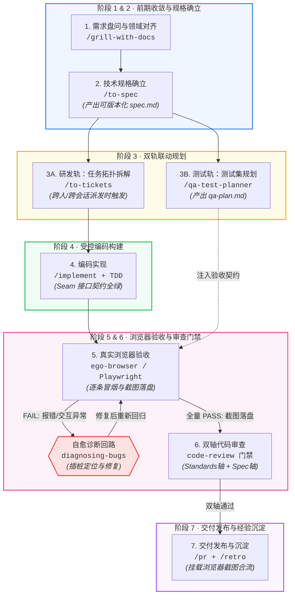
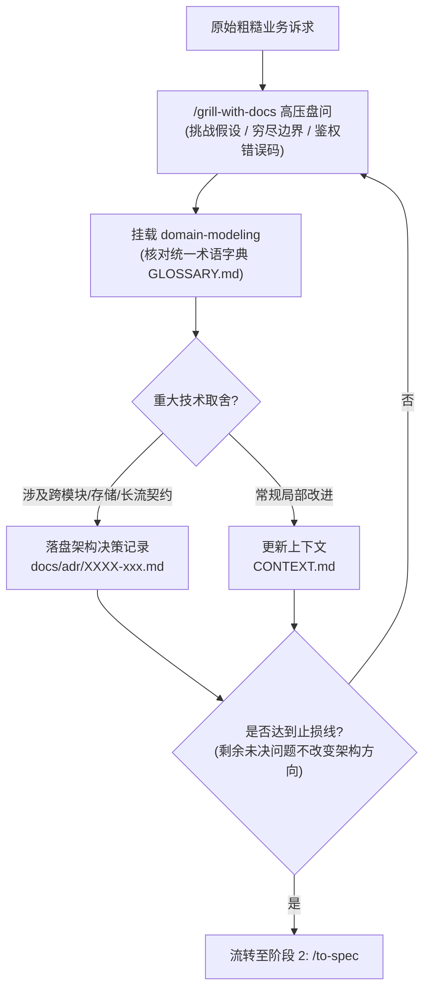
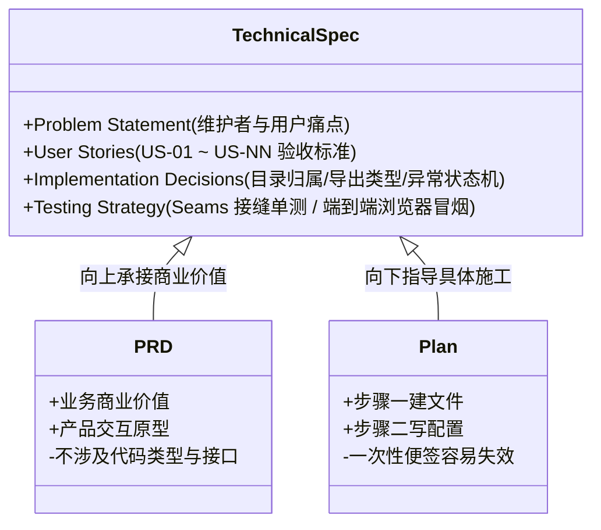
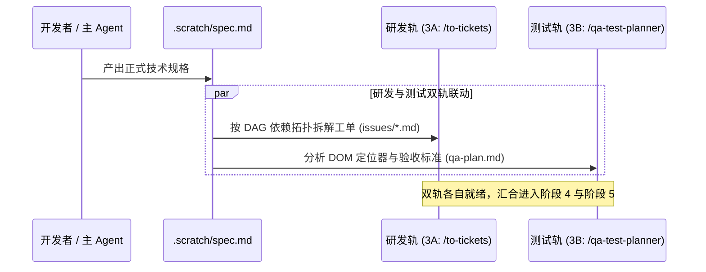
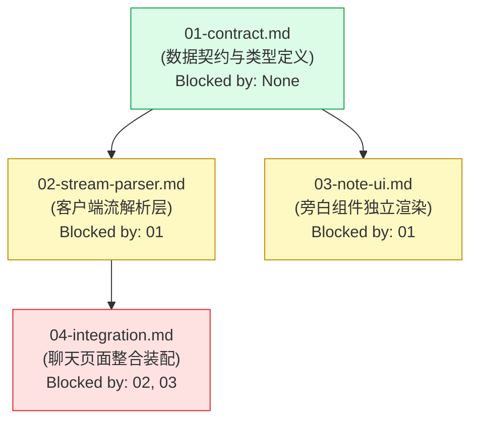
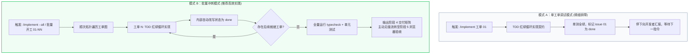
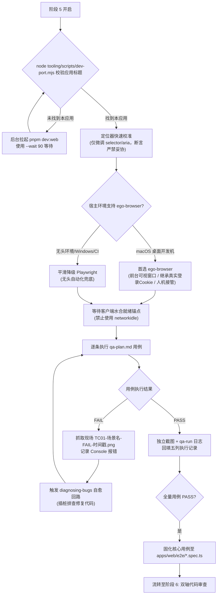
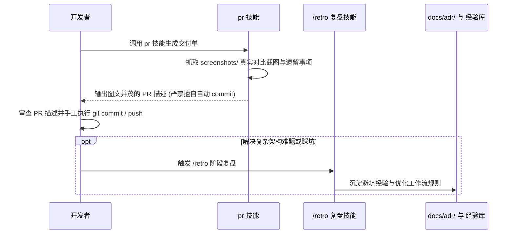
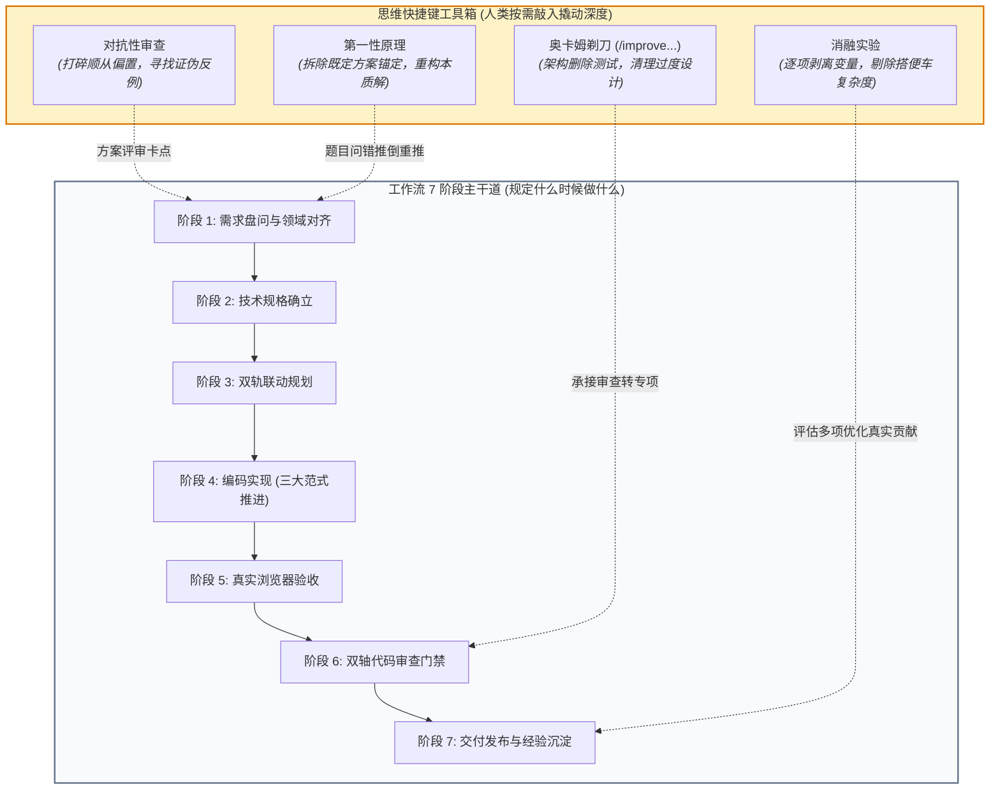
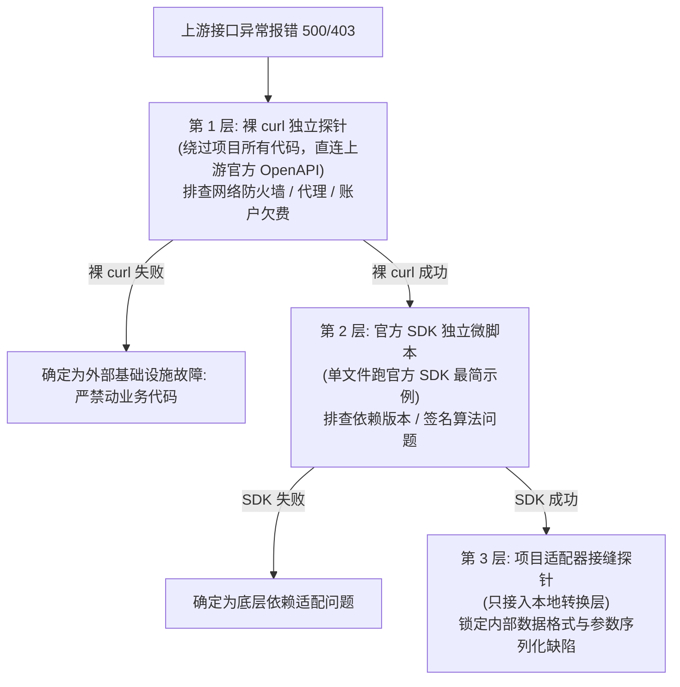

# 研发与真实浏览器测试闭环工作流全景实战指南 (QA Workflow Guide)

### 为什么叫这个名字？
- **QA Workflow（质量保证工作流）**：通常大家认为 QA（质量保证）是开发完成后的提测环节，而这套工作流把“对抗性验证与真实验收”的思维前置到了需求分析、测试规划和浏览器自动化验证中，让质量保障贯穿全过程，形成完整的研发闭环。
- **Guide（实战指南）**：根目录下的 `qa-workflow.md` 是规则定义文件，而本文件是面向团队同事的配套操作指南与案例手册，用来详细拆解每一步怎么做、为什么这么做以及如何避坑。

### 为了解决什么问题？
在日常使用 AI 辅助编码时，普遍会遇到以下几个很实际的困扰：
1. **需求理解偏差**：刚口头提了一句话，AI 就开始快速改动大批文件，做完才发现实现方向完全理解错了，导致推倒重来；
2. **单测绿灯但浏览器失效**：在内存中运行的单元测试全绿，但在真实的浏览器里打开网页时，却出现页面白屏、按钮点击无效、样式被弹层遮挡等问题；
3. **环境瞬态误判为代码缺陷**：遇到端口未启动、网络超时或上游接口限制时，AI 误以为是业务代码写错了，去大改本来正常的业务逻辑。

这套工作流通过**“动手前先对齐规格、开发时测试驱动、交付前启动真实浏览器自动验收”**的规范步骤，帮助团队在与 AI 协同开发时少踩坑、少返工，提高交付的确定性。

---

## 目录 (Table of Contents)

- [一、背景与溯源：为什么必须建立这套工作流？](#一背景与溯源为什么必须建立这套工作流)
  - [1. 理论奠基与演进：Matt Pocock 原版体系 vs 本项目实战改造](#1-理论奠基与演进matt-pocock-原版体系-vs-本项目实战改造)
  - [2. 粗放 AI 编码的四大致命陷阱](#2-粗放-ai-编码的四大致命陷阱)
  - [3. 核心设计哲学：高确定性闭环心智模型](#3-核心设计哲学高确定性闭环心智模型)
- [二、协同权限矩阵：开发者命令 vs 模型自主驱动](#二协同权限矩阵开发者命令-vs-模型自主驱动)
  - [1. 开发者独占闸门命令（模型被禁调，防确认偏误）](#1-开发者独占闸门命令模型被禁调防确认偏误)
  - [2. 通用协同技能（双向均可调用，无缝人机协作）](#2-通用协同技能双向均可调用无缝人机协作)
- [三、全景闭环流程与核心产物深度剖析（7 阶段详解）](#三全景闭环流程与核心产物深度剖析7-阶段详解)
  - [阶段 1：需求盘问与领域对齐 (/grill-with-docs)](#阶段-1需求盘问与领域对齐-grill-with-docs)
  - [阶段 2：技术规格确立 (/to-spec) —— 契约、格式与对比](#阶段-2技术规格确立-to-spec--契约格式与对比)
  - [阶段 3：双轨联动分工规划 (研发轨 3A vs 测试轨 3B)](#阶段-3双轨联动分工规划-研发轨-3a-vs-测试轨-3b)
    - [阶段 3A：工单拓扑拆解 (/to-tickets) —— 触发条件与协作形态](#阶段-3a工单拓扑拆解-to-tickets--触发条件与协作形态)
    - [阶段 3B：端到端用例规划 (/qa-test-planner) —— QA 对抗性思维](#阶段-3b端到端用例规划-qa-test-planner--qa-对抗性思维)
  - [阶段 4：测试驱动实现 (/implement + tdd) —— 红绿灯真相与模式分流](#阶段-4测试驱动实现-implement--tdd--红绿灯真相与模式分流)
    - [阶段 4 三大实现范式：单工单微调 vs 批量连续冲刺 vs 并发派发 (/implement-spec)](#阶段-4-三大实现范式单工单微调-vs-批量连续冲刺-vs-并发派发-implement-spec)
  - [阶段 5：真实浏览器验收卡点 (核心质量红线)](#阶段-5真实浏览器验收卡点-核心质量红线)
    - [1. 三级自愈环境探活与端口防漂移](#1-三级自愈环境探活与端口防漂移)
    - [2. 客户端就绪锚点（防 SSR 水合假死）](#2-客户端就绪锚点防-ssr-水合假死)
    - [3. 定位器校准机制（定位可调，断言严禁妥协）](#3-定位器校准机制定位可调断言严禁妥协)
    - [4. 执行工具分级铁律（ego-browser 首选 vs Playwright 降级）](#4-执行工具分级铁律ego-browser-首选-vs-playwright-降级)
    - [5. 异步链路终态验收机制](#5-异步链路终态验收机制)
    - [6. 异常自愈回路与 Before/After 证据闭环](#6-异常自愈回路与-beforeafter-证据闭环)
  - [阶段 6：双轴代码审查 (code-review 交付前必经硬门禁)](#阶段-6双轴代码审查-code-review-交付前必经硬门禁)
  - [阶段 7：交付发布与经验沉淀 (pr + /retro)](#阶段-7交付发布与经验沉淀-pr---retro)
- [四、实战杠杆：思维快捷键 (prompt-shortcuts.md) 如何配合工作流？](#四实战杠杆思维快捷键-prompt-shortcutsmd-如何配合工作流)
  - [1. 为什么不让流水线自动执行这些方法？（防过度工程）](#1-为什么不让流水线自动执行这些方法防过度工程)
  - [2. 核心配合场景与即插即用指令字典](#2-核心配合场景与即插即用指令字典)
- [五、快慢车道剪裁与核心红线](#五快慢车道剪裁与核心红线)
  - [1. 三档车道](#1-三档车道)
  - [2. 不可剪裁的核心链路](#2-不可剪裁的核心链路)
  - [3. 时间盒与成本控制](#3-时间盒与成本控制)
- [六、跨会话与跨人交接契约（断点无缝续接）](#六跨会话与跨人交接契约断点无缝续接)
  - [1. 状态完全落盘契约](#1-状态完全落盘契约)
  - [2. 标准化交接文档机制 (/handoff 技能，强力推荐)](#2-标准化交接文档机制-handoff-技能强力推荐)
  - [3. 轻量对话精准唤起话术模板库](#3-轻量对话精准唤起话术模板库)
- [七、实战避坑指南与排障心法](#七实战避坑指南与排障心法)
  - [坑 1：未探活即开浏览器，连接拒绝误判为业务 Bug](#坑-1未探活即开浏览器连接拒绝误判为业务-bug)
  - [坑 2：盲目等待网络空闲，SSR 水合假死导致误报](#坑-2盲目等待网络空闲ssr-水合假死导致误报)
  - [坑 3：上游网络阻断或欠费，盲目改动业务代码（三层隔离探针链）](#坑-3上游网络阻断或欠费盲目改动业务代码三层隔离探针链)
  - [坑 4：强杀端口造成协作冲突](#坑-4强杀端口造成协作冲突)
- [八、团队常见疑问解答 (FAQ)](#八团队常见疑问解答-faq)
- [九、一页纸实战速查清单 (One-Page Cheatsheet)](#九一页纸实战速查清单-one-page-cheatsheet)

---

## 一、背景与溯源：为什么必须建立这套工作流？

### 1. 理论奠基与演进：Matt Pocock 技能体系 vs 本项目实战改造

本工作流继承了 [Matt Pocock Skills](https://github.com/mattpocock/skills) 的需求审问、领域建模、Seam、垂直切片、DAG Frontier 和双轴审查。以下对比以当前官方技能为准，不再把上游简化为“纯内存单测、GitHub 强绑定或只能逐工单停顿”。

| 维度 | Matt 技能体系 | 本项目定制 | 实际收益与边界 |
|:---|:---|:---|:---|
| 测试接缝 | 在预先确认的最高公共接缝测试，可覆盖单元、集成或端到端行为 | 额外把核心用户链路的可见浏览器验收设为阶段 5 | 覆盖 DOM、CSS、水合和真实交互风险；移动视口仿真不等于物理设备 |
| QA 规划 | 提供 Testing Decisions 与 TDD 指导 | spec 后生成 qa-plan，绑定数字 US、TC 和逐断言证据 | 提前暴露对抗场景；默认 inline，独立规划只在显式 opt-in 时增加一个代理 |
| 实现 | 支持单工单，也支持 `/implement-spec` 的 DAG Frontier 与 Worktree | 日常默认单会话串行冲刺；显式并行最多两个实现代理，主 Agent 串行合并 | 控制共享资源冲突与额外成本，不把并发当成天然优势 |
| 审查 | Standards + Spec 双轴及 Fowler 坏味道基线 | 增加完整未提交 diff、US 全覆盖、三档分流和修复后复验 | 避免先审查后提交导致空 diff；仍以模型审查和人工终审为主，不冒称确定状态机 |
| Tracker 与交接 | 当前官方已支持 GitHub、GitLab 和本地 Markdown Tracker | 使用 `.scratch` 本地工作区及 `docs/handoff` 跨人交接 | 适配 Gitee；历史产物不迁移，跨人时提炼入库而非共享本地目录 |
| 流程治理 | 原子化、可插拔技能，由开发者组合 | 七阶段正本、轻量 `qa-check` 和快慢车道 | 保留团队质量底线，同时明确不新增 Hooks、不自动升级模型 |

### 2. 粗放 AI 编码的四大致命陷阱

在没有规范约束的“口头提需求，AI 直接写代码”模式下，研发团队普遍会陷入以下死循环：

```
传统粗放式 AI 编码的恶性循环：
┌─────────────────┐       ┌─────────────────┐       ┌─────────────────┐
│ 开发者一句话提需求 │ ────> │  AI 直接狂写代码  │ ────> │ 单测全绿(内存Mock)│
└─────────────────┘       └─────────────────┘       └─────────────────┘
         ▲                                                   │
         │                                                   ▼
┌─────────────────┐       ┌─────────────────┐       ┌─────────────────┐
│  线上返工推倒重来 │ <──── │ 人工点点发现交互失灵│ <──── │ 部署上线直接白屏  │
└─────────────────┘       └─────────────────┘       └─────────────────┘
```

团队在实战中总结出的四大核心痛点：

| 痛点场景 | 典型表现 | 根因剖析 | 本工作流破解方案 |
|:---|:---|:---|:---|
| **1. 盲目直接写码** | 开发者刚说一句话，AI 就改了十几个文件，跑起来发现完全理解偏了。 | 需求边界、异常分支、鉴权契约在前期缺乏深度推演与白纸黑字锁定。 | **阶段 1 & 2**：未对齐不写码，强制触发 `/grill-with-docs` 审问并生成可版本化的 `spec.md`。 |
| **2. 单测绿灯偷换浏览器可用** | 开发者称“100 个 Vitest 单测全绿”，打开网页却按钮点不动、弹窗被遮挡、页面疯狂水合报错。 | 纯内存单元测试无法验证真实 DOM、CSS 层叠上下文、事件冒泡拦截、浏览器安全沙箱及真实网络吞吐。 | **阶段 5 铁律**：核心链路必须启动真实 Chromium 浏览器（`ego-browser`）逐条冒烟并抓取屏幕截图落盘。 |
| **3. 环境瞬态误判为业务 Bug** | 遇到报错（如本地端口没起、第三方大模型欠费 403、TLS 握手超时），AI 以为业务逻辑写错了，把好端端的代码全删了重写。 | 缺乏分层探针意识，无法隔离外部环境故障与内部应用代码。 | **探活前置与三层隔离探针**：先执行探活，分层隔离外部网络、官方 SDK 与业务逻辑。 |
| **4. 交付无证据，评审靠猜** | PR 描述仅一两句说明，代码审查者根本不知道到底测过没有，上线出事故互相推诿。 | 缺乏可验证的真实证据链。 | **阶段 5 & 7**：真实浏览器操作截图全量落盘，PR 自动嵌入 Before/After 对比图。 |

### 3. 核心设计哲学：高确定性闭环心智模型

本工作流将 Matt Pocock 的高阶软件工程技能（`grill-with-docs`、`to-spec`、`tdd`、`diagnosing-bugs`、`code-review`）与自动化测试技术（`qa-test-planner`、`ego-browser`、`Playwright`）以及思维快捷键工具箱（`prompt-shortcuts.md`）深度融合，构建出**“主干道保交付下限、思维杠杆拔决策上限”**的高确定性工程心智模型：

- **制度保下限（工作流 7 阶段主干道）**：规定“什么时候做什么”，通过双轨联动、真实浏览器卡点与双轴代码审查，杜绝盲目写码、假绿灯和无证据交付，守死工程基准线；
- **思维拔上限（思维快捷键 `prompt-shortcuts.md`）**：流水线绝不教条自动执行抽象推演（防止过度设计），而是把「对抗性审查」、「第一性原理」、「奥卡姆剃刀」等方法论封装为开发者按需使用的思维杠杆，一句话打破大模型讨好偏置与局部修补惯性。

两者相互协同，构成了如下图所示的完整闭环流水线：

```
┌─────────────────────────────────────────────────────────────────────────┐
│                       阶段 1 & 2：前期收敛与规格确立                      │
│                                                                         │
│   [1. 需求盘问与领域对齐] (/grill-with-docs)                             │
│                  │                                                      │
│                  ▼                                                      │
│   [2. 技术规格确立] (/to-spec) ───────────> 产出可版本化 spec.md         │
└────────────────────────────────────┬────────────────────────────────────┘
                                     │
           ┌─────────────────────────┴─────────────────────────┐
           ▼ (研发轨)                                          ▼ (测试轨)
┌───────────────────────────────────────┐   ┌───────────────────────────────────────┐
│ [3A. 任务拓扑拆解]                    │   │ [3B. 测试集规划]                      │
│ /to-tickets (跨会话/派发场景触发)     │   │ /qa-test-planner                      │
│ 生成 issues/*.md 依赖图               │   │ 生成 qa-plan.md (P0冒烟契约与定位器)   │
└──────────────────┬────────────────────┘   └───────────────────┬───────────────────┘
                   │                                            │
                   ▼                                            │
┌───────────────────────────────────────┐                       │
│ [4. 受控编码实现]                     │                       │
│ /implement + TDD 单测红绿循环         │                       │
│ 接口与 Seam 契约纯代码保证            │                       │
└──────────────────┬────────────────────┘                       │
                   │                                            │
                   └─────────────────────┬──────────────────────┘
                                         │ (注入测试用例与断言契约)
                                         ▼
┌─────────────────────────────────────────────────────────────────────────┐
│                       阶段 5 & 6：浏览器验收与双轴门禁                │
│                                                                         │
│   ┌────────────────────────────────────────┐                            │
│   │ [5. 真实浏览器验收]                │ <────────────────────────┐ │
│   │ ego-browser (宿主优先) / Playwright    │                          │ │
│   │ 逐条执行 qa-plan.md 交互冒烟与截图     │                          │ │
│   └───────────────────┬────────────────────┘                          │ │
│                       │                                               │ │
│          [FAIL 报错 / 交互断言失败]                                   │ │
│                       │                                               │ │
│                       ▼                                               │ │
│   ┌────────────────────────────────────────┐                          │ │
│   │ [触发自愈诊断回路] (diagnosing-bugs)   │ 修复代码后重新执行浏览器冒烟│ │
│   │ 插桩探针排障、分层定位根因、精准修复   │ ─────────────────────────┘ │
│   └────────────────────────────────────────┘                            │
│                       │                                                 │
│          [全量 PASS 且截图完成落盘]                                     │
│                       │                                                 │
│                       ▼                                                 │
│   ┌────────────────────────────────────────┐                            │
│   │ [6. 双轴代码审查] (code-review 硬门禁) │                            │
│   │ Standards 规范轴 + Spec 需求轴严格对账 │                            │
│   └───────────────────┬────────────────────┘                            │
└───────────────────────┼─────────────────────────────────────────────────┘
                        │ [双轴审查全通过]
                        ▼
┌─────────────────────────────────────────────────────────────────────────┐
│                          阶段 7：交付发布与复盘                         │
│                                                                         │
│   [7. 交付发布与沉淀] (/pr + /retro)                                    │
│   自动汇总真实浏览器 Before/After 截图证据链，合流发布并沉淀工程经验    │
└─────────────────────────────────────────────────────────────────────────┘
```

<details>
<summary><b>点击展开：Mermaid 现代化纵向流程图（支持渲染环境）</b></summary>



</details>

---

## 二、协同权限矩阵：开发者命令 vs 模型自主驱动

“这些斜杠命令，到底是我手动敲，还是 AI 模型自己调？”  
在项目的工程配置中，所有技能被严格划分为两类：**开发者独占闸门命令** 与 **通用协同技能**。

### 1. 开发者独占闸门命令（模型被禁调，防确认偏误）

以下命令在技能配置中显式声明了 `disable-model-invocation: true`。**模型绝对无法在后台自主发起调用，必须由人类开发者在对话框手动敲入**：

| 命令 | 核心职责 | 为什么禁止模型自调？（设计防呆理念） |
|:---|:---|:---|
| `/grill-with-docs` | 启动高压盘问并产出 ADR 架构决策 | 防止模型自问自答、自圆其说，必须由人类给出真实的业务边界判断。 |
| `/to-spec` | 将对齐共识固化为正式技术规格 | 技术规格是系统的“工程法典”，生成必须经过开发者明确审查确认。 |
| `/implement`<br>`/implement-spec` | 授权开启 TDD 批量编码实现 | 编码是产生代码变更的动作，开发者必须作为开工把关人。 |
| `/handoff` | 压缩当前会话并生成标准交接文档 | 会话中断或跨人交接属于人类意图决策，必须由人类触发并指定下阶段目标。 |
| `/grill-me` | 轻量级逻辑漏洞思维推演 | 属于辅助开发者理清思路的对话工具，非代码自动化工具。 |

### 2. 通用协同技能（双向均可调用，无缝人机协作）

以下技能**既允许模型在流水线中按需自主触发，也允许开发者随时手动敲斜杠命令调用**：

| 技能名称 | 命令触发 | 模型自调时机 | 开发者手动调用典型场景 |
|:---|:---|:---|:---|
| `qa-test-planner` | `/qa-test-planner` | 在 `/to-spec` 产出规格后，由流水线自动联动规划 | 想单独为某个老页面规划回归测试方案时 |
| `tdd` | `/tdd` | 在 `/implement` 内部循环执行单测红绿驱动 | 开发者想针对某个纯算法模块编写红绿测试时 |
| `diagnosing-bugs` | `/diagnosing-bugs` | 阶段 5 浏览器冒烟遇到 FAIL 时，自动触发根因诊断 | 本地突然遇到奇怪的报错，让 AI 协助排查时 |
| `ego-browser` | `/ego-browser` | 阶段 5 自动拉起真实浏览器逐条执行冒烟用例 | 开发者调试前端时，让 AI 帮忙打开浏览器并截图 |
| `code-review` | `/code-review` | 阶段 5 浏览器全绿后，交付前强制触发双轴审查 | 准备合并代码前，主动发起全量代码合规审计 |
| `pr` | `/pr` | 审查通过后，自动汇总截图与证据生成 PR | 手动整理 Pull Request 描述文档时 |
| `retro` | `/retro` | 交付完成后自主提议复盘 | 解决复杂架构难题或踩坑后，沉淀经验与教训 |

---

## 三、全景闭环流程与核心产物深度剖析（7 阶段详解）

### 阶段 1：需求盘问与领域对齐 (`/grill-with-docs`)

```
┌─────────────────────────────────────────────────────────────────────────┐
│                      【阶段 1：需求盘问与领域对齐流程】                   │
├─────────────────────────────────────────────────────────────────────────┤
│                                                                         │
│                       [ 原始粗糙业务需求输入 ]                          │
│                                  │                                      │
│                                  ▼                                      │
│                [ 启动高压盘问 /grill-with-docs ]                        │
│                主动挑战隐性假设、穷尽网络/鉴权边界与异常分支            │
│                                  │                                      │
│                                  ▼                                      │
│                [ 挂载 domain-modeling 术语核对 ]                        │
│                对照 GLOSSARY.md 统一步骤概念与领域语言                  │
│                                  │                                      │
│                                  ▼                                      │
│                      [ 评估重大技术取舍决策 ]                           │
│                                  │                                      │
│         ├───── 涉及跨模块/存储/长流契约 ───> 落盘架构决策记录 docs/adr/ │
│         └───── 常规局部改进与上下文对齐 ───> 更新全局上下文 CONTEXT.md │
│                                  │                                      │
│                                  ▼                                      │
│                      [ 止损线判定 (Stop Line) ]                         │
│                      剩余未决细节是否已不改变架构方向?                  │
│                                  │                                      │
│                 ├─ 否 (仍存在核心盲区) ─> 返回继续向人类盘问            │
│                 └─ 是 (已收敛) ────────> 果断进入阶段 2: /to-spec       │
│                                                                         │
└─────────────────────────────────────────────────────────────────────────┘
```

<details>
<summary><b>点击展开：Mermaid 状态流转图（支持渲染环境）</b></summary>



</details>

- **为什么叫“盘问 (Grilling)”？**：普通提问只是被动记录需求，而“盘问”是像严苛的系统架构师一样，主动挖掘隐藏盲区：
  - “当大模型输出到一半网络断开，客户端如何恢复？Token 扣减怎么算？”
  - “已登录用户在多标签页刷新时，会话恢复与历史数据隔离如何保证？”
  - “高并发下多个请求同时修改历史记录，是否有竞态条件？”
- **止损线准则**：不追求前置推演全部实现细节。**当剩余未澄清的细节已经不会颠覆核心数据流、接口签名和模块拓扑时，果断止损进入阶段 2**，边缘分支留待编码阶段按需决策。
- **核心产出样例**：`docs/adr/0009-unified-tool-stream-projector.md`（明确统一工具流事件投影适配器的架构接缝与权衡取舍）。

---

### 阶段 2：技术规格确立 (`/to-spec`) —— 契约、格式与对比

```
┌─────────────────────────────────────────────────────────────────────────┐
│              【核心三合一产物定位：Spec vs PRD vs Plan】                 │
├─────────────────────────────────────────────────────────────────────────┤
│                                                                         │
│   ┌──────────────────────────┐                                          │
│   │   PRD（产品需求文档）     │ 回答“做给谁用、商业价值是什么”          │
│   │   • 商业目标 / 用户画像  │ ❌ 痛点：通篇不提类名、函数名与 TS 类型  │
│   │   • 业务交互原型交互图   │                                          │
│   └─────────────┬────────────┘                                          │
│                 │ [向上承接商业诉求]                                    │
│                 ▼                                                       │
│   ┌────────────────────────────────────────────────────────┐            │
│   │   ⭐ Technical Spec（技术规格）── 系统法定契约          │            │
│   │   • Problem Statement: 维护者痛点与用户痛点            │            │
│   │   • User Stories: US-01 ~ US-NN 严格验收断言契约       │            │
│   │   • Implementation: 目录归属 / 导出类型 / 异常状态机   │            │
│   │   • Testing Strategy: Seam 接口单测 + 浏览器冒烟定位器   │            │
│   │   💡 定性：可版本化的工程基准法典，开发与测试统一准绳   │            │
│   └─────────────┬──────────────────────────────────────────┘            │
│                 │ [向下指导精准工程施工]                                │
│                 ▼                                                       │
│   ┌──────────────────────────┐                                          │
│   │   Plan（施工步骤计划）   │ 回答“第一步做什么、第二步做什么”        │
│   │   • 步骤一建立文件       │ ❌ 痛点：只是一次性便签，施工完即作废    │
│   │   • 步骤二修改组件配置   │                                          │
│   └──────────────────────────┘                                          │
│                                                                         │
└─────────────────────────────────────────────────────────────────────────┘
```

<details>
<summary><b>点击展开：Mermaid 继承关系类图（支持渲染环境）</b></summary>



</details>

- **产物位置**：`.scratch/<feature>/spec.md`。
- **Spec vs PRD vs Plan 的本质区别**：
  - **PRD（产品需求）**：回答“做给谁用、有什么价值”，通篇不提类名、函数名与 TypeScript 类型；
  - **Plan（施工计划）**：回答“第一步改什么、第二步改什么”，只是一次性施工便签；
  - **Spec（技术规格）**：**系统接缝（Seams）与接口契约的法定合同**！它是只读的基准线，明确导出类型、错误码与边界断言，开发和测试必须以它为唯一准绳。
- **标准产物模板**：
  ```markdown
  # 聊天流过程旁白 · 技术规格
  Status: ready-for-agent
  来源：/grill-with-docs 共识 · ADR-0009
  
  ## Problem Statement
  - 最终用户痛点：大模型调用长耗时工具时界面静止，用户误以为卡死而频繁刷新；
  - 维护者痛点：前端缺乏统一的轻量级状态帧协议，扩展新工具需改动多层组件。
  
  ## User Stories
  - US-01: 作为用户，发起带工具调用的对话时，能实时看到「正在检索天气...」的淡入旁白；
  - US-02: 作为用户，在大模型正文生成开始时，旁白平滑收起至折叠状态；
  - US-03: 作为维护者，流解析层遇到未知的第三方事件帧时，必须静默丢弃而不是导致整个会话崩溃。
  
  ## Implementation Decisions
  1. 契约类型扩展：在 `packages/shared/src/chat-stream-contract.ts` 中维护流事件与工具帧联合类型；
  2. 接缝隔离：客户端流处理层 `apps/web/src/lib/utils/chat-stream.ts` 与状态管理 `apps/web/src/stores/chat-store.ts` 内部状态解耦，暴露独立的响应式状态。
  
  ## Testing Strategy
  1. 单元测试：在 `apps/web/src/lib/utils/chat-stream.test.ts` 中针对流状态投影编写确定性纯单测；
  2. 真实浏览器验收：在真实对话流（对应 `apps/web/e2e/chat.spec.ts` 链路）中实测旁白卡片的动画呈现与折叠。
  ```

---

### 阶段 3：双轨联动分工规划 (研发轨 3A vs 测试轨 3B)

当 `/to-spec` 产出规格后，研发轨与测试轨**同时启动、双轨并行**：

```
                   [ 阶段 2: 产出正式技术规格 spec.md ]
                                     │
                 ┌───────────────────┴───────────────────┐
                 ▼ (研发轨: 施工视角)                    ▼ (测试轨: 对抗视角)
   ┌───────────────────────────────┐       ┌───────────────────────────────┐
   │ 阶段 3A：工单拓扑拆解         │       │ 阶段 3B：端到端用例规划       │
   │ /to-tickets (条件触发)        │       │ /qa-test-planner              │
   │ 产出 issues/*.md 依赖 DAG     │       │ 产出 qa-plan.md 验收用例与断言│
   └──────────────┬────────────────┘       └──────────────┬────────────────┘
                  │                                       │
                  ▼                                       │
   ┌───────────────────────────────┐                      │
   │ 阶段 4：编码实现 (/implement) │                      │
   │ TDD 单测红绿循环保证内部契约  │                      │
   └──────────────┬────────────────┘                      │
                  │                                       │
                  └───────────────────┬───────────────────┘
                                      │ (双轨汇合：代码与验收用例双就绪)
                                      ▼
                       [ 阶段 5：真实浏览器真实验收 ]
```

<details>
<summary><b>点击展开：Mermaid 双轨时序图（支持渲染环境）</b></summary>



</details>

#### 阶段 3A：工单拓扑拆解 (`/to-tickets`) —— 触发条件与协作形态

> 💡 **本地目录澄清**：在本项目（托管于 Gitee，无 GitHub CLI）中，工单统一落盘在 **`.scratch/<feature>/issues/`** 目录下（按依赖编号，如 `01-contract.md`）。本地**只有 `issues/` 目录，没有 `tickets/` 目录**。

- **触发条件（按协作形态而非代码规模决策）**：
  - **需要拆解（生成 `issues/*.md`）**：预估需要**跨会话推进**、**跨人员交接**，或计划通过 `/implement-spec` 并发推进前沿工单；
  - **无需拆解（直接推进）**：单会话冲刺时，直接从 `spec.md` 中的 `## Work Orders` 小节起步执行，**不拆碎文件**，避免规格文件与碎片文件的多头同步摩擦。
- **工单有向无环图 (DAG) 样例**：

```
       ┌────────────────────────────────────────────────────────┐
       │ 01-contract.md: 数据契约与类型定义 (Blocked by: None)   │
       └───────────────────────────┬────────────────────────────┘
                                   │
                  ┌────────────────┴────────────────┐
                  ▼                                 ▼
   ┌─────────────────────────────┐   ┌─────────────────────────────┐
   │ 02-stream-parser.md         │   │ 03-note-ui.md               │
   │ 客户端流解析层 (Blocked: 01)│   │ 旁白组件独立渲染(Blocked:01)│
   └──────────────┬──────────────┘   └──────────────┬──────────────┘
                  │                                 │
                  └────────────────┬────────────────┘
                                   ▼
       ┌────────────────────────────────────────────────────────┐
       │ 04-integration.md: 聊天页面整合装配 (Blocked by: 02, 03)│
       └────────────────────────────────────────────────────────┘
```

<details>
<summary><b>点击展开：Mermaid 依赖拓扑图（支持渲染环境）</b></summary>



</details>

#### 阶段 3B：端到端用例规划 (`/qa-test-planner`) —— QA 对抗性思维

- **QA 对抗性思维 vs 开发者自测**：开发者容易只验证参数和返回值，QA 还要检查连续操作、弱网、超时、中断、越权和恢复等风险。
- **产物位置**：`.scratch/<feature>/qa-plan.md`，新计划声明 `QA Schema: 3`、`QA Mode` 和可选 `QA Kind`。
- **规划原则**：
  1. **分级与定位**：标明 P0/P1/P2，浏览器步骤使用稳定的语义定位器，断言必须量化且来自 spec，而不是从实现现状反推；
  2. **Seam 绑定**：每个 TC 声明 browser/api/integration/unit/static。选最高的合适接缝，browser 只用于 DOM、交互与视觉，默认不超过 5 条；
  3. **五列执行记录**：使用 `| 用例 | 断言序号 | 状态 | 证据 | 备注 |`。PASS 只引用特性目录内文件，browser 需要独立截图和 exit 0 的 qa-run 日志，其他接缝需要 exit 0 的日志；
  4. **交付验证预声明**：在 `## 交付验证` 写全量 typecheck、测试和 lint 命令，最终代码上用 qa-run 执行并绑定 tree；
  5. **冻结与修复轮**：计划在 init 时冻结，削弱既有内容须在 `## 计划变更` 说明。修复已交付特性使用 `QA Kind: fix`，每个 TC 保存同 argv、更早且 tree 不同的修复前红日志。

---

### 阶段 4：测试驱动实现 (`/implement` + `tdd`) —— 红绿灯真相与模式分流

#### 彻底破除对 TDD 的最大误解

> **红灯不是故意写错误用法**：测试应当对公共接缝提出符合 spec 的可观察预期，并在功能尚未实现时以预期原因失败。红灯也可能来自现有行为缺失，不只限于“文件还没创建”。

当前 `tdd` 技能采用**红—绿循环**，不采用“先写完全部测试，再写完全部实现”的横向方式：

1. **Red**：在预先确认的接缝写一个小型行为测试，运行并确认它因目标行为缺失而失败。
2. **Green**：只写让该测试通过的最小实现，运行同一测试确认通过，再进入下一切片。
3. **Review**：结构清理和坏味道处理属于后续 `code-review`，不塞进红绿实现循环；重构后仍需运行相关测试。

每个切片都应能说明“这个测试捕获什么、遗漏什么”，避免只追求测试数量或实现细节耦合。

#### 阶段 4 三大实现范式：单工单微调 vs 批量连续冲刺 vs 并发派发 (/implement-spec)

在技术规格（`spec.md`）和工单依赖图就绪后，流水线支持三种**不同粒度与并发度**的实现范式，团队可按特性规模与风险等级自由选择：

| 维度 / 范式 | 模式 A：单工单微调模式<br>(Single Ticket Debug) | 模式 B：单会话批量冲刺<br>(Batch Sequential Sprint) | 模式 C：多子代理并发派发<br>(Parallel Worktree Swarm) |
|:---|:---|:---|:---|
| **触发命令** | `/implement 工单 01` | `/implement --all` 或 `/implement` (无参) | `/implement-spec` |
| **执行载体** | 当前主会话单线逐步推进 | 当前主会话单线连续推进 | 调度多个后台子 Agent 并发推进 |
| **分支与隔离** | 当前开发分支原地单点实现 | 当前开发分支原地顺次推进 | 自动拉出 `integration-branch`，每个工单在**独立 Git Worktree + 专属子分支**隔离执行 |
| **推进机制** | 单工单完成后停下交出控制权，向人类汇报并等待下一指令 | 沿 DAG 拓扑顺序串行冲刺，内部自动翻转状态为 `done`，中途不停顿 | 动态计算拓扑前沿（Frontier），并发派发多个 Implementer Subagents 同步跑 TDD |
| **汇聚与回归** | 人类确认后按需开启下一张 | 全量工单编码全绿后一次性交付，主动流转阶段 5 浏览器验收 | 由 Merger Agent 滚动合并回集成分支，全部完成后由主 Agent 接管真实验收，自动清理 Worktree |
| **适用场景** | 核心架构重构、疑难 Bug 排查、需人类步步复核的高危场景 | 常见多工单业务开发（工单 2~5 张），拓扑清晰，**日常研发强力推荐** | 模块解耦度高的大型特性（工单 ≥ 4 张），追求极限并发效率与完全分支隔离 |

---

##### 1. 模式 A 与 模式 B 流向对比（单会话内部）

```
┌───────────────────────────────────────┐       ┌───────────────────────────────────────┐
│     模式 A：单工单调试模式 (精细排障)   │       │   模式 B：批量连续冲刺模式 (推荐高效实践) │
├───────────────────────────────────────┤       ├───────────────────────────────────────┤
│                                       │       │                                       │
│  [触发指令]                           │       │  [触发指令]                           │
│  /implement 工单 01                   │       │  /implement --all 或 批量开工 01-NN   │
│                 │                     │       │                 │                     │
│                 ▼                     │       │                 ▼                     │
│  [受控实现]                           │       │  [拓扑遍历]                           │
│  TDD 红绿循环实现该工单契约           │       │  顺次解析工单依赖图 (DAG 拓扑序)      │
│                 │                     │       │                 │                     │
│                 ▼                     │       │                 ▼ <────────────────┐  │
│  [状态更新]                           │       │  [执行单张工单]                    │  │
│  单测全绿，标记工单 issue 01 为 done  │       │  TDD 红绿实现工单 N 代码与测试     │  │
│                 │                     │       │                 │                  │  │
│                 ▼                     │       │                 ▼                  │  │
│  [停顿汇报] (主动交出控制权)          │       │  [自动流转]                        │  │
│  停下向人类汇报，等待下一工单指令     │       │  内部静默改写 status 为 done       │  │
│                                       │       │                 │                  │  │
│                                       │       │                 ▼                  │  │
│  特点：精细受控，步步为营             │       │  [分支判断] 是否还有就绪工单?      │  │
│  场景：核心架构重构、疑难缺陷摸索     │       │     ├─────── 是 (存在待办) ────────┘  │
│                                       │       │     │                                 │
│                                       │       │     ▼ 否 (全部工单编码完成)           │
│                                       │       │  [全量静态门禁]                       │
│                                       │       │  运行全量 typecheck + 单测套件全绿    │
│                                       │       │                 │                     │
│                                       │       │                 ▼                     │
│                                       │       │  [无缝流转]                           │
│                                       │       │  输出交付矩阵，主动流转阶段 5 浏览器  │
│                                       │       │                                       │
│                                       │       │  特点：消除流程摩擦，零停顿连续冲刺   │
│                                       │       │  场景：标准化多工单特性研发 (默认推荐) │
└───────────────────────────────────────┘       └───────────────────────────────────────┘
```

<details>
<summary><b>点击展开：模式 A 与 模式 B Mermaid 流向图</b></summary>



</details>

---

##### 2. 模式 C：用户显式选择的有限并行 (`/implement-spec`)

只有用户明确选择并行时才使用 `/implement-spec`；日常任务默认模式 B 的单会话串行冲刺。并行模式必须同时满足：工单位于依赖 frontier、文件和资源低耦合、合并与额外 Agent 成本有明确收益。

执行约束：

1. 同时最多 **2 个实现子代理**，不自动指定或升级模型，不默认增加 exploration 或 Merger 子代理。
2. 每个实现代理使用独立 Worktree 和分支；Worktree 只隔离文件，不隔离 PostgreSQL、Redis、端口、上游额度或测试账号。
3. 主 Agent 串行合并，每次合并后运行约定集成测试，失败时不继续解锁后续 frontier。创建分支、合并和清理遵循 `.claude/rules/git-workflow.md` 的确认边界。
4. DB 迁移、共享状态、相同文件或公共契约高耦合时回退串行，不为并发另造资源锁或 DAG 引擎。
5. 集成完成后由主 Agent inline 执行阶段 5，再进行双轴审查；实现代理不得把单工单通过等同于整份 spec 通过。

三大模式速记：模式 A 用于精细调试，模式 B 是日常默认，模式 C 是用户明确授权成本和资源边界后的高级选项。

---

### 阶段 5：真实浏览器验收卡点 (核心质量红线)

这是本工作流用于降低前端缺陷漏检风险的**核心质量防线**，需要与证据审计和人工抽查共同发挥作用。

```
┌─────────────────────────────────────────────────────────────────────────┐
│                      【阶段 5：真实浏览器验收全景流】                     │
├─────────────────────────────────────────────────────────────────────────┤
│                                                                         │
│   [ 阶段 5 开启 ]                                                       │
│          │                                                              │
│          ▼                                                              │
│   [ 步骤 1：node tooling/scripts/dev-port.mjs --probe --wait 90 ] ──(未就绪)──> 后台拉起 pnpm dev:web │
│   校验应用标题锚点，不关闭其他进程                                       │
│          │ (找到本应用)                                                  │
│          ▼                                                              │
│   [ 步骤 2：定位器快速校准 ]                                             │
│   对照实现微调 selector / aria (断言严禁妥协)                           │
│          │                                                              │
│          ▼                                                              │
│   [ 步骤 3：执行工具分级选择 ]                                           │
│          ├───── macOS 桌面环境 ──────> 首选 ego-browser (可视窗口/真实Cookie)│
│          └───── Linux/CI 无头环境 ───> 平滑降级 Playwright (无头自动化) │
│          │                                                              │
│          ▼                                                              │
│   [ 步骤 4：水合就绪锚点确认 ]                                           │
│   显式等待客户端水合 DOM 就绪 (严禁使用 networkidle 等待)               │
│          │                                                              │
│          ▼                                                              │
│   [ 步骤 5：逐条执行冒烟用例 ] <──────────────────────────────────────┐ │
│   按 qa-plan.md 执行交互与断言                                        │ │
│          │                                                            │ │
│          ├───── [ FAIL 报错 / 交互异常 ] ─────────────────────────────┤ │
│          │      1. 抓取现场截图 TC01-场景名-FAIL-时间戳.png           │ │
│          │      2. 记录 Console 报错与网络状态                        │ │
│          │      3. 触发 diagnosing-bugs 自愈回路 (插桩排查修复代码)───┘ │
│          │                                                              │
│          ▼                                                              │
│   [ 步骤 6：全量 PASS 证据归档 ]                                        │
│   1. 每个 TC 独立截图，脚本经 qa-run 执行并保存日志                     │
│   2. 回填五列 ## 执行记录，证据列引用截图与日志                         │
│   3. 核心用例固化为本地回归代码 (apps/web/e2e/*.spec.ts)                │
│          │                                                              │
│          ▼                                                              │
│   [ 流转至阶段 6: 双轴代码审查门禁 ]                                    │
└─────────────────────────────────────────────────────────────────────────┘
```

<details>
<summary><b>点击展开：Mermaid 执行状态机（支持渲染环境）</b></summary>



</details>

#### 1. 一键探活与端口防漂移

前端本地开发常因端口占用导致 Next.js 漂移。统一使用项目探活命令，不再手写 curl 扫描：
1. **探活**：执行 `node tooling/scripts/dev-port.mjs --probe --wait 90`，按 3030–3059 的决议范围请求 `/login` 并校验 `<title>` 中的 AI 聚合平台锚点；
2. **启动**：未找到时后台运行 `pnpm dev:web`，探活每 2 秒重试并覆盖冷启动；找到后使用输出的 `WEB_URL`；
3. **其他进程**：标题不匹配只说明端口被其他服务占用，不得关闭该进程，也不得把连接拒绝当成业务 Bug；
4. **客户端就绪**：探活只证明服务存在，仍需等待水合后的可操作元素，不用 `networkidle` 判断 SSR/HMR/SSE 页面就绪。

#### 2. 客户端就绪锚点（防 SSR 水合假死）

Next.js 采用服务端渲染（SSR），页面 HTML 加载完成时不代表 JavaScript 事件监听器已经挂载完毕！
- **反模式**：盲目使用 `waitForLoadState('networkidle')` —— 由于开发模式下 HMR（热更新）心跳和 SSE 长流连接始终存在，网络**永远不会空闲**，导致测试超时崩溃；
- **正确做法**：显式等待**“客户端水合完成后才会出现的特征 DOM”**（如带有 `placeholder="输入消息…"` 的输入框处于可点击状态，或 AuthGuard 加载动画结束）。

#### 3. 定位、真实输入与断言边界

`qa-plan.md` 在 init 时已经冻结，校准操作不能悄然改变验收对象：
- **允许就地校准**：可按真实组件微调选择器，例如把预估 `role="button"` 改为实际的 `aria-label="提交"`，并在备注列记录；
- **换入口或换操作方式等于改变断言**：必须先在 `## 计划变更` 说明并接受复核，不能用另一条轻松路径冒充原场景；
- **真实输入事件**：`evaluate` 中的 `el.click()` / `dispatchEvent` 只用于读取状态或构造前置条件；注入也仅限前置条件并写入备注。P0 核心链路至少一条从真实入口端到端；
- **数值与过程证据**：数值阈值在脚本内严格断言，不得四舍五入或用截图代替。过程脚本放在特性目录并经 qa-run 运行，不得删除，每个 TC 独立截图。
- **硬断言与失败能力**：关键预期必须有硬断言，目标缺失、动作未执行或数值不达标必须失败并非零退出，不能只打印成功文本；不通过扫描脚本代替独立证据审计。
- **环境不足**：DOM、真实交互或移动几何无法验证时只能记 BLOCKED，或经计划变更转人工；系统侧结果可下沉合适接缝，但不得用低接缝证据冒充 browser。

#### 4. 执行工具分级铁律（`ego-browser` 首选 vs `Playwright` 降级）

工具选择遵循宿主优先级，不因工具已注入上下文就绕过探活或降级说明。macOS 且无更高优先级宿主规则时，先运行 `ego-browser --version`，成功后默认可见窗口；无 GUI、CLI 不可用或宿主另有策略时使用 Playwright。

| 维度 | 可见交互验收（如 `ego-browser`） | 无头自动化（Playwright） |
|:---|:---|:---|
| **核心机制** | 可见 Chromium 窗口，多步骤脚本批处理 | 本地 Node.js 无头浏览器驱动 |
| **登录态** | 优先使用当前浏览器上下文中已有会话，敏感信息不得写入证据 | 使用 seed 的 `test_user` 或真实注册的一次性账号，不假设匿名设备身份 |
| **协同体验** | 人类可观察并在验证码等卡点接管 | 适合确定性脚本回归，不强调实时人工接管 |
| **适用环境** | 有 GUI 的桌面开发机 | Linux、Windows、无桌面环境或 CI |
| **职责分工** | 新行为首次交互验收与关键截图 | 固化为 `apps/web/e2e/*.spec.ts` 长期回归；只有实际配置 CI 时才称为 CI 门禁 |

- **登录合规**：密码从 `SEED_TEST_PASSWORD` 等环境变量读取；禁止签发令牌、写库造会话或改密码、注入 Cookie，凭据不得出现在命令行、日志或证据中。
- **证据落盘**：浏览器脚本经 `node tooling/scripts/qa-run.mjs .scratch/<feature> <标签> -- <命令>` 执行，PASS 行同时引用该日志和当前场景截图；同名日志不覆盖，每个 TC 使用独立截图。

#### 5. 异步链路终态验收机制

对于涉及后台任务队列的异步链路（如“图像生成”、“视频生成”、“语音转写”）：
- **“提交成功”绝不算 PASS**：页面提示“已提交”不代表业务成功，必须验收至**终态**（生成出真实图像/视频，或明确展示可解析的失败态）；
- **前置健康检查**：轮询前先确认后台 Worker 进程（BullMQ）存活且上游凭证有效；
- **防无限等待**：严格遵循时间盒限制，超时记为 FAIL；
- **服务端证据链**：必须提供一条服务端证据（Worker 控制台日志、数据库记录或 Redis 队列状态三选一）。

#### 6. 异常自愈回路与 Before/After 证据闭环

- **执行记录回填**：浏览器跑通一条，Agent 在 `qa-plan.md` 的 `## 执行记录` 实时追加一条 PASS；
- **Before/After 证据链**：
  - 成功截图命名：`TC01-chat-stream-pass.png`；
  - 失败现场截图：`TC01-chat-stream-FAIL-20261015103000.png`；
  - 修复后回归：执行记录同时关联 FAIL 现场图与 PASS 图，形成清晰的故障修复闭环证据。

---

### 阶段 6：双轴代码审查 (`code-review` 交付前必经硬门禁)

规则以正本 `docs/agents/qa-workflow.md` 阶段 6、7 为准，这里只说明分工。真实验收后，中大型改动的 Standards + Spec 双轴必须由**独立于实现者**的审查者完成，不能用实现者自查代替；最终交付命令和审查包都必须绑定当前 tree。

```
[ QA 工作流：collect 审查包（含未提交改动） ]
                     │
                     ▼
[ code-review：上游双轴，前台并行两个独立上下文子代理 ]
        ├── Standards：仓库成文规范 + Fowler 坏味道基线
        └── Spec：缺失或部分实现、超范围、实现有误
                     │
                     ▼
[ QA 工作流：review-report.md = 审查方式 + 两轴原文 + 三档分流 + 范围说明 ]
                     │
                     ▼
[ 本次修 → 修复、重新 collect、重跑 code-review ｜ 转专项 → 遗留事项 ｜ 驳回 → 引 ADR 或契约 ]
                     │
                     ▼
[ 阶段 7：交付命令 → qa-check review（机器校验通过）→ 人工终审清单 ]
```

- **审查技能**：`code-review` 使用 Matt Pocock 上游原文，Standards 轴内置 12 条 Fowler 坏味道基线；仓库成文规范（`CLAUDE.md`、`.claude/rules/`、相关 ADR、UI 改动时的 `DESIGN.md`）优先于基线。QA 工作流调用时只在其“项目定制”段替换 diff 来源。
- **三档分流**：由 QA 工作流逐条标注，驳回引 ADR 或契约，转专项写明理由；Standards 硬违规和 Spec“缺失或部分实现”“实现有误”默认本次修；两轴原文不得删改，档位由人工终审确认。
- **证据审计分工**：确定性部分由 qa-check 负责，包括接缝与证据绑定、截图跨 TC、冻结计划与基线时序、browser 入口脚本位置、交付日志 argv 与 tree；截图是否支撑断言、是否使用真实输入等语义问题归正本阶段 7 的人工终审清单。
- **合法暂停与完成语义**：拿不到两份真实独立返回时保持“待独立审查”，只交付待审查材料包，不运行最终 `qa-check review`。最终交付命令和 `qa-check review` 由 QA 工作流在阶段 7 执行，本会话 `结果: PASS` 只称“机器校验通过”；独立审查完成以真实 `code-review` 两轴结果为据，人工终审另行认定。

---

### 阶段 7：交付发布与经验沉淀 (`pr` + `/retro`)

```
┌─────────────────────────────────────────────────────────────────────────┐
│                      【阶段 7：交付发布与经验沉淀流程】                   │
├─────────────────────────────────────────────────────────────────────────┤
│                                                                         │
│   [ 阶段 6 双轴审查通过 ]                                               │
│             │                                                           │
│             ▼                                                           │
│   [ 触发 pr 交付技能 ]                                                  │
│   自动聚合 .scratch/<feature>/screenshots/ 真实对比截图与遗留事项       │
│             │                                                           │
│             ▼                                                           │
│   [ 生成图文并茂的 PR 描述文档 ]                                        │
│   包含：问题背景、技术决策、Before/After 浏览器证据链、遗留项跟踪         │
│             │                                                           │
│             ▼                                                           │
│   [ 开发者人工确认与终审 ]                                              │
│   🛑【安全红线】严禁 AI 擅自自动执行 git commit / git push              │
│   由具备真实身份的开发者核对后手工执行提交与推仓                        │
│             │                                                           │
│             ▼ (完成复杂特性、重大重构或遭遇踩坑)                        │
│   [ 触发 /retro 复盘机制 ]                                              │
│   沉淀避坑经验至 docs/adr/，动态调优 qa-workflow 规则与防呆门禁         │
│                                                                         │
└─────────────────────────────────────────────────────────────────────────┘
```

<details>
<summary><b>点击展开：Mermaid 交付时序图（支持渲染环境）</b></summary>



</details>

- **人工终审心法**：
  1. 首先对照 `spec.md` 核查验收标准与真实测试截图——重点判断**“测试是否真正锁定了业务关心的核心行为，而不是自欺欺人的无谓断言”**；
  2. 快速扫视双轴审查的高危告警项；
  3. 常规实现代码充分信任单测与类型检查，避免逐行逐字纠结陷入疲劳。
- **关于 Git Commit 的铁律**：`pr` 技能只负责生成包含截图的 PR 描述文档，**严禁代理任何未经开发者明确确认的 git commit 操作**！
- **工作流自身的发布验收**：另以干净会话的真实 /implement dogfood 验证独立上下文审查真实发生、无独立上下文能力时合法暂停；工具测试与手动派发 reviewer 不冒充这项发布验收。

---

## 四、实战杠杆：思维快捷键 (`prompt-shortcuts.md`) 如何配合工作流？

在翻阅仓库时会看到 `docs/agents/prompt-shortcuts.md` 这个文件，可能会有疑问：“它在流水线里到底怎么运行的？模型会自动读它吗？”

一句话定性：**它不是流水线在后台自动执行的脚本，模型在跑常规流程时也不会自动阅读它。它是给人类工程师准备的「杠杆工具箱」——用最少字数的标准短语，在关键节点撬动 AI 改变思考模式。**

```
┌────────────────────────────────────────────────────────────────────────────────────────┐
│               【思维快捷键 (prompt-shortcuts.md) 挂载与介入机制全景图】                  │
├────────────────────────────────────────────────────────────────────────────────────────┤
│                                                                                        │
│   [ 工作流 7 阶段标准主干道 ]                 [ 人类工程师认知纠偏杠杆 (按需撬动深度) ]   │
│   (规定研发节奏：什么时候做什么)              (纯思维工具：不自动执行，遇到盲区时手动敲入)│
│                                                                                        │
│    ┌────────────────────────┐                                                          │
│    │ 阶段 1：需求盘问与对齐 │ <══════════ [ 对抗性审查 ]  打破顺从讨好，挖掘反例与盲区   │
│    └───────────┬────────────┘ <══════════ [ 第一性原理 ]  拆掉惯性补丁，推倒重构本质解法 │
│                │                                                                       │
│                ▼                                                                       │
│    ┌────────────────────────┐                                                          │
│    │ 阶段 2：技术规格确立   │                                                          │
│    └───────────┬────────────┘                                                          │
│                │                                                                       │
│                ▼                                                                       │
│    ┌────────────────────────┐                                                          │
│    │ 阶段 3：双轨联动规划   │                                                          │
│    └───────────┬────────────┘                                                          │
│                │                                                                       │
│                ▼                                                                       │
│    ┌────────────────────────┐                                                          │
│    │ 阶段 4：编码实现 (TDD) │ ── (由阶段 4 三大实现范式受控推进，不设认知干预)         │
│    └───────────┬────────────┘                                                          │
│                │                                                                       │
│                ▼                                                                       │
│    ┌────────────────────────┐                                                          │
│    │ 阶段 5：浏览器真实验收 │                                                          │
│    └───────────┬────────────┘                                                          │
│                │                                                                       │
│                ▼                                                                       │
│    ┌────────────────────────┐                                                          │
│    │ 阶段 6：双轴代码审查   │ <══════════ [ 奥卡姆剃刀 ] 承接审查“转专项”，利用 Deletion Test │
│    └───────────┬────────────┘                          清理冗余抽象与无意义工厂层      │
│                │                                                                       │
│                ▼                                                                       │
│    ┌────────────────────────┐                                                          │
│    │ 阶段 7：交付发布与复盘 │ <══════════ [ 消融实验 ] 逐项剥离优化项，量化真实独立贡献 │
│    └────────────────────────┘                                                          │
│                                                                                        │
│  💡 协作定性：工作流负责定规矩、保底线（下限）；思维快捷键负责人按需触发、拔高认知（上限）。│
└────────────────────────────────────────────────────────────────────────────────────────┘
```

<details>
<summary><b>点击展开：Mermaid 流程图（支持渲染环境）</b></summary>



</details>

### 1. 为什么不让流水线自动执行这些方法？（防过度工程）

大语言模型如果缺乏约束，容易陷入两种极端：要么盲目顺从，要么过度设计。  
如果流水线在每一步都自动跑“第一性原理”或“消融实验”，就会出现“改一个按钮颜色都要推翻整套底层架构从零推导”的灾难。因此：
- **`qa-workflow.md` 负责定轨道**：确保按部就班快速产出、测试并验收，不跑偏；
- **`prompt-shortcuts.md` 负责按需纠偏**：只在人类觉得思考陷入盲区、或者逻辑越修越复杂时，由人亲自掏出来撬动一次。

> 💡 **职责边界澄清**：关于阶段 4 的具体任务执行方式（如单工单调试、`/implement --all` 批量冲刺、`/implement-spec` 并发派发），属于**工程推进范式**，已在第三节阶段 4 详尽阐述；本节工具箱专注于人类工程师在关键节点按需敲入的 **4 大纯认知级思维纠偏杠杆**。

---

### 2. 核心配合场景与即插即用指令字典

在实际协作中，遇到以下 4 种陷入思维盲区的场景时，直接把文件中的标准短语复制到对话框中：

#### 场景 1：阶段 1 方案讨论陷入“顺从讨好”时 ── 敲入「对抗性审查」
- **配合时机**：阶段 1 需求对齐或方案初稿评审时；
- **典型现象**：AI 表现得像一个没有主见的顺从者，你提什么方案它都夸“很好、很完善”，但你凭工程直觉感觉有高并发、网络弱网或脏数据风险；
- **直接对 AI 说**：
  > *「对这个方案做对抗性审查，优先寻找能推翻核心假设的反例，不要帮它找理由。」*
- **激活模型机制**：强行打破大模型的谄媚偏置（Sycophancy），逼迫其从“合谋者”转为“攻击者”，主动挖掘幂等性、超时雪崩、存储死锁等极端盲区。

#### 场景 2：需求陷入修修补补的死胡同时 ── 敲入「第一性原理」
- **配合时机**：阶段 1 或阶段 2，发现讨论一直在给老旧设计的坏味道打补丁、越改越重时；
- **典型现象**：大家在讨论“怎么加一个全局 Map、再加一个事件总线来解决数据不同步”，陷入了惯性优化的泥潭；
- **直接对 AI 说**：
  > *「不要基于现有方案继续设计，从第一性原理重新分析这个问题到底该怎么解。」*
- **激活模型机制**：彻底拆掉既定代码的“锚定效应”，退回到问题最原始的本质约束（例如“本质上只是单向流数据刷新，为什么不直接利用 React 缓存？”），往往能用极简方案替代复杂补丁。

#### 场景 3：阶段 6 双轴审查分流出复杂坏味道时 ── 敲入「奥卡姆剃刀（结构清理）」
- **配合时机**：阶段 6 审查发现某模块多层过度抽象，结论划入“转专项”时；
- **典型现象**：当前特性开发功能虽然绿了，但代码里多出了无意义的工厂层和封装，想清理又怕影响当前发布；
- **直接对 AI 说**：
  > *「直接调用 /improve-codebase-architecture 进行专项结构清理。」*
- **激活模型机制**：该技能内置架构删除测试（Deletion Test），并感知全局 ADR；它会针对冗余代码进行大胆精简，同时确保已有 1300+ 个单元测试一行不断，既去除了臃肿，又不会误伤有意设计的接缝。

#### 场景 4：引入多项优化后评估收益时 ── 敲入「消融实验」
- **配合时机**：阶段 7 或性能调优合并后；
- **典型现象**：为了优化首屏渲染，同时加了“本地缓存、动态分包、预加载接口”三项改动，虽然整体变快了，但不知道到底是哪个起作用、哪个只是“搭便车的无效复杂度”；
- **直接对 AI 说**：
  > *「给这几项改动设计消融实验，逐项评估独立贡献。」*
- **激活模型机制**：以 Baseline 基准为起点，逐个剔除改动变量（Ablation），精准量化每一项的真实收益，果断删除只增加复杂度却毫无明显收益的冗余代码。

---

## 五、快慢车道剪裁与核心红线

### 1. 三档车道

- **快车道**：文案、样式、非核心小修直接 `/implement` + TDD，不强制 qa-plan，也不跑 review 检查；触及核心链路仍须补 P0 浏览器冒烟，不能借快车道省略真实验收。
- **标准车道**：单会话独立功能，`/to-spec` → inline `/qa-test-planner` → 串行 `/implement` → 验收 → 独立双轴审查，不拆碎工单。
- **慢车道**：多会话、跨模块或跨人特性，执行完整 7 阶段；按协作需要拆 DAG 工单。并行不是慢车道的必选项，仍默认串行。
- **修复轮**：修复已交付特性时新建 `.scratch/<feature>-fix-<n>/`，spec 只列本轮缺陷并引用原 US，使用 `QA Kind: fix`，不改写原特性的执行记录；每个 TC 保存同源红绿日志。

所有车道都不新增 Hooks、不自动升级模型、不强制独立 QA。新计划使用 Schema 3，只在 `plan / acceptance / review` 三个边界显式检查；Schema 1/2 保持原规则，LEGACY 仅表示未校验。

### 2. 不可剪裁的核心链路

1. 身份认证：登录、登出、Token 刷新、登录墙与意图回跳；
2. 流式对话：SSE、思考过程、停止生成与重跑；
3. 图像生成：提交、排队、结果和失败态；
4. 视频生成：提交、异步终态、播放和异常提示；
5. 语音转写：录音、上传和转写结果；
6. 历史记录：列表、筛选、详情和跨入口一致性；
7. 计费结算：Token 统计、预留、扣减、释放和欠费阻断。

其他高价值用户交互页面也应按风险补浏览器验收。可见 Chromium 是真实浏览器环境；移动视口仿真不等于物理 iOS/Android 设备，麦克风、安全区、触控和原生媒体兼容性应按需补 WebKit 或真实设备。

### 3. 时间盒与成本控制

- 交互式验收聚焦 3–5 条直接受影响的 P0 用例，默认 15 分钟；存量回归交给 `pnpm --filter @repo/web test:e2e`。
- 默认 inline 规划，不新增 QA 子代理；用户显式 `--independent` 才增加 1 个规划代理，且不传模型参数。
- 默认 `/implement` 串行冲刺；只有明确选择 `/implement-spec` 才最多使用 2 个实现代理，主 Agent 串行合并。
- 超时、环境不可用或证据不足记 BLOCKED，先诊断或调整范围，不以降级名义改写 PASS。

---

## 六、跨会话与跨人交接契约（断点无缝续接）

在日常协作中，一个大任务可能由于 Token 达到上限、下班断点或多人协作而跨越多个会话。本工作流天生具备**“可恢复关键上下文”**的接力能力。

```
┌────────────────────────────────────────────────────────────────────────────────────────┐
│                   【跨会话与跨人交接双轨机制全景流】                                     │
├────────────────────────────────────────────────────────────────────────────────────────┤
│                                                                                        │
│                 [ 当前会话遭遇中断点 (Token上限 / 下班断点 / 换人交接) ]               │
│                                      │                                                 │
│             ┌────────────────────────┴────────────────────────┐                        │
│             ▼                                                 ▼                        │
│   ┌───────────────────────────┐     ┌──────────────────────────────────────────────┐   │
│   │ 方式 A：轻量对话模板唤起  │     │ 方式 B：/handoff 标准化交接文档 (强力推荐)   │   │
│   │ (同人同机、轻量快速续接)  │     │ (深度复杂、跨人协作、跨机器交接)             │   │
│   ├───────────────────────────┤     ├──────────────────────────────────────────────┤   │
│   │ 开发者直接使用标准化模板  │     │ 开发者手动敲入独占命令：                     │   │
│   │ 在新对话框直发给 Agent    │     │ /handoff "说明下一会话的目标与关注重点"      │   │
│   │                           │     │                                              │   │
│   │ 核心依赖磁盘既有产物：    │     │ 技能自动浓缩并收敛于工作区落盘：             │   │
│   │ .scratch/<feature>/       │     │ • 本地断点续接：.scratch/<feature>/handoff.md│   │
│   │  ├── spec.md              │     │ • 跨人/跨机交接：docs/handoff/<日期>-slug.md │   │
│   │  ├── qa-plan.md           │     │                                              │   │
│   │  └── screenshots/         │     │ 包含：断点进展、Suggested Skills、路径引用   │   │
│   └─────────────┬─────────────┘     └──────────────────────┬───────────────────────┘   │
│                 │                                          │                           │
│                 ▼                                          ▼                           │
│   ┌───────────────────────────┐     ┌──────────────────────────────────────────────┐   │
│   │ 新会话输入：              │     │ 新会话输入（极简一句话）：                   │   │
│   │ 复制场景模板(如场景一/二) │     │ 「请阅读交接文档 <工作区路径>，              │   │
│   │ 指向 spec.md 或 qa-plan.md│     │  严格按其中的建议技能和目标继续推进。」      │   │
│   └─────────────┬─────────────┘     └──────────────────────┬───────────────────────┘   │
│                 │                                          │                           │
│                 └─────────────────────┬────────────────────┘                           │
│                                       │                                                │
│                                       ▼                                                │
│                 [ 新 Agent 可恢复关键上下文，秒级无缝接力开工 ]                            │
│                                                                                        │
└────────────────────────────────────────────────────────────────────────────────────────┘
```

### 1. 状态完全落盘契约

所有关键上下文均不依赖聊天窗口记忆，全部持久化存储在磁盘中：

```
.scratch/<feature>/
├── spec.md                     # 阶段 2 技术规格与契约
├── issues/                     # 可选 DAG 工单
├── scope.json                  # init 建立的 v2 基线与路径范围
├── qa-plan.md                  # Schema 3 计划与五列执行记录
├── prechange/
│   ├── qa-plan.md              # 开工时冻结的计划
│   └── files/                  # 开工前或 add 时按 base 保存的前值
├── evidence/                   # qa-run 生成的命令与交付验证日志
│   ├── tc01.log
│   └── verification.log
├── screenshots/                # 每个 TC 独立的真实场景截图
├── review-package.diff         # collect 生成的审查补丁
├── review-package.json         # v2 清单、范围外改动与 treeDigest
├── review-report.md            # 审查方式、两轴原文、三档分流与范围说明
└── handoff.md                  # 可选的同机会话交接文档
```

### 2. 标准化交接文档机制 (`/handoff` 技能，强力推荐)

除了口头对话描述外，工作流深度集成了 **`.claude/skills/handoff/SKILL.md`** 标准化交接技能。它是解决长会话断点、换人协作最优雅的工程方案。

#### (1) 如何生成交接文档？
在当前会话即将结束、达到 Token 预算或需要下班交接时，开发者在对话框敲入 `/handoff` 闸门命令，并附带下一阶段的目标：
```bash
/handoff "下一会话开启批量冲刺实现工单 01-04，并完成阶段 5 浏览器验收"
```

#### (2) `/handoff` 技能的核心行为规范
- **自动提炼进展与断点**：总结当前会话已达成的工程成果、尚未解决的阻断问题（Blockers）；
- **声明建议技能集 (`Suggested Skills`)**：根据当前所处阶段，显式建议新 Agent 在开工后优先调用的技能（如建议调用 `/implement`、`ego-browser`、`code-review` 等）；
- **严禁正文重复冗余**：**绝不**将 `spec.md`、`qa-plan.md`、代码 diff 或 ADR 的大段正文复制进交接文档，一律通过文件相对路径引用，保持交接文档极度精炼、节省新会话上下文；
- **全量凭证脱敏**：自动擦除会话中出现的 API Key、测试账密、Cookie 或私密 Token；
- **严格遵循工作区落盘规范（严禁写入系统 /tmp）**：
  - **默认同机断点续接（单机流转，不入库）**：自动保存至当前特性工作区 **`.scratch/<feature>/handoff.md`**（若无特定特性，存至 `.scratch/handoff/<日期>-<slug>.md`），与规格、测试计划同级归档；
  - **跨团队成员交接 / 跨机器流转（版本化入库）**：落盘至 **`docs/handoff/<日期>-<slug>.md`**，随 Git 提交归档，团队其他同事拉取代码后即可直接接力。

#### (3) 新会话如何极简唤起接力？
在新开启的会话中，开发者完全**无需再花时间重复敲入长篇背景**，只需给 Agent 发送极简的一句话指令：
> *「请阅读交接文档 `.scratch/<feature-name>/handoff.md`（或 `docs/handoff/2026-10-01-chat-agent-tools-phase1-to-phase2.md`），严格按照其中的建议技能和指引继续推进。」*

Agent 读入该文档后，即可瞬间还原所有前序工程共识与测试断点，减少上下文重建偏差！

---

### 3. 轻量对话精准唤起话术模板库

在无需生成正式交接文档的轻量级场景下，也可以直接复制以下模板在对话框中唤起新 Agent：

```markdown
<!-- 场景一：技术规格已定，新会话开启批量冲刺实现 -->
「我已完成了 <feature-name> 的规格与测试规划。请先阅读 .scratch/<feature-name>/spec.md 和 .scratch/<feature-name>/qa-plan.md 了解契约，然后直接以批量冲刺模式运行 /implement 开启 TDD 编码实现，单测全绿后主动流转至浏览器验收。」

<!-- 场景二：编码已完成，新会话接力启动浏览器验收 -->
「<feature-name> 的业务代码与单测均已就绪。请阅读 .scratch/<feature-name>/qa-plan.md，执行阶段 5 的真实浏览器验收。务必先通过 curl 探活 3030 端口，优先调用 ego-browser 逐条执行用例，将截图存入 .scratch/<feature-name>/screenshots/ 并回填执行记录。」

<!-- 场景三：排查中断，接力未通过的失败用例 -->
「请阅读 .scratch/<feature-name>/qa-plan.md 末尾的 ## 执行记录，聚焦尚未 PASS 的失败用例，调用 diagnosing-bugs 插桩定位并修复，修复后重新在浏览器中回归验证。」
```

---

## 七、实战避坑指南与排障心法

### 坑 1：未探活即开浏览器，连接拒绝误判为业务 Bug

- **灾难场景**：Agent 唤起浏览器访问 `http://localhost:3030`，屏幕提示 `ERR_CONNECTION_REFUSED`。Agent 误以为路由代码写炸了，疯狂修改 Next.js 配置文件和业务代码。
- **正规解法**：操作浏览器前，必须通过命令行静默探活：
  ```bash
  curl -s -o /dev/null -w "%{http_code}" http://localhost:3030
  ```
  若返回 000 表明服务未启动，先拉起服务，严禁将网络不可达当作业务 Bug。

---

### 坑 2：盲目等待网络空闲，SSR 水合假死导致误报

- **灾难场景**：自动化脚本等待 `networkidle` 超时；或者页面 HTML 刚渲染出来，React 水合尚未完成，脚本猛点按钮毫无反应，误报“按钮点击无效”。
- **正规解法**：
  1. 坚决弃用 `networkidle` 等待策略；
  2. 采用**客户端就绪锚点**：必须显式等待水合完成标志性元素（如已绑好点击事件的按钮或特定容器）挂载后再执行交互。

---

### 坑 3：上游网络阻断或欠费，盲目改动业务代码（三层隔离探针链）

```
┌─────────────────────────────────────────────────────────────────────────┐
│                      【三层隔离探针链判定流程】                           │
├─────────────────────────────────────────────────────────────────────────┤
│                                                                         │
│                   [ 遇到上游接口报错 500 / 403 / 超时 ]                 │
│                                      │                                  │
│                                      ▼                                  │
│  ┌───────────────────────────────────────────────────────────────────┐  │
│  │ 第 1 层：裸 curl 独立探针 (网络、鉴权与防火墙隔离)                  │  │
│  │ 作用：完全绕过项目所有代码与环境变量，裸调上游官方 OpenAPI 端点   │  │
│  └───────────────────────────────────┬───────────────────────────────┘  │
│                                      │                                  │
│                 ├──── [ 裸 curl 失败 ] ──> 确定为外部网络阻断/欠费/防火墙│
│                 │                          🛑【严禁修改任何业务代码！】 │
│                 │                                                       │
│                 ▼ [ 裸 curl 响应正常 ]                                  │
│  ┌───────────────────────────────────────────────────────────────────┐  │
│  │ 第 2 层：官方 SDK 独立微脚本 (依赖版本与参数签名隔离)             │  │
│  │ 作用：单文件脚本直接调用官方 SDK 最简 Hello World 样例             │  │
│  └───────────────────────────────────┬───────────────────────────────┘  │
│                                      │                                  │
│                 ├──── [ SDK 脚本失败 ] ──> 确定为 SDK 依赖版本或签名问题│
│                 │                          🛑【锁定依赖问题，不动业务】 │
│                 │                                                       │
│                 ▼ [ SDK 脚本运行成功 ]                                  │
│  ┌───────────────────────────────────────────────────────────────────┐  │
│  │ 第 3 层：项目适配器接缝探针 (内部数据流与序列化定界)              │  │
│  │ 作用：仅接入项目本地 Adapter 与数据映射层                         │  │
│  └───────────────────────────────────┬───────────────────────────────┘  │
│                                      │                                  │
│                                      ▼                                  │
│                 [ 锁定内部数据契约与参数映射缺陷 ]                      │
│                 此时才开始在本地安全精准修复业务代码                    │
└─────────────────────────────────────────────────────────────────────────┘
```

<details>
<summary><b>点击展开：Mermaid 探针流向图（支持渲染环境）</b></summary>



</details>

- **心法精髓**：遇到接口异常，在工作区写一个完全独立的单文件测试微脚本（如 `.scratch/<feature>/probe-ark.mts`），一层层向内推进定界，**严禁在未排查隔离前盲目修改已有的业务代码**！

---

### 坑 4：强杀端口造成协作冲突

- **灾难场景**：发现 3030 端口被占，直接执行 `kill -9 $(lsof -t -i:3030)`，误杀了同事或者自己在其他窗口运行的调试进程。
- **正规解法**：利用项目自带的端口漂移决议脚本（`tooling/scripts/dev-port.mjs`），在 3031~3059 寻找可用端口平滑启动，绝不野蛮杀进程。

---

### 坑 5：证据与断言脱节

- **KB-CHAT-CITE 的教训**：命令说明或单元测试曾被当作引用角标真实点击链路的浏览器证据，文件存在并不能证明 DOM 交互发生。browser 断言现在必须同时引用当前场景截图和浏览器脚本的 qa-run 日志，其他接缝也要日志。
- **知识库文档预览修复的教训**：热区实测 43.994px 被写成 44px，修复后还可能沿用旧截图。数值必须在脚本内严格断言，修复轮必须保存同 argv、红先绿后且 tree 不同的日志，每个 TC 使用独立新截图。

---

## 八、常见疑问解答 (FAQ)

### Q1：我只改个页面文案或者换个按钮颜色，也必须跑完这 7 个阶段吗？

不需要。请对照[第五节快慢车道与核心红线](#五快慢车道剪裁与核心红线)，极简改动走快车道，运行相关单测和类型检查即可。触及核心链路时才必须补对应的 P0 浏览器验收；是否提交仍按 Git 确认规则处理。

### Q2：`ego-browser` 弹出窗口后，我能直接用鼠标进去点吗？

可以，可见窗口便于人机协同。遇到验证码、短信登录或复杂交互时，人类可接管后再交还 Agent。实际工具选择仍遵循宿主优先级，不是所有环境都强制使用同一品牌。

### Q3：如果我们在没有图形界面的 Linux CI 服务器上跑，怎么验收？

可以使用无头 Playwright，并说明降级原因。`apps/web/e2e/*.spec.ts` 可通过 `pnpm test:e2e` 运行；只有实际配置了 CI 时才能声称 CI 会自动阻断，不能把本地命令当成已有 CI 门禁。

### Q4：为什么规范禁止 AI 未经授权执行 `git commit`？

提交和推送需要明确的责任边界。AI 可以整理变更、验证结果和 PR 描述；只有用户明确要求提交时才可按 `.claude/rules/git-workflow.md` 展示文件与验证结果后执行，push、merge 等高风险动作仍需二次确认。

### Q5：测试用例跑失败了，我能不能直接改改断言让它变绿？
**答：不能为了退出码改弱断言。** 计划在 init 时已冻结，定位器可以按真实组件校准，但换入口、换操作方式、改写或删除既有断言都属于计划变化。确需调整时，必须在 `## 计划变更` 写明对应 TC 或交付验证的原因并接受审查；若只是迁就当前实现，应恢复原断言，如实记录 FAIL/BLOCKED。

### Q6：遇到长耗时的异步任务（比如生成视频要等 1 分钟），浏览器验收会不会超时卡死？
**答：不会，规范定义了完整的异步链路终态验收机制。**  
用例会设定合理的超时上限并以非阻塞间隔轮询后台终态，同时会提前校验后台 Worker 进程是否健康；一旦超时会自动熔断并输出堆栈，绝不会无限死等。

### Q7：`/pr` 技能的产物到底是什么？在什么场景下使用？
**答：它的产物是一份带完整可信证据链的 Pull Request 描述 Markdown 文档，用于准备向远程仓库提交 PR / MR 时使用。**  
1. **不会替你自动提交代码**：项目坚守 Git 责任边界，`/pr` **绝不自动执行** `git commit` 或 `git push`；
2. **核心产物内容**：它会自动扫描本次改动的核心要素，生成图文并茂的交付单：
   - **改动摘要与爆炸半径**：清晰说明修改了哪些模块、影响范围有多大；
   - **Before/After 浏览器证据链**：优先从 `.scratch/<feature>/screenshots/` 选择与原始断言对应的关键截图，并以 Markdown 引用嵌入 PR；不得仅凭文件存在就宣称行为已验证；
   - **遗留事项透明化**：自动把阶段 6 双轴审查分流出的 `## 遗留事项` 带入 PR，公开给代码审查者（Reviewer）；
3. **典型使用场景**：当特性编码完成、单测全绿、真实浏览器验收通过、双轴审查无阻断后，输入 `/pr`，然后直接把生成的 Markdown 复制到 Gitee/GitLab/GitHub 的 PR 描述框即可，免去人工截图贴图和手写说明的繁琐工作。

### Q8：`/retro` 会让模型自动记住教训吗？

不会。复盘的价值是把经验转化为 ADR、活跃规则、交接文档和回归测试，而不是改变模型权重。新会话是否读取这些资产取决于宿主和项目配置；规则与测试能降低重复犯错概率，但不提供“100% 不再踩坑”的保证。没有 CI 配置时，不得把本地测试描述成已被 CI 强制阻断。

### Q9：这套工作流是软约束还是硬门禁？

它由多层约束组成，不能笼统称为绝对硬门禁：

- `disable-model-invocation` 在支持的宿主中限制模型自动调用人工独占技能，但不保证每个宿主行为一致；
- `qa-check` 能检查 Schema、接缝、证据路径、qa-run 头尾、argv、exit、tree、范围外改动和审查产物新鲜度，但不能判断截图语义或证明日志无法伪造；
- 自检状态栏是可见提醒，不是执行证明；独立审查和证据审计仍需真实发生，人工可重跑检查器复核；
- 本会话 `node tooling/scripts/qa-check.mjs review` 的 `结果: PASS` 只称“机器校验通过”，不证明独立来源、不判断证据语义、不构成交付授权，不替代真实独立审查或人工终审；测试汇报必须与最后一次实际运行一致。

因此，更准确的说法是“提示词编排 + 轻量结构与证据绑定 + 独立审查 + 人工终审”。文件存在或写有 PASS 不等于原始断言已执行，证据与断言匹配仍须抽查。

### Q10：每次对话都会加载整本指南吗？

通常不需要。根规则提供入口，正本和技能按阶段读取，长指南用于需要时查阅。具体注入、缓存和压缩行为由宿主决定，不承诺固定 Token 数或“绝不加载”。控制成本的有效方式是保持正本精简、传递文件路径、避免重复粘贴大 diff，默认不增加规划或实现代理；独立上下文审查仍按阶段 6 执行。

### Q11：长上下文会导致流程纪律漂移吗？

可能。系统提示位置、自检声明和磁盘产物能降低风险，但不能锁定模型注意力或保证永不遗忘。较实用的做法是：在阶段边界重读必要规范、以 `scope.json`（含 `prechange/` 快照）和 qa-plan 恢复事实，`review-base` 仅用于旧流程兼容回退；在长任务中按阶段交接，并用真实命令复核当前状态。交接是有损摘要，不能宣称完全无信息损失或零偏差。

---

## 九、实战速查清单 (One-Page Cheatsheet)

在日常特性开发或 Bug 修复开工前，快速扫视此卡片：

```markdown
1. 门禁与计划
   - 完整门禁只在任务首轮、阶段切换和宣称交付时声明，同阶段不重复。
   - 新计划用 Schema 3；每个 TC 写 Seam，交付命令在规划时写全。
   - 先真实调用 code-review 并取得独立双轴结果；review 的“结果: PASS”只称“机器校验通过”，不证明独立来源、不判断证据语义、不构成交付授权，人工终审另行认定。

2. 开工与执行
   - 规划收口（qa-check plan 通过）后、改代码前：review-package.mjs init .scratch/<feature> -- <路径白名单>。
   - 纳入阶段产物：review-package.mjs add .scratch/<feature> -- <路径...>。
   - 单文件测试：pnpm --filter @repo/web test "<相对 apps/web 的路径>"。
   - 命令证据：node tooling/scripts/qa-run.mjs .scratch/<feature> <标签> -- <命令>。
   - 服务探活：node tooling/scripts/dev-port.mjs --probe --wait 90；未就绪再后台启动 pnpm dev:web。

3. 验收与审查
   - browser = 独立截图 + exit 0 qa-run 日志；其他接缝 = exit 0 日志。
   - 真实入口与输入事件；注入只构造前置条件并写备注；数值在脚本内严格断言。
   - collect 后调用 code-review（两个独立子代理）；原样落盘两轴、逐条标注三档，语义证据交人工终审清单。
   - 最终代码重跑交付命令，再运行 node tooling/scripts/qa-check.mjs review .scratch/<feature>。
   - 不改弱冻结断言，不覆盖日志，不删除过程脚本，不注入 Cookie 或伪造会话。
```

---

> **相关参考文件索引**：
> - 顶层质量门禁指令：根目录 `CLAUDE.md`（单一事实源，`AGENTS.md` 为其符号链接；参考资料见 `docs/project-guide.md`）
> - 工作流规约源码：`docs/agents/qa-workflow.md`
> - 架构决策沉淀：`docs/adr/`
> - 教学演练教案：`docs/teach/qa-workflow/lessons/0001-qa-browser-testing-workflow.html`
