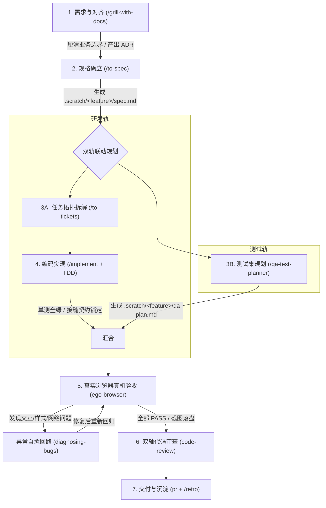

# 研发与真实浏览器真机测试闭环工作流全景实战指南 (QA Workflow Guide)

> **目标读者**：平台前端/全栈工程师、测试工程师、Tech Lead 及协同使用 AI Agent 的所有研发人员。  
> **核心使命**：杜绝“单测假绿灯、线上全白屏”、“需求模糊瞎写码、上线返工推倒重来”等痛点，建立“未对齐不写码、双轨规格联动、真机浏览器卡点、快慢车道自适应”的高确定性工程交付闭环。

---

## 目录 (Table of Contents)

- [一、背景与痛点：为什么必须建立这套工作流？](#一背景与痛点为什么必须建立这套工作流)
- [二、技能权限矩阵澄清：开发者命令 vs 模型自调](#二技能权限矩阵澄清开发者命令-vs-模型自调)
  - [1. 开发者独占命令（模型被禁调，作为流程闸门）](#1-开发者独占命令模型被禁调作为流程闸门)
  - [2. 通用协同技能（双向均可调用）](#2-通用协同技能双向均可调用)
- [三、核心闭环全景流程与产物深度剖析](#三核心闭环全景流程与产物深度剖析)
  - [阶段 1：需求盘问与领域对齐 (/grill-with-docs)](#阶段-1需求盘问与领域对齐-grill-with-docs)
  - [阶段 2：技术规格确立 (/to-spec) —— 格式、意义与对比](#阶段-2技术规格确立-to-spec--格式意义与对比)
  - [阶段 3A：工单拓扑拆解 (/to-tickets) —— 格式、意义与对比](#阶段-3a工单拓扑拆解-to-tickets--格式意义与对比)
  - [阶段 3B：端到端用例规划 (/qa-test-planner) —— QA 视角与用例设计](#阶段-3b端到端用例规划-qa-test-planner--qa-视角与用例设计)
  - [阶段 4：测试驱动实现 (/implement + tdd) —— 红绿灯真相与实现机制](#阶段-4测试驱动实现-implement--tdd--红绿灯真相与实现机制)
  - [阶段 5：真实浏览器验收卡点 —— 执行、PASS 回填与排障](#阶段-5真实浏览器验收卡点--执行pass-回填与排障)
  - [阶段 6：双轴代码审查 (code-review)](#阶段-6双轴代码审查-code-review)
  - [阶段 7：交付发布与经验沉淀 (pr + /retro) —— PR 生成与复盘机制](#阶段-7交付发布与经验沉淀-pr---retro--pr-生成与复盘机制)
- [四、跨会话无缝交接契约：新会话如何精准唤起与协作？](#四跨会话无缝交接契约新会话如何精准唤起与协作)
  - [1. 状态落盘契约](#1-状态落盘契约)
  - [2. 常用阶段交接提示词话术模板](#2-常用阶段交接提示词话术模板)
- [五、日常使用技巧：快慢车道剪裁与红线原则](#五日常使用技巧快慢车道剪裁与红线原则)
  - [1. 三档车道剪裁标准（谁来判定与如何切换）](#1-三档车道剪裁标准谁来判定与如何切换)
  - [2. 不可剪裁的红线原则（自动判定 vs 手动扩展）](#2-不可剪裁的红线原则自动判定-vs-手动扩展)
  - [3. 15 分钟时间盒与分流机制（ego-browser vs Playwright）](#3-15-分钟时间盒与分流机制ego-browser-vs-playwright)
- [六、实战避坑指南与排障心法](#六实战避坑指南与排障心法)
  - [坑 1：未探活即开浏览器，连接拒绝误判为业务 Bug](#坑-1未探活即开浏览器连接拒绝误判为业务-bug)
  - [坑 2：盲目依赖网络空闲，SSR 水合假死导致误报](#坑-2盲目依赖网络空闲ssr-水合假死导致误报)
  - [坑 3：上游网络阻断或欠费，盲目改动业务代码（三层隔离探针）](#坑-3上游网络阻断或欠费盲目改动业务代码三层隔离探针)
- [七、实战速查清单 (Cheatsheet)](#七实战速查清单-cheatsheet)

---

## 一、背景与痛点：为什么必须建立这套工作流？

在传统“开发者写提示词，AI 写业务代码”的粗放模式下，研发团队普遍会撞上以下**致命陷阱**：

```
传统粗放 AI 辅助编码的死循环：
开发者一句话提需求 ──> AI 直接敲键盘写码 ──> 单测全绿（其实是 Mock 骗自己）
         ▲                                                │
         │                                                ▼
   线上翻车/推倒重来 ◄── 手工点点发现交互失灵 ◄── 上线/提测直接白屏
```

具体体现为四个核心痛点：

| 痛点场景 | 典型表现 | 根因剖析 | 工作流应对方案 |
|:---|:---|:---|:---|
| **1. 盲目直接写码** | 开发者刚说一句话，AI 就开始改 10 个文件，改完发现理解完全偏了。 | 需求边界、接口契约与异常分支未在前期被充分挑战与锁定。 | **阶段 1 & 2**：未对齐不写码，强制盘问并产出 `spec.md` 与 ADR。 |
| **2. 单测绿灯偷换真机可用** | 开发者宣称“100 个单测全绿，绝对没问题”，但页面一开：按钮点击没反应、样式被悬浮层遮挡、SSR 水合失败。 | 纯内存单元测试无法验证真实 DOM 事件挂载、CSS 层叠上下文、浏览器安全限制与流式网络交互。 | **阶段 5 铁律**：触及用户核心链路，必须由真实 Chromium 浏览器（ego-browser）逐条冒烟并截屏落盘。 |
| **3. 环境问题误判为代码 Bug** | 遇到报错（如端口未启动、大模型上游欠费 403、TLS 握手失败），AI 误以为业务代码写错了，胡乱回滚重构正常代码。 | 缺乏分层探针意识，未能将外部基础设施故障与应用层代码隔离。 | **探活前置与三层隔离探针**：curl 先探活端口，独立探针分清环境瞬态与代码缺陷。 |
| **4. 交付无证据，评审靠猜** | PR 描述只有一两句话，评审者不知道是否真的在浏览器中跑通，出了问题互相扯皮。 | 交付物缺乏可信度证据链支撑。 | **阶段 7**：PR 必须强制挂载浏览器真实操作的前后对比截图，证据落盘归档。 |

---

## 二、技能权限矩阵澄清：开发者命令 vs 模型自调

在团队实践中，常有成员困惑：“这个技能到底是我敲，还是模型自己跑？”

在项目的技能体系配置中，技能被严格划分为两组：**开发者独占闸门命令** 与 **通用协同技能**。

### 1. 开发者独占命令（模型被禁调，作为流程闸门）

以下技能的 frontmatter 中配置了 `disable-model-invocation: true`。**模型在代码中绝对无法自主发起调用，必须由开发者在对话框手动敲入**：

- `/grill-with-docs`：启动需求高压盘问与文档化对齐；
- `/to-spec`：将对齐成果固化为技术规格文件；
- `/implement` / `/implement-spec`：授权模型开启 TDD 实现；
- `/grill-me`：轻量级思维逻辑推演。

> **为什么这样设计？**  
> 防止模型“自己提需求、自己写规格、自己通过”，产生严重的确认偏误（Confirmation Bias）。这四个命令是开发者与架构师把控工程方向的**关键安全闸门**。

### 2. 通用协同技能（双向均可调用）

以下技能**模型被允许在流水线中自主调用，同时开发者也可以在任何时候手动敲斜杠命令调用**：

- `qa-test-planner`（`/qa-test-planner`）：规划端到端测试用例；
- `tdd`（`/tdd`）：红绿循环切片单测；
- `diagnosing-bugs`（`/diagnosing-bugs`）：科学定位疑难故障；
- `ego-browser`（`/ego-browser`）：真实 Chromium 浏览器自动化与人工介入接管；
- `code-review`（`/code-review`）：双轴代码审查；
- `pr`（`/pr`）：汇总证据链生成 PR 文档；
- `retro`（`/retro`）：阶段性工程复盘。

> **澄清说明**：日常开发中，如果你想临时调试一个 Bug，完全可以直接对模型说：“用 `/diagnosing-bugs` 帮我排查一下”；如果你想让模型打开浏览器看看页面，也可以直接说：“用 `/ego-browser` 帮我看一下 `http://localhost:3030/chat`”。模型可以在流水线自动驱动它们，开发者也拥有随时调用的完全自由。

---

## 三、核心闭环全景流程与产物深度剖析



---

### 阶段 1：需求盘问与领域对齐 (`/grill-with-docs`)

- **解决了什么问题**：防止“需求一句话，做完完全不是那回事”。很多初始业务诉求充斥着隐式假设、漏洞和未考虑的边缘状态。
- **这个流程做什么**：
  1. Agent 会像一个严苛的技术总监一样，对你的需求进行多轮高压审问（Grilling），穷尽探讨接口参数、错误码、鉴权隔离、限流降级与存储事务；
  2. 强制挂载领域建模（`domain-modeling`）能力，核对术语一致性；
  3. 将重大技术取舍直接落盘为架构决策记录（`docs/adr/XXXX-xxx.md`）或更新 `CONTEXT.md`。
- **输出物**：架构决策文档（ADR）及共识结论。

---

### 阶段 2：技术规格确立 (`/to-spec`) —— 格式、意义与对比

- **产物位置**：`.scratch/<feature>/spec.md`。
- **产物标准格式**：
  ```markdown
  # <特性名称> · 技术规格
  Status: ready-for-agent
  日期：2026-10-XX
  来源：/grill-with-docs 盘问共识 · ADR-XXXX
  
  ## Problem Statement
  - 维护者视角痛点：...
  - 最终用户视角痛点：...
  
  ## User Stories
  1. 作为开发维护者，我想要...，以便...
  2. 作为终端用户，我想要...，以便...
  
  ## Implementation Decisions
  1. 模块物理切分与目录归属：...
  2. 接口契约与导出类型定义（精确到 TypeScript 类型、参数与返回值）：...
  3. 异常降级行为与状态机定义：...
  
  ## Testing Strategy
  1. 单元测试切缝验证覆盖范围：...
  2. 回归与端到端浏览器冒烟规划：...
  ```
- **核心三者区别（Spec vs PRD vs Plan）**：
  - **需求文档 (PRD)**：回答“**做给谁看、要什么商业/业务价值**”（关注交互流、产品形态、ROI），完全不关心类名、函数入参出参；
  - **实现计划 (Plan)**：回答“**第一步建文件、第二步改配置、第三步写函数**”的操作顺序便签，做完后基本作废；
  - **技术规格 (Spec)**：回答“**系统的物理接缝（Seams）与接口契约合同是什么**”。它是**只读的、具有契约效力的工程合同**，精确到类型定义与错误码，开发与测试必须严格以它为准绳。

---

### 阶段 3A：工单拓扑拆解 (`/to-tickets`) —— 格式、意义与对比

> 💡 **本地目录与命名澄清**：  
> 虽然通用技能名称为 `/to-tickets`，但在本项目规范（`docs/agents/issue-tracker.md`）中，因为仓库托管在 Gitee，所有实现工单（Issue/Ticket）均统一存放在 **`.scratch/<feature>/issues/`** 目录下，按依赖顺序一题一文件编号（如 `01-agent-note-contract.md`）。因此本地**只有 `issues/` 目录，没有 `tickets/` 目录**，两者在概念上指代同一个工单体系。

- **产物位置**：`.scratch/<feature-slug>/issues/<NN>-<slug>.md`（从 `01` 开始按阻塞依赖顺序编号）。
- **产物标准格式**（对齐 `docs/agents/issue-tracker.md` 实战）：
  ```markdown
  # 01 — 事件契约新增「过程旁白」+ 规格回写
  
  **What to build:** 聊天流事件契约新增 agent_note（过程旁白）事件类型，客户端流解析层识别并透传给订阅方...
  
  **Blocked by:** None — can start immediately  # 依赖前置工单编号
  
  **Status:** ready-for-agent  # 状态标签（ready-for-agent / claimed / resolved）
  
  - [ ] 契约类型新增 agent_note 事件，中文注释写明语义
  - [ ] 客户端流解析新增 agent_note 分支
  - [ ] 契约单测：agent_note 帧可解析；未知事件类型仍显式忽略
  - [ ] typecheck / lint / test 全绿
  
  ## Comments
  （后续讨论与进展追加记录于此）
  ```
- **与 PRD / Plan 的区别**：
  - 工单（Issues/Tickets）是把全局 Spec 按照**有向无环图（DAG 依赖拓扑）**切割出的“流水线工位任务卡”；
  - 它的核心价值是支持**并行分工与无缝接力**：每个子工单职责极窄且高度解耦，未被阻塞的工单（`Blocked by: None`）可以被不同开发者或新会话认领（将状态改为 `claimed`），完成后改为 `resolved`，彼此边界互不踩踏。

---

### 阶段 3B：端到端用例规划 (`/qa-test-planner`) —— QA 视角与用例设计

- **什么是 QA 视角？与开发自测有什么区别？**
  - **开发者视角（顺向思维）**：只关心代码逻辑是否顺畅（“我只要传入 A，能拿到 B 就算成功”），天然存在确认偏误；
  - **QA 视角（对抗性与用户行为视角）**：不管你内部代码写得多精巧，只站在真实浏览器用户角度审视：“页面加载时有没有白屏？”、“按钮被遮挡时能不能点？”、“快速连击会不会发重？”、“长流式网络中断时怎么恢复？”。
- **产物位置**：`.scratch/<feature>/qa-plan.md`。
- **产物标准格式**：
  ```markdown
  # QA 计划：<特性名称> · 浏览器与自动化验收
  关联 spec：.scratch/<feature>/spec.md
  
  ## 环境前提
  - 开发服务：http://localhost:3030 (探活 200)
  - 客户端就绪锚点：等待 placeholder="输入消息…" 出现，禁止 networkidle
  
  ## 用例
  ### TC-01 [P0] 开启 Agent 开关
  1. 打开 http://localhost:3030/chat，等待输入框激活。
  2. 点击 aria-label="开启 Agent 工具调用" 按钮。
  **预期**：按钮状态切为 aria-pressed="true"，文案切为「关闭 Agent 工具调用」。
  
  ### TC-02 [P0] Agent 模式纯文本对话冒烟
  1. 输入「请只回复两个字：收到」并回车发送。
  **预期**：POST /api/chat 返回 200 (text/event-stream)，界面打印「收到」，Usage 显示 token 消耗。
  
  ## 执行记录
  （预留给阶段 5 验收回填）
  ```
- **日常单测 vs QA Plan 的区别**：
  - 单元测试（Vitest）：在 Node 内存虚拟机中测函数，测不到真实 DOM、CSS 样式计算、浏览器安全沙箱；
  - QA Plan：在真实的 Chromium 浏览器中测界面渲染、真实网络吞吐与全链路闭环。

---

### 阶段 4：测试驱动实现 (`/implement` + `tdd`) —— 红绿灯真相与实现机制

这里必须破除一个关于 TDD 的**巨大常见误区**：

> ❌ **误解**：“红灯测试是故意写一个反面教材、或者写一个错误的用例来测试报错。”  
> ✅ **真相**：“红灯测试是一个**完全正确、完全符合业务契约、对未来功能提出合理预期的正面测试**！它之所以是红灯，仅仅是因为**功能代码目前还没写出来**！”

```
TDD 红-绿-重构闭环：
1. 【红灯 Red】编写一个完全正确的测试契约 ──> 运行测试：报错（因为底层代码未实现）
       ▲                                                │
       │                                                ▼
3. 【重构 Refactor】优化代码架构，测试保持全绿 ◄── 2. 【绿灯 Green】编写最极简业务代码让测试通过
```

#### 这个测试是谁写的？怎么写的？
- **谁写的**：在开发者敲入 `/implement` 后，由 Agent 驱动底层的 `tdd` 技能自动编写，开发者无需手工一行行写单测；
- **怎么写的**：Agent 根据 `spec.md` 中的接口定义，先在对应测试文件（如 `runtime-context.test.ts`）中写下一个测试用例：
  ```typescript
  it('应当正确返回 registry 且具备内置工具', async () => {
    // 此时 runtime-context.ts 甚至可能还没写完该函数
    const ctx = await createAgentRuntimeContext({ userId: 'u1' });
    expect(ctx.registry.has('image_generate')).toBe(true);
  });
  ```
- **红灯确认**：Agent 运行测试命令，由于模块未实现，报错退出。**红灯确认成功**（证明测试确实测到了关键逻辑，不是无论怎么跑都绿的假测试）；
- **变绿与重构**：Agent 编写最简实现，再次运行测试变绿；然后进行代码整洁度重构，确保历史存量测试（1300+ 个）100% 保持绿灯。

---

### 阶段 5：真实浏览器验收卡点 —— 执行、PASS 回填与排障

#### 1. PASS 标记是怎么填上去的？
在阶段 3B 生成的 `qa-plan.md` 尾部，预留了 `## 执行记录` 小节。  
当阶段 5 由 Agent 调用 `ego-browser` 在真实 Chromium 浏览器中逐条执行时，Agent 会**实时将实测结果追加回填到该文档中**：

```markdown
## 执行记录
- TC-01 [P0] **通过 (PASS)**：页面加载正常，点击开关 aria-pressed 切为 true，截图 01-TC01-开关开启.png
- TC-02 [P0] **通过 (PASS)**：输入「请只回复收到」，SSE 流式正常输出，Usage 正常统计，截图 02-TC02-文本回答.png
- TC-03 [P0] **通过 (PASS)**：工具调用过程卡片正常渲染，截图 03-TC03-工具卡片.png
```

#### 2. 如果遇到失败（FAIL）怎么办？—— 异常自愈回路
若点击无反应或接口报错：
1. Agent 立即将当前现场抓取为截图（如 `04-TC03-执行报错现场.png`），记录 Console 报错堆栈；
2. 在 `qa-plan.md` 标记 `TC-03 [P0] 失败 (FAIL)`；
3. 自动调用 `diagnosing-bugs`，通过编写**独立隔离探针脚本**（见下文排障心法）定位根因；
4. 修复代码后，Agent **重新进入浏览器回归执行**；
5. 验证成功后，在执行记录中追加：`TC-03 [P0] 回归通过 (PASS)`。

---

### 阶段 6：双轴代码审查 (`code-review`)

在所有浏览器用例标记为 `PASS` 后，自动触发双轴代码审查：
1. **Standards 规范轴**：TypeScript 严格模式、ESLint 规则、DESIGN.md 色彩与动效令牌、无敏感密钥硬编码；
2. **Spec 需求轴**：对照 `spec.md` 逐条核对，有无漏写的功能、有无未经授权的多余代码。

---

### 阶段 7：交付发布与经验沉淀 (`pr` + `/retro`) —— PR 生成与复盘机制

#### 1. `/pr` 是什么时候用？会自动 commit 吗？
- **使用时机**：写完代码、单测全绿、浏览器验证全 PASS、审查无阻断后使用；
- **核心作用**：
  - `/pr` **不是**直接执行 git commit（项目的 Git 规范严格禁止未经确认的自动化提交）；
  - `/pr` 会自动扫描 `.scratch/<feature>/screenshots/` 目录下的所有真实截图，**自动生成一份图文并茂的 Pull Request Markdown 描述**，把前后对比图作为可信证据链嵌入其中，供开发者在提 PR 时直接使用。

#### 2. `/retro` 是什么时候用？在于用户自己决定吗？
- 是的，`/retro` 是**由用户/开发者自主决定是否调用的复盘技能**；
- 建议在以下场景主动调用：
  - 遇到过离奇的环境瞬态、网络阻断；
  - 攻克了复杂的深模块重构架构难关；
  - 调用 `/retro` 后，Agent 会帮助你将踩坑经验与反模式沉淀到 `docs/adr/` 或 `docs/teach/` 中，让团队以后不再踩同一个坑。

---

## 四、跨会话无缝交接契约：新会话如何精准唤起与协作？

在实际工作中，由于上下文窗口限制或下班交接，一个大型特性往往需要开新会话接着做。总不能在新会话里直接打一句“接着干吧”，模型肯定无从下手。

### 1. 状态落盘契约

只要前序会话严格遵循了工作流，工程状态已经完整落盘在文件系统中：
- 需求与架构背景：`docs/adr/`
- 技术规格合同：`.scratch/<feature>/spec.md`
- 当前测试进度与截图清单：`.scratch/<feature>/qa-plan.md` 中的 `## 执行记录`

### 2. 常用阶段交接提示词话术模板

在新会话的第一条消息中，直接套用以下**精准话术模板**：

#### 场景 A：规格已规划完，新会话启动编码实现
> 「我刚才完成了 `<feature-name>` 的规格与测试规划。请先阅读 `.scratch/<feature-name>/spec.md` 和 `.scratch/<feature-name>/qa-plan.md` 熟悉契约，然后直接执行 `/implement` 开启 TDD 编码实现。」

#### 场景 B：编码已完成，新会话启动真实浏览器验收
> 「`<feature-name>` 的业务代码和单元测试均已完成。请阅读 `.scratch/<feature-name>/qa-plan.md`，执行阶段 5 的真实浏览器验收。确保先通过 curl 探活 3030 端口，使用 ego-browser 逐条执行 P0 用例，将截图存入 `.scratch/<feature-name>/screenshots/` 并回填执行记录。」

#### 场景 C：中途接力未完成的浏览器验收
> 「请阅读 `.scratch/<feature-name>/qa-plan.md`，重点查看末尾的 `## 执行记录`，接力执行尚未 PASS 的用例，遇到问题调用 diagnosing-bugs 进行自愈排查。」

---

## 五、日常使用技巧：快慢车道剪裁与红线原则

### 1. 三档车道剪裁标准（谁来判定与如何切换）

```
快慢车道判定逻辑：
[新任务进入]
     │
     ▼
[是否触及核心链路？] ──No──> 单点小修复/文案微调 ──> 🟢【快车道】直接 TDD 修复，不写庞大 Spec
     │
    Yes (触及核心链路)
     │
     ▼
[任务规模评估]
     ├──> 单会话独立新功能 ──────> 🟡【标准车道】/to-spec → qa-plan → TDD → 浏览器验收 → PR
     └──> 跨模块/多会话深重构 ────> 🔴【慢车道】完整 7 阶段全流程 (含 /grill-with-docs 与工单拆解)
```

- **谁来判定？**
  - **Agent 首轮主动判定**：Agent 在回复首部的【流程自检门禁】（Execution Gate）中会明确声明其认定的车道；
  - **开发者拥有一票决定权**：开发者可以直接在提示词中覆盖指令，例如：“这个功能影响很大，给我走慢车道全流程”或“这只是个文案修补，走快车道直接改”。

### 2. 不可剪裁的红线原则（自动判定 vs 手动扩展）

- **默认六大核心红线链路**：
  1. 认证（登录/登出/Token 刷新/匿名认证）；
  2. 对话流式收发（Chat SSE 流/思考流/停止生成）；
  3. 图像生成提交与任务状态；
  4. 视频生成提交与异步轮询；
  5. 语音录制与文件上传转写；
  6. 计费扣减与 Quota 结算。
- **疑问解答：如果我做的新功能不在这六个里面，但我也想让浏览器验收，能手动执行吗？还是必须改规则？**
  - **答案：随时可以手动执行，完全不需要改任何规则！**
  - 解释：六大红线链路是**底线防线（模型会自动强制执行，绝不允许绕过）**。如果你开发了一个全新的功能（例如新增了“命理排盘分析结果页”或“个人资产仪表盘”）：
    - 你可以直接对模型说：“走阶段 5 帮我在真实浏览器里验证一下”；
    - 或者直接敲 `/ego-browser`；
    - 广义上，只要是**具有用户可见界面、具有交互行为的新功能**，均鼓励将其纳入浏览器真机验收范畴！

### 3. 15 分钟时间盒与分流机制（ego-browser vs Playwright）

为什么需要分流？因为两种工具的成本与特性完全不同：

| 工具维度 | `ego-browser` 交互真实验收 | `Playwright` 自动化脚本 (`test:e2e`) |
|:---|:---|:---|
| **执行机制** | 大模型逐帧看截图、推断坐标、模拟真人交互 | Node.js 本地进程极速无模型执行代码 |
| **单次耗时** | 1 ~ 3 分钟 / 用例（多轮 LLM 调用） | **秒级完成**（100ms ~ 1s / 用例） |
| **Token 成本** | 高（每次交互消耗大量上下文与多模态视觉 Token） | **0 Token**（完全离线本地执行） |
| **适用场景** | **本次改动的新功能首次验收**、探索性交互、人工接管登录、抓取 PR 证据截图 | **存量历史功能的防劣化回归**、CI 流水线自动化检查 |

#### 时间盒具体如何限制？
- **用例数量控制**：单次 `ego-browser` 交互验收，只跑本次改动直接受影响的链路，**严格控制在 3 ~ 5 条 P0 冒烟用例**，绝不把全站所有页面从头点一遍；
- **总耗时控制**：单次交互式浏览器验证限制在 **15 分钟** 时间盒内；
- **超时熔断**：如果某条用例排障超过 15 分钟，强制停下交互式盲目重试，转为提取极简探针排障。

---

## 六、实战避坑指南与排障心法

### 坑 1：未探活即开浏览器，连接拒绝误判为业务 Bug

- **惨痛现象**：Agent 直接唤起浏览器访问 `http://localhost:3030`，页面报错 `ERR_CONNECTION_REFUSED`。Agent 误以为代码有严重 Bug，开始翻天覆地乱改业务逻辑。
- **正规解法**：在启动浏览器前，先执行命令行探活：
  ```bash
  curl -s -o /dev/null -w "%{http_code}" http://localhost:3030
  ```
  如果返回非 200，说明服务根本没起或者端口漂移到了 3031，先通过 `pnpm dev:web` 确保开发服务正常，严禁将网络连接拒绝当成业务缺陷排查。

---

### 坑 2：盲目依赖网络空闲，SSR 水合假死导致误报

- **惨痛现象**：在 Next.js 项目中，如果盲目等待网络空闲（例如在 Playwright 中使用 `waitForLoadState('networkidle')`），由于开发模式下存在 HMR（热更新）轮询以及 SSE 流式连接，网络永远不会处于空闲状态，导致测试直接超时报废；或者页面 HTML 刚刚从服务端拉取出来，React 客户端事件监听器还没挂载（水合中），脚本立刻点击按钮毫无反应，造成“点击失灵”的假报警。
- **正规解法**：
  1. **绝对禁止** 盲目等待网络空闲；
  2. **必须使用客户端就绪锚点（Readiness Anchor）**：必须显式等待证明 React 客户端水合已经完成的特定 DOM 元素出现（例如等待带有 `placeholder="输入消息…"` 的输入框渲染并处于可交互状态），然后再执行后续交互。

---

### 坑 3：上游网络阻断或欠费，盲目改动业务代码（三层隔离探针）

- **惨痛现象**：对话接口返回 `{"error": "No output generated"}`。开发者误以为是自己封装的 SSE 流解析器写错了，删代码重构。
- **正规解法（三层隔离探针链）**：
  遇到上游大模型/第三方接口异常时，在改动任何业务代码前，先写一个独立的临时测试脚本（如 `probe.mts`）：
  1. **第一层：裸 curl 验证**：绕开所有业务代码，直接 curl 火山方舟/通义千问官方域名，确认网络连通性与余额（排查欠费 403 或本地代理阻断）；
  2. **第二层：SDK 极简探针**：使用官方 SDK 直连调用最简 Prompt，验证凭证有效性；
  3. **第三层：业务接缝探针**：逐层接入本地适配器，精准定位故障层级。

---

## 七、实战速查清单 (Cheatsheet)

在日常开发任务中，直接对照此清单执行即可无障碍闭环：

```markdown
### 🚀 研发闭环实战检查清单

[ ] 1. 【对齐阶段】
    - 是否清晰知晓需求边界？重大架构改动是否运行了 /grill-with-docs？
    - 是否已产出或对齐了对应的 ADR 架构决策？

[ ] 2. 【规格与规划】
    - 是否敲入 /to-spec 生成了 .scratch/<feature>/spec.md？
    - 是否已由 qa-test-planner 规划好 .scratch/<feature>/qa-plan.md？
    - 测试用例是否具备明确的元素选择器（aria/placeholder）与量化断言？

[ ] 3. 【编码与单测】
    - 是否敲入 /implement 遵循 TDD 编写测试与功能？
    - 运行 `pnpm --filter @repo/web test` 确保 100% 绿灯？

[ ] 4. 【真机浏览器验收】（核心链路必选）
    - 是否已执行 `curl http://localhost:3030` 验证服务存活？
    - 是否以客户端就绪元素（而非盲等网络空闲）为等待锚点？
    - 是否调用 ego-browser 跑通 P0 冒烟，并捕获截图至 .scratch/<feature>/screenshots/？
    - 控制台（Console）是否已确认无未捕获异常与 React 水合报错？
    - 是否在 qa-plan.md 的「## 执行记录」中逐条回填 PASS？

[ ] 5. 【审查与交付】
    - 是否通过 code-review 完成规范轴与需求轴双重审计？
    - PR 描述中是否已嵌入真实浏览器操作截图作为证据链？
```

---

> **附录：相关核心资料索引**
> - 工作流规约源码：`docs/agents/qa-workflow.md`
> - 顶层执行纪律与门禁：`CLAUDE.md`（单一事实源，`AGENTS.md` 为其符号链接；参考信息见 `docs/project-guide.md`）
> - 架构决策沉淀：`docs/adr/`
> - 真实浏览器教学与实战记录：`docs/teach/qa-workflow/`
