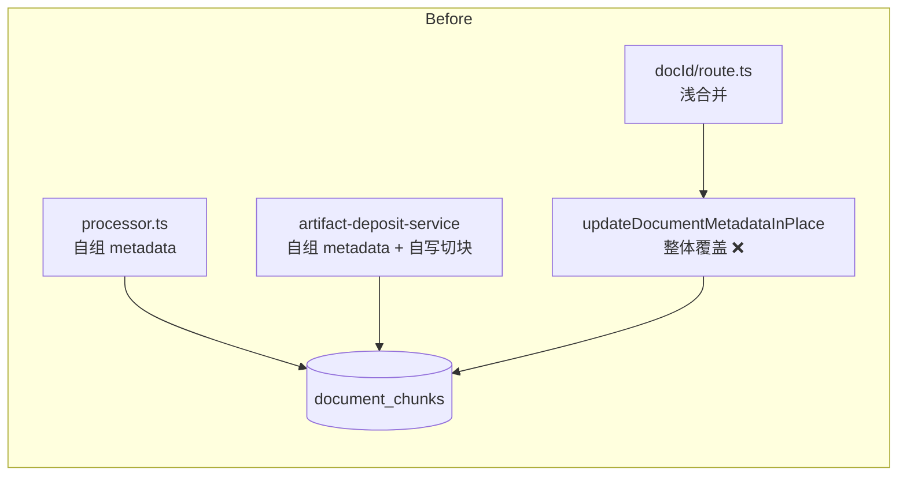
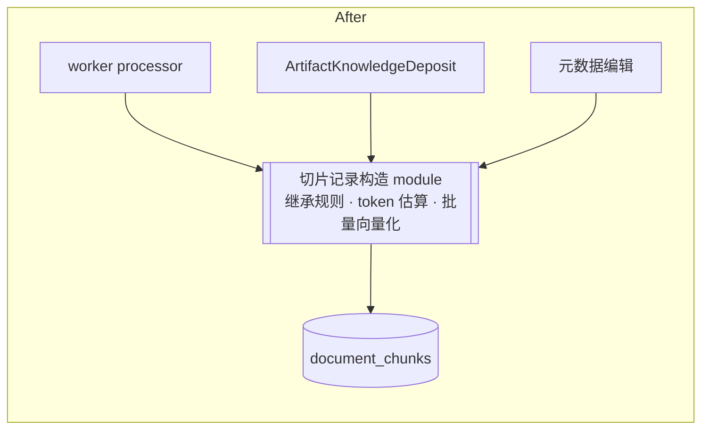
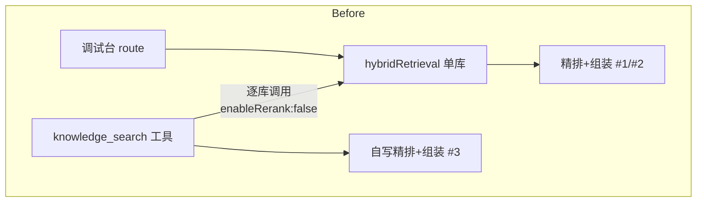
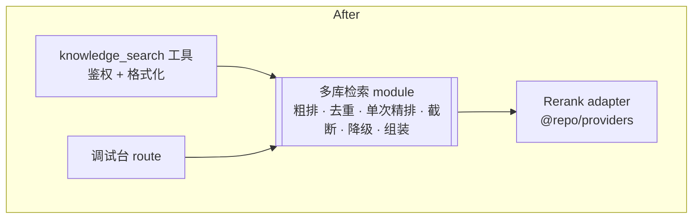
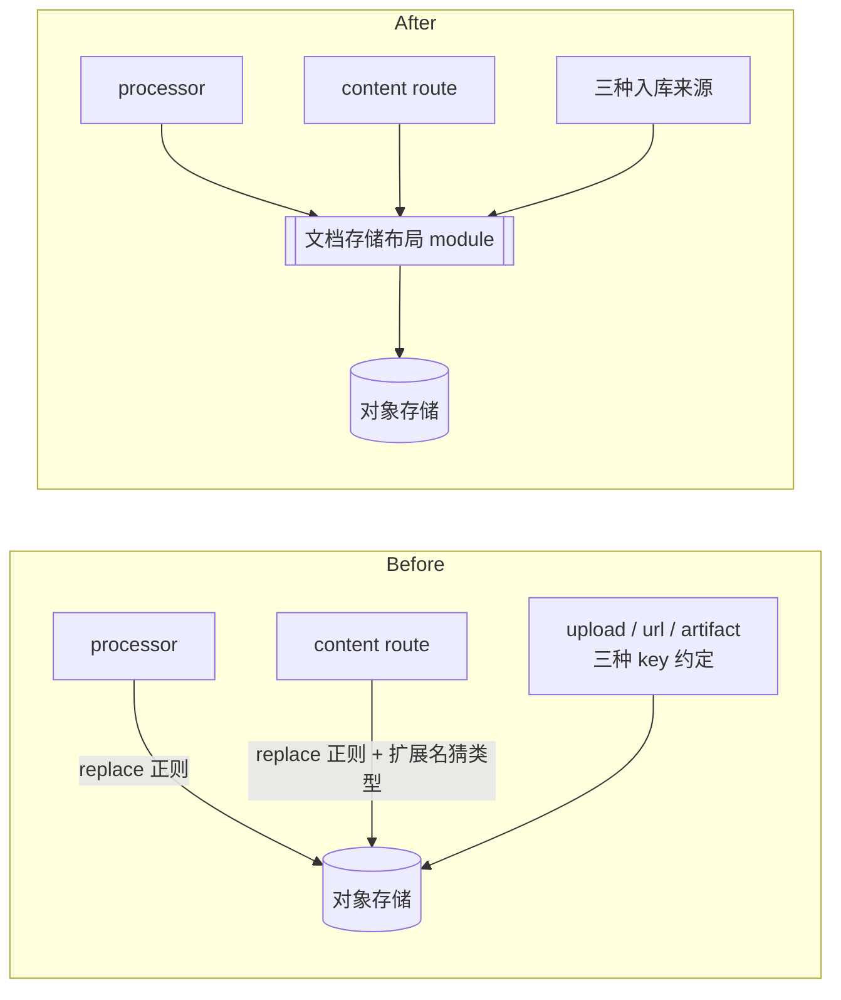
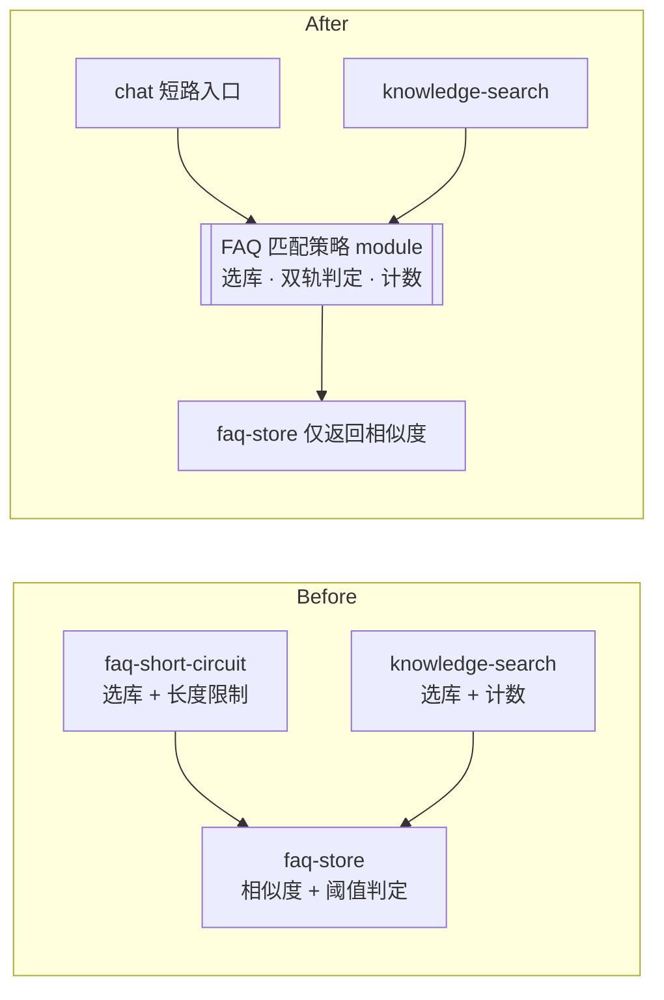

# 架构审查：知识库 / RAG 链路深化机会

> 生成时间：2026-10-28 · 范围：近 40 次提交热点（ADR-0027 ~ 0034 涉及的 `apps/web/src/lib/rag`、`packages/db/src/rag`、`apps/worker/src/workers/rag-index`、`knowledge-search` 工具、`tooling/scripts/qa-check.mjs`）
> 词汇：领域术语取自 `GLOSSARY.md`；架构术语取自 codebase-design（module / interface / depth / seam / adapter / leverage / locality）。
> 证据来源：只读走查 + 关键行人工复核。标注「待验证」的是读代码推断，未运行。

## 总览

| # | 候选 | 推荐强度 | 一句话 |
|---|------|---------|--------|
| 1 | 切片记录构造模块 | **Strong** | 「一份切片由什么构成」散在 4 处，原地改元数据会抹掉 worker 写入的字段（已复核） |
| 2 | 多库检索入口 | **Strong** | Rerank 后组装切片写了 3 遍；`hybridRetrieval` 只认单库，迫使 Agent 工具关掉它的精排再自写一遍 |
| 3 | 文档存储布局模块 | Worth exploring | `content.md` key 推导 3 份、storageKey 约定 3 种、fileType 从 `name` 反推且两分支不一致 |
| 4 | KnowledgeFaq 匹配策略模块 | Worth exploring | FaqShortCircuit / FaqGroundTruth 判定落在 db 层，选库逻辑写两份 |
| 5 | 中文分词与向量化 adapter | Worth exploring | jieba 单例 4 份 + 正则兜底 1 份，索引端与查询端「碰巧一致」 |
| 6 | qa-check.mjs 子域拆分 | Speculative | 1600+ 行六个子域混杂，但测试已充分，收益主要是可读性 |

---

## 候选 1：切片记录构造模块 — `Strong`

**涉及文件**
- `apps/worker/src/workers/rag-index/processor.ts:274-300`（worker 入库）
- `apps/web/src/lib/rag/artifact-deposit-service.ts:28-258`（ArtifactKnowledgeDeposit 同步入库）
- `packages/db/src/rag/chunk-store.ts:671-735`（`updateDocumentMetadataInPlace`）
- `apps/web/src/app/api/knowledge-bases/[id]/documents/[docId]/route.ts:120-136`（路由层浅合并）

**问题**

DocumentMetadataInheritance 这条不变量没有一个 module 拥有它，结果 4 个写入点各自构造切片 `metadata`：

| 写入点 | 切片 metadata 组成 |
|---|---|
| processor.ts:287-298 | `...docMetadata, tags, sourceType, fileName, storageKey, parsedContentKey` |
| artifact-deposit-service.ts:246-252 | `tags, sourceType, sourceSessionId, sourceArtifactId, chunkIndex` |
| chunk-store.ts:692-695 | `...metadata, tags`（**整体覆盖**） |
| [docId]/route.ts:120-136 | 路由层浅合并 + 重复一份键名白名单正则（原版在 metadata-filter.ts:35） |

后果（已复核源码）：用户在 DocumentMetadata 对话框改一次标签，`updateDocumentMetadataInPlace` 用 `SET "metadata" = $1::jsonb` 整体覆盖，worker 写入的 `sourceType / fileName / storageKey / parsedContentKey` 全部丢失；之后按 `sourceType` 做 MetadataFilter 会漏召回。现有集成测试只断言 `updatedChunkCount > 0`。

另外两条入库路径的切片口径也不一致：worker 用 800/80 重叠 splitter、标题不进正文、token 按中西文分别估算；产物路径手写 500/800 无重叠切块、标题进正文、token 一律 `len/3`、逐条 `embed` 无并发上限。

**方案**

建一个「从文档 + 原始片段 → 切片记录」的深 module，独占三件事：元数据打平继承规则、token 估算、批量向量化。worker 与 ArtifactKnowledgeDeposit 只喂文本片段；原地更新元数据也调用同一规则从文档主表重新计算，而不是手写合并。

> ⚠️ 与 ADR-0034 的关系：ADR-0034 明确产物入库**同步、进程内、500 字切块、绕过 worker**。本候选不挑战这一点——仍是同步进程内执行，只是切片记录的构造规则由同一 module 提供。切块参数是否统一需在拷问阶段决定（ADR-0034 规定的 500 字可作为该 module 的一个参数）。

**收益**
- Locality：「切片 metadata 有哪些字段」只在一处定义，修一次全链路生效；字段丢失 bug 从结构上消失。
- Leverage：三个调用方（worker、产物沉淀、元数据编辑）共享一份实现；未来新增入库来源（如 FaqDistillationFeedback 落文档）零成本接入。
- 测试：「改标签后 sourceType 仍在」这类不变量可以在 module interface 上用纯数据断言，不再依赖真实 PostgreSQL；产物路径从零测试变为被同一套测试覆盖。

**Before / After**

---

## 候选 2：多库检索入口 — `Strong`

**涉及文件**
- `apps/web/src/lib/rag/hybrid-retrieval.ts:318-425`
- `apps/web/src/app/api/chat/_lib/agent/tools/knowledge-search.ts:171-273`
- `apps/web/src/app/api/knowledge-bases/[id]/query/route.ts`

**问题**

`hybridRetrieval` 的 interface 一次只接一个 `knowledgeBaseId`。ADR-0030 要求「多库粗排 → 聚合候选 → 单次全局 CrossEncoderRerank」，于是 `knowledge-search.ts:185` 只能传 `enableRerank: false` 关掉内部精排，再在 :226-262 自己实现一遍「调 provider → RelevanceScoreCutoff → RerankFallback → 组装切片」。

结果是 Rerank 结果到切片对象的组装写了 3 遍（hybrid-retrieval.ts:348-376、:398-424、knowledge-search.ts:248），且都带 `candidateList[res.index] ?? candidateList[0]` 静默兜底——provider 返回越界索引时悄悄换成第一条，不报错。`knowledge-search.ts:270` 的 `knowledgeBaseId || targetKnowledgeBaseIds[0]` 永远不会走到，说明调用方已经不清楚上游契约。

检索调试台的 `query/route.ts:88` 把 chunk-store 内部行（含 `userId`、`contentSegmented`）原样回给前端，`retrieval-debugger.tsx:28-31` 从服务端 module 引用类型。

**方案**

让检索入口 interface 直接接收知识库 ID 列表，内部完成「各库并发粗排 → 去重截断 maxCandidates → 一次精排 → 截断 → 组装 CitationAnchor」。Agent 工具只做鉴权与提示词格式化；调试台拿到的是面向展示的投影，而不是存储行。

> ✅ 与 ADR-0030 一致：这是把 ADR-0030 已决定的「单次全局 Rerank」放进它本该在的 module 里，而不是重新讨论该决定。

**收益**
- Locality：精排、阈值截断、降级、越界处理只有一份；越界改为显式报错或丢弃只需改一处。
- Leverage：单库调试台与多库 Agent 走同一 interface（单库只是长度为 1 的列表）。
- 测试：hybrid-retrieval（729 行）与 knowledge-search（547 行）里各自重复的精排测试可以合并到一个 interface 上；Agent 工具测试只剩鉴权和格式化。

**Before / After**

---

## 候选 3：文档存储布局模块 — `Worth exploring`

**涉及文件**
`processor.ts:172, 275` · `documents/[docId]/content/route.ts:30-164` · `documents/route.ts:220` · `url/route.ts:100` · `artifact-deposit-service.ts:201`

**问题**
- `content.md`（StructuredDocNormalization 的提纯缓存）key 推导写了 3 份正则替换。
- storageKey 约定 3 种：`docs/{u}/{docId}/v{n}/{file}`、`url-{ts}-{rand}`、`artifact-{ts}-{rand}`。
- DocumentPreview 的 fileType 从 `document.name` 扩展名反推，但 UrlDocument 入库后 `name` 被改成无扩展名标题；失败分支（:64）只认 pdf/txt/markdown，成功分支（:156-164）还认 docx/xlsx/csv——失败的 docx 被当成 markdown。
- csv 不走提纯 `content.md` 分支，预览显示原始 CSV 而非 TableChunk 对应的 GFM 表格。
- 路由直接 `prisma.documentChunk.findMany`，违反 chunk-store.ts:6 声明的收口约定。

**方案**
一个「给文档 → 原件 key、提纯件 key、可展示正文与类型」的 module；类型在入库时持久化，不再从 `name` 反推。

**收益**
key 规则一处定义一处测试；预览类型 bug 消失；路由与 worker 不再各自知道存储布局。

**Before / After**

---

## 候选 4：KnowledgeFaq 匹配策略模块 — `Worth exploring`

**涉及文件**
`packages/db/src/rag/faq-store.ts:412-450` · `apps/web/src/lib/.../faq-short-circuit.ts:12-67` · `knowledge-search.ts:70-79, 198-212, 290` · `faq-service.ts`

**问题**
- FaqShortCircuit（≥0.92）与 FaqGroundTruth（≥0.78）的判定在 **db 层** 产出 `isShortCircuit / isGroundTruth` 业务标志——存储 adapter 承担了策略。
- 「取用户 active 状态、按 updatedAt 倒序前 3 个库」在两处各写一份；「query > 500 字跳过」只有短路一侧有。
- 命中计数的递增条件分在两个调用方（当前不会重复累加，但不变量靠巧合维持）。

**方案**
web 侧一个「(用户, 问题, 场景) → 直出 / 权威口径 / 未命中，并负责计数」的 module；db 层只返回相似度。

**收益**
阈值策略和存储解耦，ADR-0027 的双轨规则在一个 interface 上即可完整测试（目前 faq-service 无测试，faq-store 需真实 PG）。

**Before / After**

---

## 候选 5：中文分词与向量化 adapter — `Worth exploring`

**涉及文件**
`parser.ts:50-73` · `faq-service.ts:10-20` · `hybrid-retrieval.ts:129-181` · `memory-search.ts:48` · `faq-store.ts:70-73`

**问题**
jieba 单例 4 份、正则兜底 1 份，降级行为各不相同（worker 无降级、web 两处回退正则）。词法检索要求**索引端与查询端分词严格一致**，目前只是碰巧一致；jieba 加载失败时查询端退回正则，召回会静默劣化。`faq-service.ts` 名为 FAQ，实为通用「分词 + 单条向量化」，导致 ArtifactKnowledgeDeposit 反向依赖 FAQ module。

**方案**
在 `@repo/shared/server` 或 `@repo/providers` 放一个文本处理 module，入库与查询两侧取同一分词器与向量化函数，降级策略只定义一次。

**收益**
「索引/查询分词一致」由结构保证；删掉 4 份重复初始化。真实存在两个 adapter（jieba / 正则降级），seam 是真的。

---

## 候选 6：qa-check.mjs 子域拆分 — `Speculative`

**涉及文件** `tooling/scripts/qa-check.mjs`（约 1600+ 行）

**问题**
可清晰切出 6 个子域：spec/plan 解析（:92-310）、技能遮蔽（:310-386）、运行日志与证据定位（:387-540）、冻结计划 / AssertionMarker / TestBinding（:548-795）、过程脚本静态扫描（:795-880）、评审分诊（FindingId 解析）+ 会话 jsonl 扫描（:1083-1470）。`checkAcceptance` 单函数约 180 行，`issue(` 散布 90+ 处。

**方案**
按子域拆 4~5 个 module，`checkFeature` 只编排并输出 ReconciliationTable。

**为何只是 Speculative**
schema4（85 例）与 control-points（25 例）测试已充分覆盖，当前改动频繁但未见因结构引发的缺陷；收益主要是可读性。可在下一次大改 qa-check 时顺手做。

---

## 检查过、认为无需改动的点

- `buildMetadataFilterClause`：键名白名单 + 位置参数绑定，无注入风险，有单测。（小隐患待验证：`$gte/$lte` 对非数字值强转 numeric 可能使整条查询报错。）
- 两路召回 SQL 在 SQL 层做了用户/知识库越权过滤，并有集成测试。
- `rrf.ts`、`citation.ts` 是真正的深 module，测试充分。
- web 端 `csv-parser.ts` 被前端 FAQ 导入与服务端共用，与 worker 的 `table-parser.ts`（文档型 CSV）用途不同，不算重复。
- processor 的错误分类（致命 → failed，瞬态 → 抛出重试）清晰，依赖注入完整，8 个用例覆盖主流程。
- `apps/web/src/lib/rag/rerank.ts` 是仅被自身测试引用的 5 行再导出（ADR-0030 下沉遗留）——删除测试结论：直接删，测试迁到 `packages/providers`。属于清理，不单列候选。

## 附带发现（不属于深化，但值得单独排查）

- **待验证**：`replaceDocumentChunksInTransaction`（chunk-store.ts:200-227）置 `ready` 前不校验 `document.version` 仍等于本任务版本，旧版本任务晚到可能把尚未索引完的新版本标成 ready；且使用全局 `prisma` 而非 processor 注入的 client。

---

## 首选推荐：候选 1「切片记录构造模块」

理由：
1. **唯一一个已复核的线上数据正确性缺陷**——改一次标签就会让切片丢失 `sourceType` 等字段，MetadataFilter 随之漏召回，且现有测试抓不到。
2. **热点最集中**：ADR-0029、0032、0034 三次特性都在往切片 metadata 里加字段，每次都要改多处；下一个入库来源（如 FaqDistillationFeedback 衍生文档）还会再加一处。
3. **不与任何 ADR 冲突**：保留 ADR-0034 的同步进程内入库，只收拢构造规则。
4. 改完后，候选 3（存储布局）与候选 5（分词 adapter）都可以作为它的内部依赖自然落位。

候选 2 紧随其后，适合作为第二个切入点；它与候选 1 互不阻塞。
