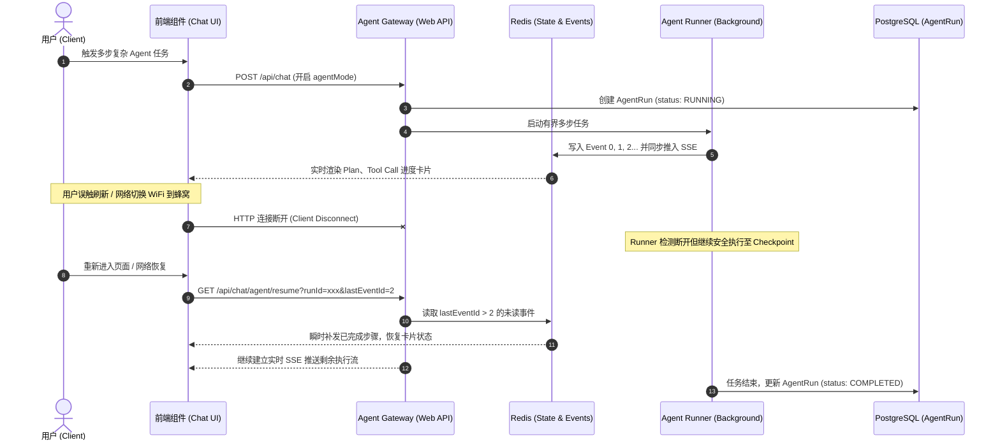

# 02 · PRD：Agent 执行运行时持久化与断点续跑 (Runtime Checkpoint & Stream Resume)

> **实现阶段**：Stage 2（核心架构突破：构建工业级状态机与连接韧性）  
> **文档版本**：v1.0 | **创建日期**：2026-11-18 | **规划状态**：待实现 (Ready for Dev)  
> **关联模块**：`apps/web/src/app/api/chat/_lib/agent/`、`packages/shared/src/chat-stream-contract.ts`、`packages/db/prisma/schema.prisma`、`apps/web/src/stores/chat-store.ts`

---

## 1. 业务痛点与底层思考

### 1.1 现状与痛点
- **易失性内存执行（Ephemeral Memory）**：当前 `agent-runner.ts` 直接将 Node.js 内存中的 `ReadableStream` 管道化到 HTTP 响应。执行周期与单次 HTTP 请求生命周期强绑定。
- **用户体感脆弱**：一次完整的多步 Agent 规划、检索与工具调用通常需要 20s~90s。在此期间：
  - 用户若在移动端锁屏、切换 App、在桌面端误刷新页面或网络跳变，HTTP 连接立刻中断；
  - 内存执行流被系统截断或变成孤儿进程，中间状态丢失；
  - 前端展示为错误中断或空白，已消耗的预留 Token 配额变成悬挂账，产物完全丢失。
- **面试与工业级差距**：工业级 Agent 与玩具 Demo 的根本分水岭之一就在于**系统的韧性（Fault Tolerance）**——分布式环境默认“网络随时可能中断、进程随时可能重启”。

### 1.2 设计原则（张一鸣思维操作系统）
1. **假设一切都会失败**：网络不可靠、客户端不可靠、单次连接不可靠。执行状态必须独立于网络连接而持久化。
2. **Context not Control**：服务端如实持久化状态变迁的 Context（事件流水与检查点），客户端只负责消费和按需订阅。
3. **消除无效重跑**：已完成的 Step 决不能因为外部网络抖动而重新调用 LLM 和工具，保护 Token 成本与时间延迟。

---

## 2. 核心功能与产品形态

### 2.1 交互表现与用户旅程



1. **执行中实时卡片**：
   - 任务启动时立即生成唯一 `runId`，在对话气泡中渲染带有活跃态指示器的「智能体协同工作台」。
2. **断线与离开感知**：
   - 用户离开页面或连接中断时，界面不报错、不高亮红色异常，仅显示轻量状态提示：`后台正在持续推进（Step 2/5）...`。
3. **一键恢复与增量重放（Zero State Loss）**：
   - 重新进入聊天页面时，系统自动检测当前会话是否存在未完成的 `AgentRun`。
   - 存在未完成任务时，主动发起 Resume 请求，历史 step 毫秒级回放，工具调用树与思考过程无缝恢复。
4. **中断确认态（HITL Approval Resume）**：
   - 若 Agent 运行到危险操作（需 HMAC 确认的工具），即使断线，重新连入后卡片依然稳定呈现「等待授权审批」面板，支持继续操作或取消。

---

## 3. 技术方案与实现细节

### 3.1 状态与事件模型设计

#### A. Prisma 数据模型改造（`packages/db/prisma/schema.prisma`）
增强现有 `AgentRun` 表结构：

```prisma
enum AgentRunStatus {
  PENDING
  RUNNING
  PAUSED_APPROVAL // 等待人工审批
  COMPLETED
  FAILED
  ABORTED
}

model AgentRun {
  id             String         @id @default(uuid())
  conversationId String         @map("conversation_id")
  userId         String         @map("user_id")
  status         AgentRunStatus @default(PENDING)
  currentStep    Int            @default(0) @map("current_step")
  maxSteps       Int            @default(5) @map("max_steps")
  checkpointData Json?          @map("checkpoint_data") // 包含当前累积的 messages、plans
  totalTokens    Int            @default(0) @map("total_tokens")
  createdAt      DateTime       @default(now()) @map("created_at")
  updatedAt      DateTime       @updatedAt @map("updated_at")

  @@index([conversationId, status])
  @@index([userId, status])
  @@map("agent_runs")
}
```

#### B. Redis 实时事件缓存与检查点（TTL 24小时）
- **事件流键**：`agent:run:{runId}:events`（Redis Stream 或有序 Hash / List）
  - 每条记录包含：`{ seq: number, event: string, data: string, timestamp: number }`
- **检查点键**：`agent:run:{runId}:checkpoint`
  - 存储当前 step 的上下文数据（用于故障恢复或继续下一个 step）：
    ```json
    {
      "step": 2,
      "plan": { "goal": "...", "steps": [...] },
      "completedToolResults": [...],
      "accumulatedTokens": 1420
    }
    ```

### 3.2 核心接口定义

#### 1. 断点恢复请求 (Resume SSE)
- **Path**: `GET /api/chat/agent/resume`
- **Query Params**:
  - `runId`: string (Agent 执行 ID)
  - `lastEventId`: number (客户端收到的最后事件序号，默认为 0)
- **Response**: `text/event-stream`
  - 先吐出 `seq > lastEventId` 的已存事件；
  - 随后监听活跃的 Redis PubSub 频道或直接挂载持续流。

#### 2. 主动中止请求 (Abort Run)
- **Path**: `POST /api/chat/agent/abort`
- **Body**: `{ "runId": "string", "reason": "user_cancelled" }`
- **Response**: `{ "success": true, "status": "ABORTED" }`

### 3.3 客户端改造（`chat-store.ts` & `chat-stream.ts`）
1. **自增 `event_id` 追踪**：
   - 改造 `packages/shared/src/chat-stream-contract.ts`，为所有 SSE 事件统一注入 `seq: number` 和 `runId?: string`。
2. **看门狗与自动重连**：
   - 当检测到 SSE 超过 15 秒静默或连接非正常关闭（`onError` / `onAbort`），不置为 `isStreaming: false`，而是触发指数退避自动重连（最多 3 次，间隔 1s, 2s, 4s），调用 `/api/chat/agent/resume`。
3. **页面加载初始化检查**：
   - 切换对话或加载历史会话时，检查是否有处于 `RUNNING` 或 `PAUSED_APPROVAL` 的 Run，若有，自动激活重连工作流。

---

## 4. 边界条件与异常处理

1. **孤儿进程清理与硬超时**：
   - 单个 AgentRun 设置全局最大执行时效（`AGENT_RUN_MAX_DURATION = 300s`）。若 300s 后仍未到达终态且无客户端心跳，后台定时任务将其标记为 `FAILED`（超时关闭），并退还未消耗的预留配额。
2. **写操作并发防护**：
   - 同一会话（`conversationId`）在同一时刻仅允许一个活跃的 `RUNNING` 实例。后续重复触发直接返回当前正在运行的 `runId`。
3. **Redis 宕机降级**：
   - 若 Redis 连接异常，系统平滑降级为现有的单次纯内存 SSE 流模式，并记录警告日志，绝不阻断用户正常对话。

---

## 5. 验收标准与交付物

| 检查项 | 验证方式 | 预期目标 |
| :--- | :--- | :--- |
| **刷新不丢状态** | 运行一个 4 步 Agent 任务，在第 2 步工具调用时按 F5 刷新网页 | 页面重新进入后 500ms 内恢复执行状态卡片，无缝走完后续 3 步 |
| **断线增量补推** | 模拟网络断开 5 秒后恢复 | 客户端按 `lastEventId` 顺序补齐丢失事件，不产生乱序或重复文本 |
| **审批态持久保持** | 触发 Webhook 敏感操作进入 HMAC 审批态，关闭浏览器 5 分钟后再打开 | 审批弹窗依然有效展示，支持点击「批准」并继续向下执行 |
| **配额准确性** | 发生中断并完成恢复后 | `AIUsageRecord` 账本扣除的 Token 精确等于实际累积调用的 Token，无多扣或死锁 |
