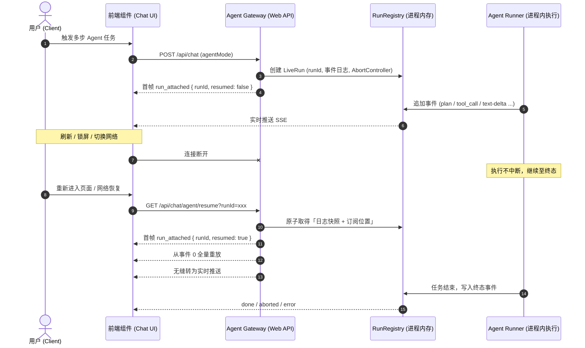

# 02 · PRD：Agent 运行时连接韧性与流式恢复 (Runtime Connection Resilience & Stream Resume)

> **实现阶段**：Stage 2（核心架构突破：执行与连接解耦）
> **文档版本**：v1.1 | **更新日期**：2026-11-23 | **规划状态**：已实现，r6 后机器门禁 PASS，待人工终审
> **关联模块**：`apps/web/src/app/api/chat/_lib/`、`packages/shared/src/chat-stream-contract.ts`、`apps/web/src/stores/chat-store.ts`、`apps/web/src/lib/conversation/message-snapshots.ts`
> **关联决策**：ADR-0061《Agent 执行与 HTTP 请求生命周期解耦：进程内运行注册表与事件重放》

---

## 0. 版本说明（v1.1 取代 v1.0）

v1.0 的「Redis 事件流水 + DB 运行态表 + `seq` 增量重放 + 进程重启后继续执行」方案，在拷问中被以下事实否定：生产为单容器单 Node 进程；会话历史存浏览器侧；`AgentRun` 是结束时一次性写入的审计表；Redis 为 Upstash 外部托管。最终方案收敛为**进程内运行注册表 + 全量事件重放**，能力边界从「执行持久化」下调为「连接层韧性」。

| v1.0 内容 | v1.1 处置 | 依据 |
| :--- | :--- | :--- |
| Redis 事件流 / checkpoint（TTL 24h） | 删除，改为进程内 `RunEventLog` | ADR-0061 §2 |
| `AgentRun` 表改造 + `AgentRunStatus` | 删除，`AgentRun` 分析表零改动 | ADR-0061 §2 |
| `seq` / `lastEventId` 增量补发 | 删除，改为全量重放 + 客户端重建 | ADR-0061 §2、备选方案 |
| 进程重启后继续执行 | 删除，改为 `RunInterrupt` | ADR-0061 §1 |
| `PAUSED_APPROVAL` 状态 | 删除，审批沿用 ADR-0041 现有机制 | ADR-0061 背景 §5 |
| 「断点续跑」叙事 | 改为「流式恢复」，不承诺执行恢复 | ADR-0061 §8 |

---

## 1. 业务痛点与边界

### 1.1 现状与痛点

- **执行与连接强绑定**：`runAgent` 直接消费 `req.signal`（`chat-handler.ts:359`），输出流直接管道到 HTTP 响应。用户刷新、锁屏、切 App 或网络跳变时，连接中断即触发 abort，多步任务在第 2 步、第 3 步被截断。
- **结果无处可取**：最终文本、产物与工具结果从未被任何客户端接收，服务端也不保存会话历史（`chat-store.ts:356` 存浏览器侧），断线即等于结果丢失。
- **用户体感脆弱**：一次完整任务通常 20s~90s。期间任何连接波动都会显示为错误中断，已消耗的配额与已完成的步骤全部作废。

### 1.2 能力边界（重要）

本特性保证的是**连接层韧性**，不是**进程层持久化**：

- **覆盖**：刷新页面、锁屏/切 App、Wi-Fi 与蜂窝切换、短暂断网。执行在服务端继续，客户端恢复后重新挂载并取得完整结果。
- **不覆盖**：web 进程重启、容器重调度、多副本/Serverless 部署。此时进行中的任务标记为 `RunInterrupt`，客户端提示「任务已中断」，用户可重新执行。
- 该边界适用于当前「长驻、单 Node 进程、单副本」部署（腾讯云 Docker 单容器）。不得对外表述为「任务永不丢失」。

### 1.3 设计原则

1. **执行独立于连接**：连接只决定谁在观看，不决定任务是否继续。
2. **内存即真源**：运行态的唯一副本在进程内存；不引入跨进程存储，不为不存在的多副本场景预付复杂度。
3. **恢复即重放**：恢复不依赖增量游标，而是重建消息后重放完整事件日志；实时与恢复共用同一套消费逻辑。
4. **停止必须真实**：用户看到的「已停止」必须等于服务端已停止，且只结算一次。

---

## 2. 核心功能与用户旅程



### 2.1 功能清单

1. **执行中实时卡片**：任务启动即下发 `run_attached`，对话气泡渲染带活跃态指示器的「智能体协同工作台」。
2. **断线无感**：连接中断时界面不报错、不置红，显示轻量提示「连接中断，正在重连…」。
3. **自动重连与全量重放**：刷新、锁屏返回、网络恢复时自动 `attach`；消息重建后从事件 0 重放，工具调用树、计划与产物无缝恢复。
4. **完成后取回结果**（v1.1 新增）：任务在用户离开期间跑完时，返回会话即可取得完整文本、产物与工具结果；日志保留 30 分钟。
5. **停止真实生效**：停止按钮经服务端中止接口触发，收到终态事件后正常收尾；5s 未收到则本地提示「已请求停止」。
6. **并发保护**：同一会话已有活跃任务时，新请求返回 `409` 与现有 `runId`，客户端保留草稿并挂载现有任务。
7. **中断提示**：进程重启或日志过期后，统一提示「任务已不可用，可重新执行」，不区分具体原因。

---

## 3. 技术方案

### 3.1 运行注册表（进程内存）

新增模块（建议路径 `apps/web/src/app/api/chat/_lib/agent/run-registry.ts`），单例持有：

```ts
interface LiveRun {
  runId: string;                 // crypto.randomUUID()，不可枚举
  userId: string;
  conversationId: string;
  status: 'running' | 'completed' | 'aborted' | 'failed';
  events: Uint8Array[];          // 完整 SSE 事件帧，含 text-delta
  bytes: number;
  controller: AbortController;   // 唯一中止来源
  subscribers: Set<(frame: Uint8Array) => void>; // 每次 attach 一个独立订阅
  startedAt: number;
  settledAt?: number;
}
```

**不变量（实现必须满足）**：

1. **原子挂载**：每次 attach 调用 `subscribe(runId, onFrame)` 时，注册表在同一次同步调用内返回「历史帧快照 + 订阅内游标」并完成回调注册，不得出现「先读历史、再订阅」的间隙；游标只存在于该次订阅内部。
2. **同日志**：初始 `POST /api/chat` 的响应流与 `/resume` 消费同一份 `events`。
3. **幂等 attach**：每次 attach 创建独立订阅与独立游标；多标签页各自独立重放，不共享 reader，不互相覆盖。
4. **保留**：终态后保留 30 分钟（`RUN_LOG_RETENTION_MS`），从 `settledAt` 起算。
5. **淘汰**：全部 run（活跃 + 终态）上限 128 个 / 64MB（`RUN_LOG_MAX_RUNS` / `RUN_LOG_MAX_BYTES`）；超限先淘汰最久未访问的终态 run；活跃 run 不参与淘汰。
6. **活跃上限与过载拒绝**：活跃 run 单独设上限 16 个 / 32MB（`RUN_ACTIVE_MAX_RUNS` / `RUN_ACTIVE_MAX_BYTES`）；超限时新 Agent 请求**在配额预留之前**返回 `503`「当前任务过多，请稍后再试」，不创建任务。内存保护不依赖 240s 预算。
7. **单 run 上限**：日志软上限 8MB，超出记录告警，不截断（截断破坏重放正确性）。
8. **不落库、不进 Redis**：注册表是运行态唯一副本；进程重启即全部消失。

### 3.2 事件契约

在 `packages/shared/src/chat-stream-contract.ts` 新增一个事件，其余事件保持不变：

```ts
export type ChatStreamRunAttachedEvent = {
  type: 'run_attached';
  runId: string;
  /** true = 重连挂载（客户端需重建消息）；false = 初始请求 */
  resumed: boolean;
};
```

- 所有流（初始与 resume）**首帧**均为 `run_attached`。
- `run_attached` 是**每次连接的投递首帧**，不写入共享 `RunEventLog`；`resumed` 属于单次连接属性，重放时不会携带错误值。
- 不新增 `seq`、不新增 `runId` 到每个事件。

### 3.3 核心接口

#### 1. 断点挂载（Resume SSE）

- **Path**：`GET /api/chat/agent/resume?runId=xxx`
- **鉴权**：`getCurrentUser`；注册表中 `userId` 必须匹配，否则 `403`。
- **Response**：`text/event-stream`
  - 首帧 `run_attached { runId, resumed: true }`；
  - 随后从事件 0 全量重放；
  - 同一次订阅内转为实时推送，不换连接。
- **不可用**：`410 { code: 'RUN_UNAVAILABLE' }`。进程重启、日志过期、非法 runId 统一此响应与文案，不区分原因。
- **心跳**：沿用 `withSseHeartbeat`（15s）。

#### 2. 主动中止（Abort Run）

- **Path**：`POST /api/chat/agent/abort`
- **Body**：`{ "runId": "string" }`
- **行为**：归属校验 → `controller.abort()` → 运行器在下一个检查点停止 → 写终态事件 → 统一结算一次。
- **幂等**：重复调用返回当前状态；run 不存在返回 `410`。

#### 3. 初始请求的并发约束

- `POST /api/chat`（agent 模式）检测同 `conversationId` 已有活跃 `LiveRun` 时，返回 `409 { runId }`，不创建新任务。
- 普通对话（`agentMode: false`）不进入注册表，不受此约束；多模型对比走 `agentMode: false`，同样不受影响。

### 3.4 客户端改造

1. **runId 持久化**：`run_attached` 到达时把 `runId` 写入消息快照（`message-snapshots.ts` 与消息类型同步扩展），随每秒节流落盘。
2. **attach 触发**：
   - 打开/切回包含该 runId 消息的会话；
   - `window` 的 `online` 事件；
   - `visibilitychange` 转前台（移动端锁屏返回时定时器被冻结，必须靠此事件立即补一次）。
3. **重建**：`run_attached.resumed === true` 时，先把该 runId 对应的助手消息清空，再按事件序列重建；`resumed === false` 时只记录 runId。
4. **看门狗**：**25s 未收到任何字节**（心跳 15s + 10s 余量）判定断线，不置 `isStreaming: false`、不报错。
5. **重连**：退避 1s→2s→4s→8s→10s 封顶，持续重试；终止条件为「收到终态事件」「resume 返回 410」「累计重连超过 240s」。期间显示「正在重新连接（第 N 次）」。
6. **放弃后**：显示「连接中断，任务可能仍在后台执行」，提供「重新连接」与「停止」按钮；runId 已持久化，后续打开会话仍可自动 attach。
7. **停止按钮**：调用 abort 接口并等待终态事件；5s 未收到则本地收尾并提示「已请求停止」。
8. **普通对话维持现状**：仍绑定请求信号，断开即中止；本特性不改变其行为，也不为其提供 attach。

---

## 4. 边界条件与异常处理

1. **运行中断（RunInterrupt）**：web 进程重启后注册表为空；客户端 attach 得到 `410`，提示「任务已不可用，可重新执行」。半截消息保留在本地，可一键重跑。
2. **日志过期**：终态 30 分钟后淘汰；过期后的 attach 与中断同样处理，不区分原因。
3. **结算恰好一次**：正常完成、主动中止、预算耗尽、审批暂停、异常五类收尾，先由运行器写入**唯一终态事件**并把 `LiveRun` 标记为终态（记 `settledAt`），随后由 `ChatCompletionLifecycle` 执行恰好一次结算；客户端断开、attach 失败、重复 abort 均不进入完成生命周期。审批暂停按 ADR-0041 视为有效终态。
4. **配额**：沿用现有预留与对账机制（`/api/internal/billing/reconcile`）；中断任务由既有 `releaseExpiredQuotaReservations` 释放未执行预留。本特性不新增计费逻辑。
5. **审批恢复**：沿用签名 token（10 分钟 TTL）与客户端本地快照；审批请求发出后本次流已正常结束，重新点批准是新的 `ApprovalResume` 请求，不属于本特性的 attach 语义。
6. **多标签页**：各自独立 attach 与重放；同一 run 的订阅幂等。
7. **部署边界**：仅在长驻单 Node 进程、单副本部署下成立；Vercel/Serverless、多副本不提供同等能力。
8. **不做全局活跃任务提示**：非当前会话不打扰；任务最长 240s 自然结束。
9. **过载保护**：活跃 run 上限 16 个 / 32MB；超限时新 Agent 请求在配额预留前返回 `503`，不创建任务。该上限独立于 240s 预算，内存保护不能依赖任务自然结束。

---

## 5. 验收标准

| 检查项 | 验证方式 | 预期结果 |
| :--- | :--- | :--- |
| **执行中刷新恢复** | 4 步 Agent 任务跑到第 2 步工具调用时按 F5 | 回到会话自动 attach；消息重建无重复、无缺字；后续步骤实时可见；`done` 正常落盘 |
| **完成后返回取结果** | 运行中刷新，等任务在后台跑完（≥60s 后回来） | 打开会话即拿到完整文本、产物与工具结果，与未中断运行一致 |
| **断线自动重连** | DevTools 切 Offline 5s 再恢复 | 显示「重连中」，恢复后内容无重复、无缺失，无需手动操作 |
| **停止真实生效** | 运行中点击停止 | 服务端 1 个检查点内停止；UI 显示已停止；之后不再产生 token（日志核对） |
| **并发防护** | 两个标签页同会话同时发送 | 第二个请求 `409`；客户端保留草稿并 attach 现有任务 |
| **进程重启中断** | 运行中重启 web 容器 | 回来看到「任务已不可用」，半截消息保留，可重跑；无悬挂状态 |
| **审批跨刷新** | 进入审批态后刷新 / 关浏览器 5 分钟 | 审批面板仍在，批准后继续执行（现状回归项，需真实验证） |
| **配额准确性** | 中断 → 恢复 → 完成全流程 | 账本扣除 = 实际用量，预留全部释放（现状回归项，需真实验证） |
| **日志回收** | 完成后 30 分钟再 attach | `410` +「任务已不可用」，可重跑 |

---

## 6. 明确不做（Out of Scope）

- 进程重启后的执行恢复、独立执行宿主（BullMQ worker 承接 Agent 执行）。
- Redis 事件流水、`checkpointData`、DB 运行态表、`AgentRunStatus` 枚举。
- `seq` / `lastEventId` 增量重放。
- `PAUSED_APPROVAL` 持久化状态（审批沿用 ADR-0041）。
- 全局活跃任务提示、跨设备恢复（会话历史本身在浏览器侧）。
- 普通对话的断线韧性；多模型对比模式。

---

## 7. 关联决策与术语

- 架构决策：`docs/adr/0061-agent-runtime-connection-resilience.md`
- 术语定义：`GLOSSARY.md`「运行时韧性与流式恢复」——`LiveRun`、`RunEventLog`、`Attach`、`StreamResume`、`RunInterrupt`、`Abort`。
- `Checkpoint` 在本项目中专指「智能体计划中的阶段节点」，不再表示运行时检查点。

---

## 8. 遗留问题与人工终审事项（2026-11-23 补充）

截至 2026-11-23，r6 Spec-only 复审已修复 r5 残留的 6 行对账绑定；`final6-*` 交付验证、`gate-acceptance-12.log`、`gate-review-6.log` 均 PASS。机器门禁只校验审查材料结构、交付日志、tree 与范围完整性，不判断证据语义、独立来源与交付授权。以下事项仍需人工终审确认或补充处理：

| 事项 | 当前事实 | 待确认/处理 |
| :--- | :--- | :--- |
| 九项真实浏览器验收与窄屏覆盖 | §5 列出九项验收；`qa-plan.md` 的 browser 只覆盖 TC01/02/03 三条链路，且只覆盖桌面视口；`screenshots/` 没有窄屏截图。完成后返回、并发、进程重启、审批跨刷新、配额准确性、日志回收主要只有 integration/unit 证据。 | 需确认是补充真实浏览器验收，还是把范围变更正式写入计划并接受现有 integration/unit 证据。 |
| P-W01 重连文案回归 | 代码已把 `reconnectingAttempt` 文案移到流式分支上方（`message-item.tsx:762-765`）；但 TC02-1 已删除，`message-item.test.tsx:247-264` 只断言“重连放弃后”的「重新连接」/「停止」按钮，没有断言“正在重新连接（第 N 次）”文案；`review-report.md` 对 P-W01 引用的 `final6-message-item.log` 不能证明该文案。 | 需确认补充组件级文案断言，或接受仅源码审查、无回归断言。 |
| `online` / `visibilitychange` 自动挂载 | 实现位于 `conversation-orchestrator.ts:68-79`；当前测试中未找到 `online`、`visibilitychange` 或 `resumePendingRuns` 对应用例。 | 需确认补充触发源测试，或由人工验证并接受该覆盖缺口。 |
| TC03 停止截图口径 | `screenshots/tc03-stopped.png` 可见“已停止 · 未生成内容”，看不到 `tc03-browser-r12.log` 所称的 60 字正文；截图不能独立支撑 TC03-2 的数值。 | 需补充目标区域截图或可定位的 DOM 证据，或由人工接受日志口径。 |
| TC01/TC02 非真实输入标注 | `gate-review-6.log` 仍对 `tc01-refresh-resume.mjs`、`tc02-offline-reconnect.mjs` 报 `SYNTHETIC_INPUT_IN_SCRIPT`；对账表把相关行标注为“非真实输入”。脚本本身通过真实 `fill`/`click`/`dblclick` 操作页面，`localStorage` 用于错误计数与重连观察。 | 需人工确认该标注是否满足真实输入要求。 |
| r5 历史原文残留旧值 | r5 原文仍保留其审查时的 6 个旧实测值与旧源码行号；r6 是新的独立轮次并已按当前 checklist 复制 65 行，机器门禁以 r6 为准。r5 已封存，不能改写或删除 `.source.json` 重封。 | 保留 r5 为历史轮次，或由人工终审在交付说明中解释 r5 与 r6 的差异。 |
| 交付汇报计数口径 | 当前 `qa-plan.md`、`reconciliation.md`、`spec-review-checklist.json`、`gate-acceptance-12.log` 均为 65 条断言；`git log 76a8b299..HEAD` 为 10 个提交。此前交付汇报曾写 64 条断言、9 个提交。 | 最终交付说明统一使用 65 条断言、10 个提交。 |

以上事项不改变 §5 验收标准与 §6 Out of Scope；它们记录的是机器门禁无法自动判定的证据语义、覆盖范围与人工确认点。
