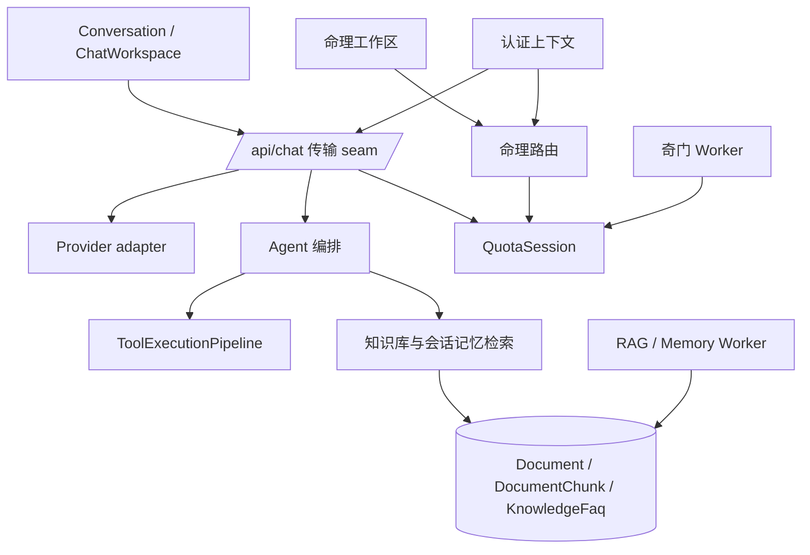
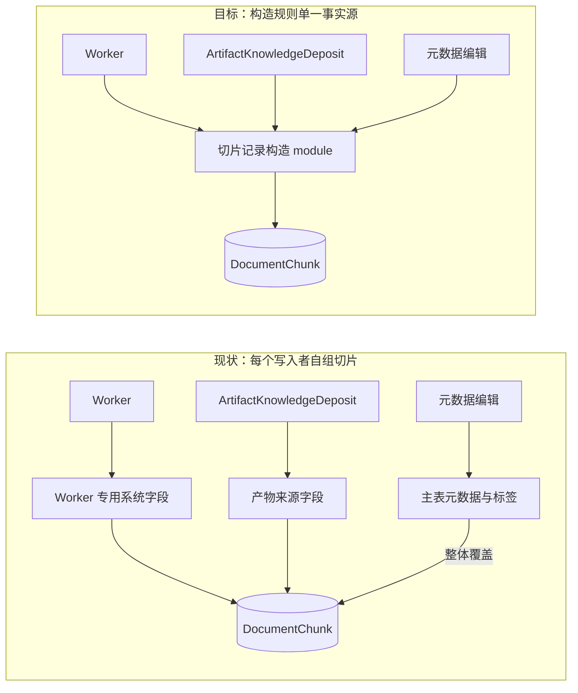
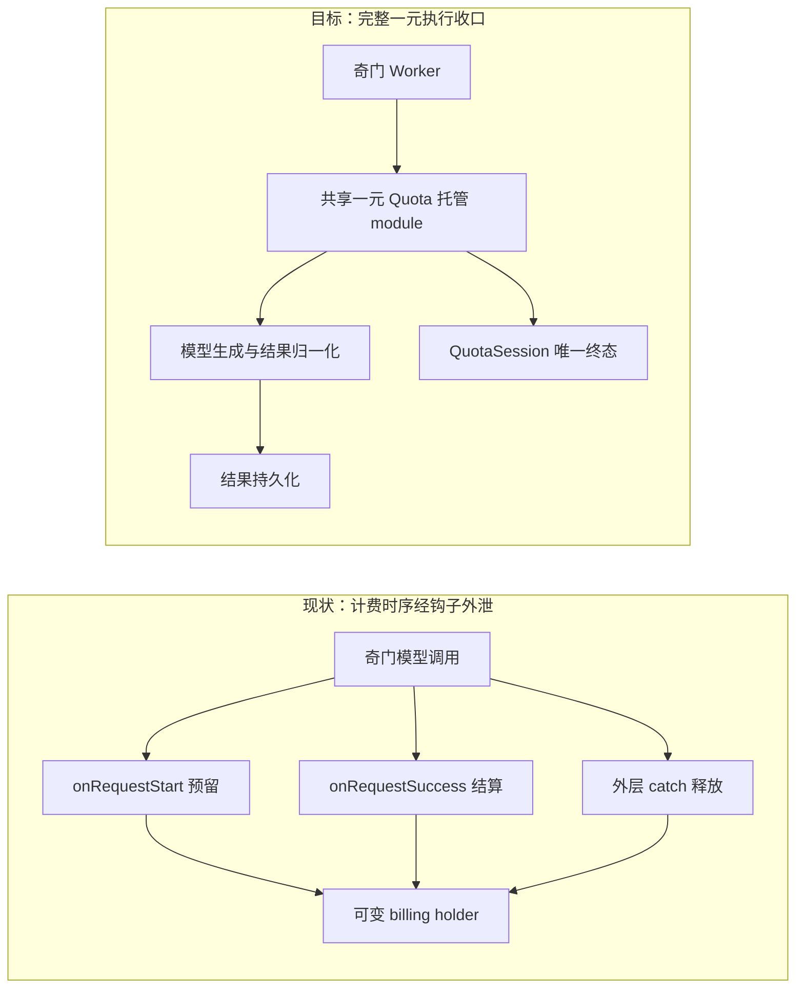
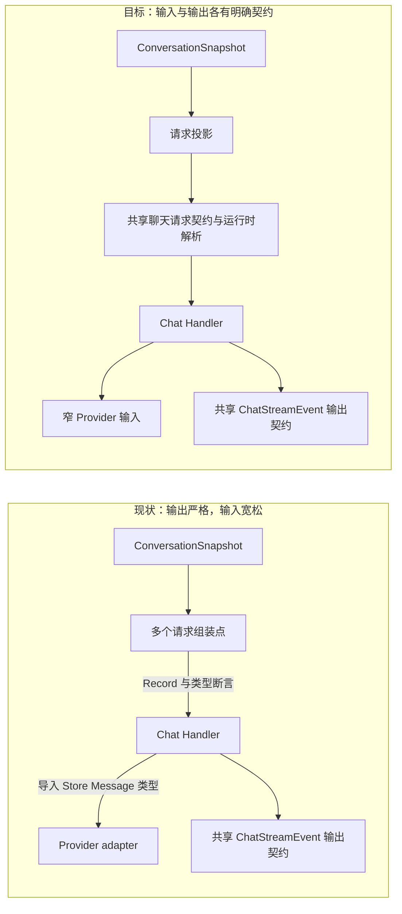
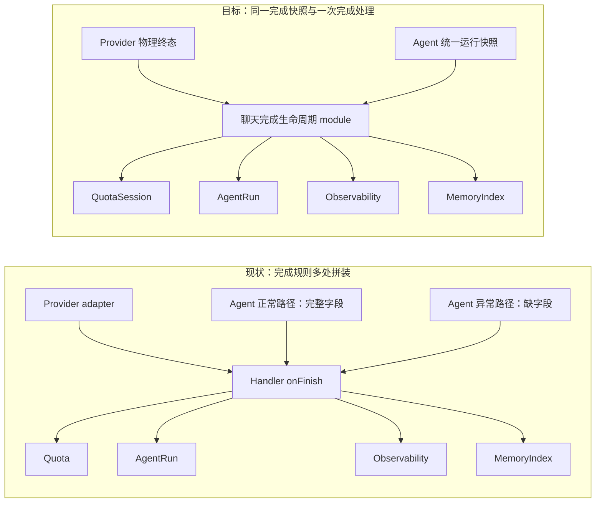
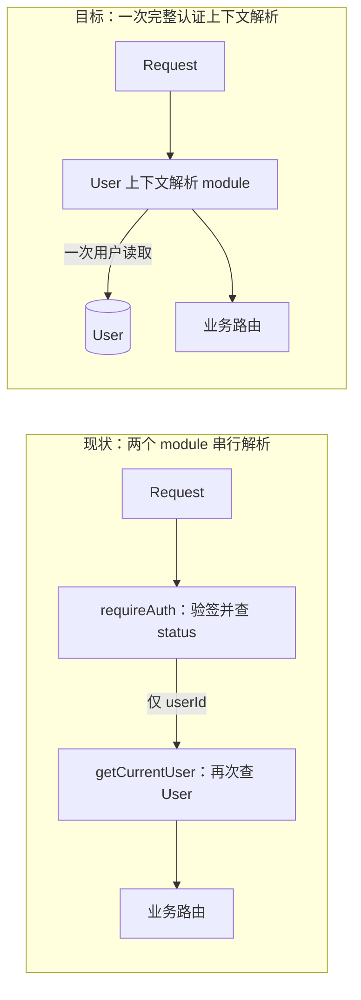
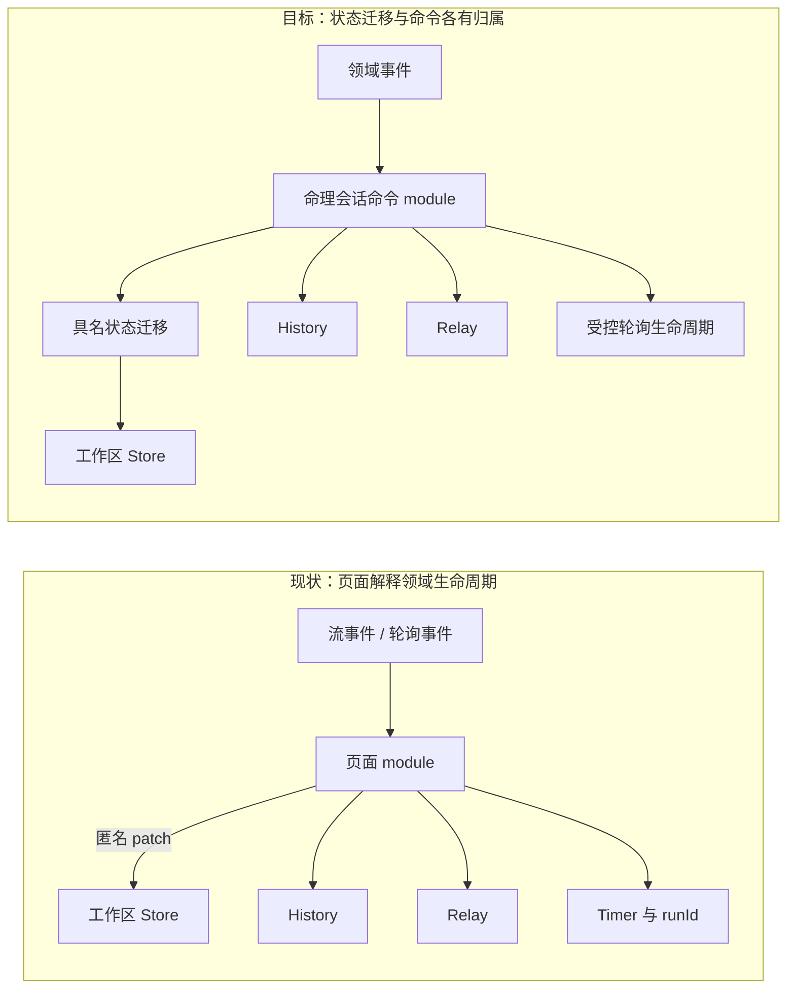
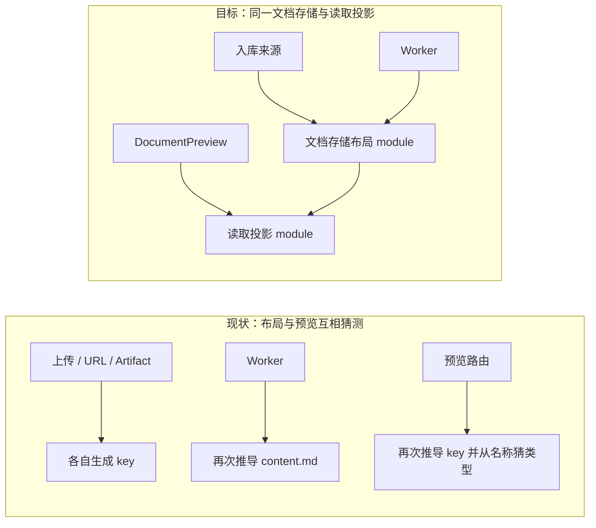
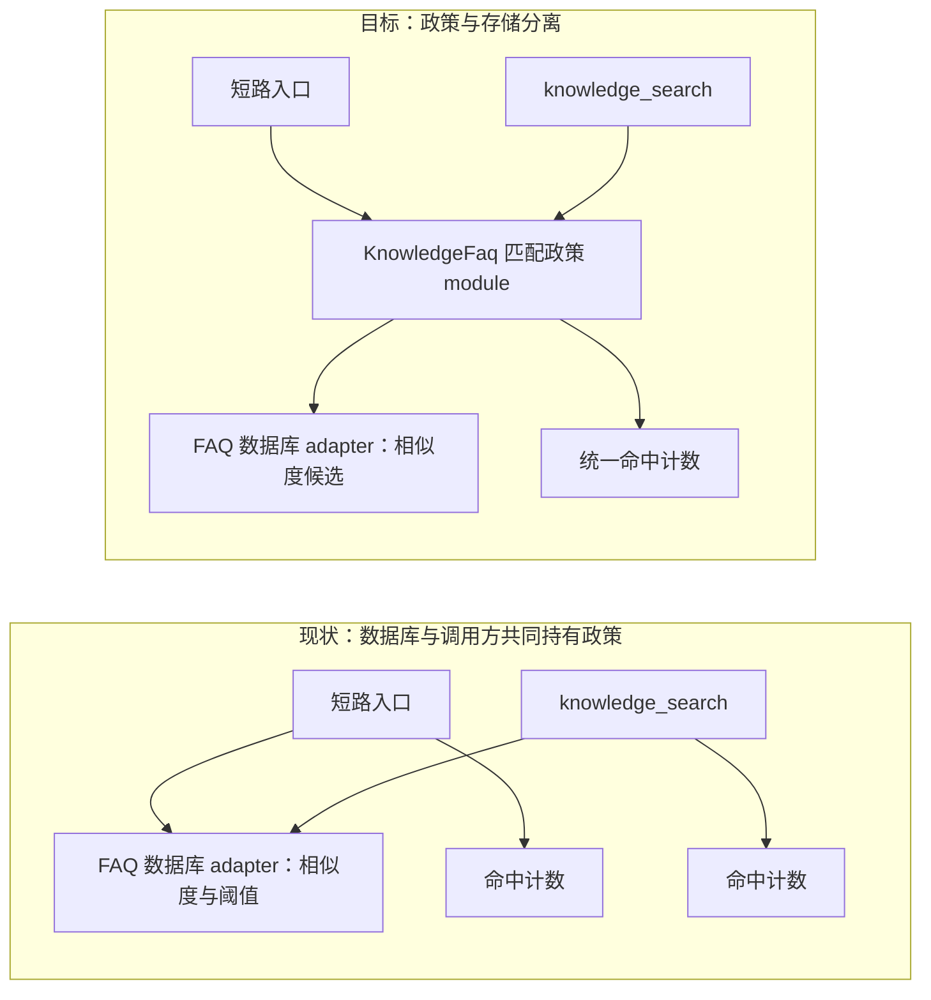
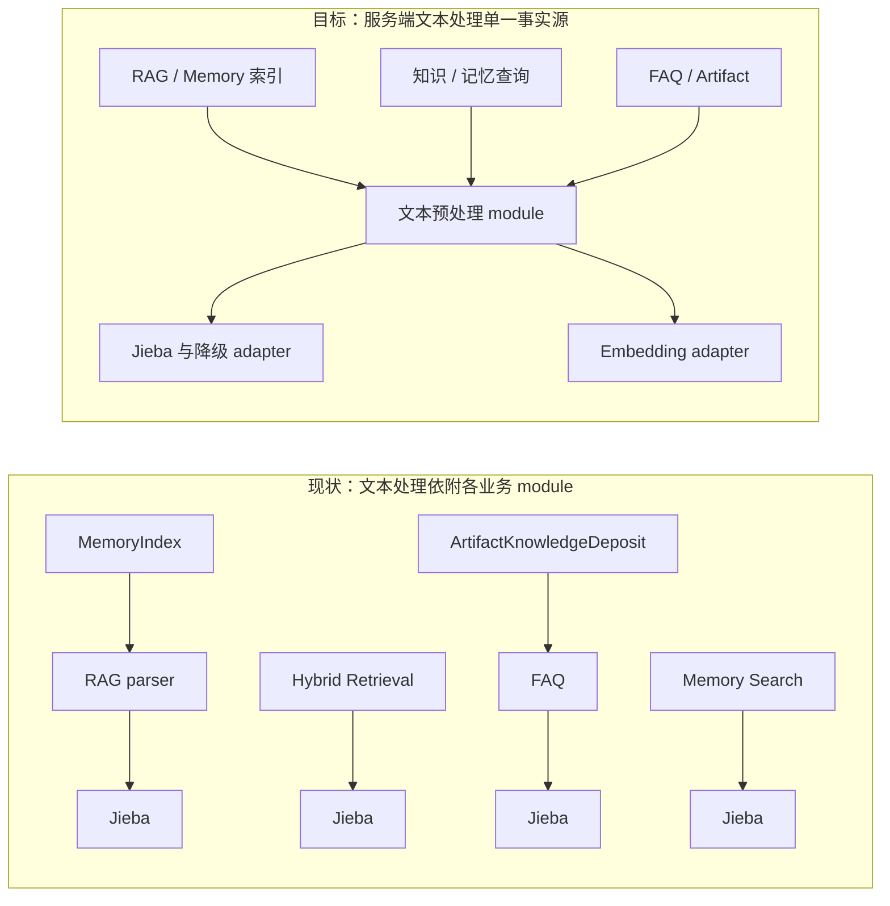

# 核心模块架构深化审查报告

> 日期：2026-11-10  
> 基线：`8167b28`（当前 HEAD）  
> 范围：智能对话、知识库 / RAG、命理、登录认证、计费，以及直接相关的 Worker、数据库与共享契约  
> 方法：近期提交热点分析、领域术语与 ADR 对照、分域源码走查、deletion test、测试接缝检查与定向测试  
> 术语：领域词汇遵循 `GLOSSARY.md`；架构词汇使用 `module` / `interface` / `depth` / `seam` / `adapter` / `leverage` / `locality`  
> 状态：本文只提出候选，不预设具体 interface，不代表已经立项或批准实施

## 一、结论摘要

当前系统并不缺少抽象。相反，对话前端协调、流事件投影、工具治理、RAG 精排、认证加固和 QuotaSession 已经历多轮收敛。本轮不再建议拆散这些已有深度的 module，而把注意力放在仍由调用者重复掌握内部规则的区域。

最值得优先处理的是 **知识库切片记录构造**：Worker、ArtifactKnowledgeDeposit 与 DocumentMetadataInheritance 三条路径分别构造切片元数据；其中原地元数据更新会整体覆盖 Worker 写入的 `sourceType`、`fileName`、`storageKey`、`parsedContentKey` 等字段。这个问题同时具备数据正确性风险、热点变更频率、跨调用者 `leverage` 和明确的测试缺口。

| 建议顺序 | 编号 | 领域              | 深化候选                                   | 推荐强度            | 主要原因                                                                     |
| -------: | ---- | ----------------- | ------------------------------------------ | ------------------- | ---------------------------------------------------------------------------- |
|        1 | C1   | 知识库            | 切片记录构造与 DocumentMetadataInheritance | **Strong**          | 已确认整体覆盖会丢失切片系统字段；三条写入路径需要同一不变量                 |
|        2 | C3   | 计费 / 命理       | 奇门 Worker 的一元 Quota 生命周期          | **Strong**          | 可变 holder 与五个模型钩子重新拆散了预留、结算、释放时序                     |
|        3 | C4   | 智能对话          | 聊天请求传输契约                           | **Strong**          | 输出流已有严格共享契约，输入仍靠类型断言并反向依赖前端 Store 类型            |
|        4 | C5   | 智能对话 / 计费   | 聊天完成生命周期与 AgentRun 审计           | **Strong**          | 正常与异常路径的完成字段已发生漂移，结算、审计、观测和记忆派发挤在一个回调中 |
|        5 | C2   | 登录认证          | User 上下文解析                            | **Strong**          | `getCurrentUser` 链路串行查询用户表两次，测试必须按内部顺序准备双份 mock     |
|        6 | C6   | 命理              | 八字、紫微、奇门会话状态迁移与完成副作用   | **Strong**          | 通用 patch 仍承载核心数据写入，轮询、历史与接力时序留在页面 module 内        |
|        7 | C7   | 知识库            | DocumentPreview 读取投影与存储布局         | **Worth exploring** | key 推导、文件类型识别、正文回退分别由入库和预览路径维护                     |
|        8 | C8   | 知识库 / 对话     | KnowledgeFaq 匹配政策                      | **Worth exploring** | 阈值判断落在数据库 adapter，选库与命中计数政策散在两个调用者                 |
|        9 | C9   | 知识库 / 会话记忆 | 服务端中文分词与向量化预处理               | **Worth exploring** | 索引端与查询端各自维护分词和降级，MemoryIndex 还反向复用 RAG parser          |

另有两项应立即排查但不值得新增 module 的局部问题：旧版 RAG 任务缺少版本护栏，以及认证引导连续执行两次静默刷新。详见第十节。

## 二、扫描依据与现状判断

### 2.1 变更热点

近期 35 次提交中，对话与知识库占主导：`ChatStreamProjector`、`ConversationOrchestrator`、聊天页面编排、检索契约、CrossEncoderRerank 和 KnowledgeLifecycle 均已完成深化。拉长到近期核心域历史后，`chat-handler.ts`、`agent-runner.ts`、命理工作区和 RAG 检索仍反复出现，说明这些位置值得优先扫描，而不是平均用力。

### 2.2 当前核心链路示意

图中需要继续深化的不是每一条连线，而是几处调用者仍必须了解实现细节的 seam：切片写入、聊天输入、聊天完成、奇门一元计费、User 上下文解析和命理会话生命周期。

### 2.3 与既有审查的关系

`docs/plans/2026-10-28-rag-architecture-review.md` 的精排候选已经由 ADR-0030 补充决策和 ARCH-CK-01 落地，本文不再重复推荐。其切片构造、存储布局、FAQ 政策和文本预处理候选在当前 HEAD 仍有源码证据，本文重新核实行号、测试和迁移约束后保留。

`docs/plans/2026-10-30-chat-knowledge-architecture-backlog.md` 中 ARCH-CK-01～06 已完成。本文 C4、C5 是服务端输入与完成生命周期的新候选，不重开已经完成的 Store 协调和页面编排决策。

## 三、C1：收拢切片记录构造与 DocumentMetadataInheritance

**推荐强度：Strong｜首选候选**

### 涉及文件

- `apps/worker/src/workers/rag-index/processor.ts:274-319`
- `apps/web/src/lib/rag/artifact-deposit-service.ts:169-258`
- `packages/db/src/rag/chunk-store.ts:821-884`
- `apps/web/src/app/api/knowledge-bases/[id]/documents/[docId]/route.ts:112-150`
- `packages/db/src/__tests__/chunk-store-retrieval.test.ts:311-354`
- `apps/web/src/app/api/knowledge-bases/[id]/documents/artifact/route.test.ts:44`

### Problem

Worker 在 `processor.ts:301-308` 为切片写入文档元数据、标签以及 `sourceType`、`fileName`、`storageKey`、`parsedContentKey`。ArtifactKnowledgeDeposit 在 `artifact-deposit-service.ts:235-252` 另写一套来源字段；其文本预处理和向量化还依赖名为 FAQ 的 module。

元数据编辑路径先在路由中合并 Document 主表元数据，再由 `updateDocumentMetadataInPlace` 仅用这份元数据和标签构造切片值（`chunk-store.ts:841-846`），最后通过 `SET "metadata" = $1::jsonb` 整体覆盖（`chunk-store.ts:848-860`）。Worker 只存在于切片上的字段因此会丢失。路由中的浅合并无法挽救这些字段，因为 Document 主表原本就没有保存它们。

现有集成测试只断言更新数量和新的过滤条件生效，没有断言系统字段在更新前后保持完整。ArtifactKnowledgeDeposit 的实现没有独立测试；其路由测试替换整个 `depositArtifactToKnowledgeBase`，无法覆盖真实切块与元数据构造。

### Deletion test

删除任何一个写入点的局部构造，其他调用者仍必须知道切片字段、来源溯源、标签继承和向量化规则。复杂度不会消失，只会继续散在 Worker、ArtifactKnowledgeDeposit 和元数据编辑路径中，因此共享构造规则具有真实 `leverage`。

### Solution

形成一个拥有“文档与来源片段如何成为可检索切片记录”的深 module，集中管理 DocumentMetadataInheritance、BidirectionalProvenance、系统字段保留、token 估算和批量向量化政策。Worker 与 ArtifactKnowledgeDeposit 保留不同的解析、切块大小和同步/异步编排；元数据编辑复用同一字段保留规则，而不是手写另一份合并。

不应统一 ADR-0034 已确定的同步进程内产物入库与 Worker 异步索引，也不应在没有检索评测证据时统一切块参数。

### Benefits

- **Locality**：新增切片字段或来源字段时只修改一个权威位置；元数据更新不再依赖调用者记得保留隐藏字段。
- **Leverage**：Worker、ArtifactKnowledgeDeposit 和后续知识沉淀入口共享同一不变量。
- **测试**：可用纯数据测试字段保留矩阵，再保留少量真实 PostgreSQL 集成测试验证事务与过滤；产物入库不再需要只靠路由 mock 间接保护。

### Before / After

### 迁移与验收约束

先补“编辑标签后 `sourceType` / `storageKey` / `parsedContentKey` 仍存在”的红灯用例，再迁移三个写入路径。必须覆盖普通文件、UrlDocument、ArtifactKnowledgeDeposit、自定义元数据和空标签；保留 ADR-0032、ADR-0034 的既定行为。

## 四、C3：让奇门 Worker 回到一元 Quota 生命周期

**推荐强度：Strong**

### 涉及文件

- `apps/worker/src/workers/qimen-section.ts:18-21`
- `apps/worker/src/workers/qimen-section.ts:47-121`
- `apps/worker/src/workers/qimen-section.ts:136-147`
- `packages/shared/src/qimen-analysis.ts:177-190`
- `packages/shared/src/qimen-analysis.ts:312-401`
- `apps/web/src/lib/billing/with-quota-unary.ts:15-58`
- `apps/web/src/lib/billing/quota-session.ts:1-11`

### Problem

奇门 Worker 用可变 `billing.session` holder 连接三个位置：`onRequestStart` 预留、`onRequestSuccess` 结算、外层 `catch` 释放。为了取得模型消息、输出上限和原始 usage，`qimen-analysis` 的 interface 暴露五个请求阶段钩子。全仓这些钩子的生产使用者只有奇门 Worker，说明它们主要把内部调用时序泄漏给了计费调用者。

成功结算发生在模型请求成功钩子中，而 `store.saveSectionResult` 在其后才执行（`qimen-section.ts:87-122`）。保存失败会再进入外层释放路径。最终结果是否正确依赖 QuotaSession 的下层幂等与状态守护，调用者本身没有形成清晰的“一次业务执行、一次终态”生命周期。

当前 Web 的一元管道位于 `apps/web` 并引用 Web 别名，Worker 不能直接复用；项目又禁止 app 之间直接引用。这是共享实现位置的问题，不是让 Worker 导入 Web 文件的理由。

### Deletion test

删除 holder 只会迫使 Worker 重新手写另一套预留、结算和异常释放；删除模型阶段钩子后，观测与计费仍需从某处获得结果。复杂度集中在“一次一元调用的完整生命周期”，适合由已有 QuotaSession seam 上方的共享托管 module 承担。

### Solution

把一元配额托管能力放到 Web 与 Worker 都可依赖的共享位置，再让奇门 Worker 通过同一生命周期执行“模型生成、结果归一化与必要持久化”。模型调用 module 接收普通输出预算并返回结果及用量物料，不再通过五个公开钩子把计费时序推给调用者。确有需要的观测日志可以保留在内部或独立观测 seam，但不能继续充当可变配额状态的传输通道。

### Benefits

- **Locality**：成功、失败、保存异常和管理员免预留审计回到同一决策路径。
- **Leverage**：Web 一元路由与 Worker 两个真实运行环境共同使用一套生命周期规则，seam 不再是假设。
- **测试**：无需模拟五个钩子的调用顺序，可以直接验证模型失败、结果校验失败、保存失败、usage 缺失、管理员和重复任务。

### Before / After

### 迁移与验收约束

遵循 ADR-0001 对 holder 垫片的否定和 ADR-0002 的一元二态语义；不改变 BullMQ 任务协议、Redis 盘局结构和 QuotaSession 决策表。先为“模型成功但保存失败”和“非法模型 JSON”建立回归测试。当前未找到奇门 Worker 的专项测试文件，这是实施前必须补齐的缺口。

## 五、C4：建立聊天请求传输契约，消除前后端类型倒置

**推荐强度：Strong**

### 涉及文件

- `apps/web/src/app/api/chat/_lib/chat-handler.ts:81-155`
- `apps/web/src/app/api/chat/_lib/types.ts:8-9`
- `apps/web/src/app/api/chat/_lib/agent/agent-runner.ts:70-74`
- `apps/web/src/app/api/chat/_lib/adapters/doubao.ts:17-18`
- `apps/web/src/types/chat-message.ts:41-70`
- `apps/web/src/lib/utils/chat-stream.ts:16-32`
- `apps/web/src/lib/agent/approval-display.ts:55-92`
- `apps/web/src/app/api/chat/batch-reserve/route.ts:8-42`
- `packages/shared/src/chat-stream-contract.ts:250-281`

### Problem

聊天输出流已经由 `@repo/shared` 的 `ChatStreamEvent` 和 `parseChatStreamEvent` 统一并校验；输入方向却仍以 `body as { ... }` 断言代替运行时解析，只检查 `messages` 是非空数组。`role`、`content`、附件形状和多个 Agent 字段没有在同一位置形成契约矩阵。

服务端 `chat-handler`、adapter 与 Agent 编排还从 `@/stores/chat-store` 引用消息类型。该类型实际是 ConversationSnapshot 的完整运行时形态，包含流式状态、推理、引用、计划和审批卡片等字段。传输 seam 因而反向依赖页面快照结构，调用者与测试容易把“本地保存什么”误当成“应回传上游什么”。

客户端 `StreamChatRequest.body` 又只是 `Record<string, unknown>`；普通发送、重新生成、ApprovalResume 和对比模式批量预留分别组装请求。字段增加时，类型安全主要在断言两端，而不是在真实 transport seam 上。

### Deletion test

删除某一处的请求体类型声明不会让字段约束消失；发送、恢复、计费预留和服务端适配仍需要同一套规则。若删除一个共享传输契约，这些规则会重新散回多个调用者，因此它具备明确的 `leverage`。

### Solution

在现有共享流契约旁边补齐输入方向的传输 module：定义并解析消息、附件、Agent 选项、ArtifactContextInjection、ApprovalResume 和预留所需字段。客户端通过明确投影从 ConversationSnapshot 生成请求，服务端只把解析后的窄消息结构交给 adapter。不要直接把完整 `Message` 搬到共享包，也不要让审批凭证或 UI 状态混入普通历史消息。

批量预留复用相同的消息与模型输入规则，但保留其独立批量语义，不强行合并整个请求形状。

### Benefits

- **Locality**：请求字段、非法输入和隐私裁剪规则集中，服务端不再依赖 Store 的实现位置。
- **Leverage**：普通发送、重新生成、审批恢复、对比预留和 Provider adapter 共享同一输入事实源。
- **测试**：非法 role/content/附件、Agent 布尔值、审批恢复、产物上下文和批量预留可在同一契约上形成决策表；adapter 测试无需构造完整本地快照。

### Before / After

### 迁移与验收约束

保持 ADR-0041 的审批历史裁剪、ADR-0037 的 ArtifactContextInjection 和 ADR-0046 的双快照语义。先锁定当前合法请求样例，再加入非法输入矩阵；不能用“严格校验”为名悄悄改变现有合法附件和恢复请求行为。

## 六、C5：收拢聊天完成生命周期与 AgentRun 审计

**推荐强度：Strong**

### 涉及文件

- `apps/web/src/app/api/chat/_lib/types.ts:11-58`
- `apps/web/src/app/api/chat/_lib/chat-handler.ts:304-403`
- `apps/web/src/app/api/chat/_lib/agent/agent-runner.ts:920-1029`
- `apps/web/src/app/api/chat/_lib/adapters/generic.ts:35-62`
- `apps/web/src/app/api/chat/_lib/adapters/xunfei.ts:32-51`
- `apps/web/src/app/api/chat/_lib/adapters/doubao.ts:259-325`
- `apps/web/src/app/api/chat/_lib/agent/agent-runs-persistence.test.ts:56-127`
- `docs/adr/0015-artifacts-workbench-and-agent-runs.md:34-37`

### Problem

`ChatStreamFinish` 同时承载物理流终态、usage、搜索与 Webhook 计数、步数、工具流水、Artifact 引用、耗时和 EvaluatorNode 元数据。`chat-handler` 的 `onFinish` 再依次处理输出合规、QuotaSession.finalize、AgentRun 落库、Langfuse flush 和 MemoryIndex 派发。完成生命周期已经成为多个独立变化轴的汇合点，但仍由路由闭包直接编排。

漂移已经出现：Agent 正常结束在 `agent-runner.ts:949-962` 提交 `steps`、`toolCalls`、`artifactRefs`、`durationMs` 和 `evaluator`；异常结束在 `agent-runner.ts:1002-1009` 只提交终态、usage、正文、原因和两类计数。于是失败或部分交付的 AgentRun 会使用数据库默认值，丢失已经执行的工具与产物审计，不符合 ADR-0015 对全生命周期运行记录的目标。

现有 `agent-runs-persistence.test.ts` 只覆盖成功路径。定向执行时还观察到：该用例只替换 `streamText`，Planner 使用的 `generateText` 未被套牢，实际发起一次 DeepSeek 请求并依靠 401 降级通过。这说明当前集成测试需要知道 SDK 的多个内部入口，尚未形成稳定的模型调用测试 seam。

### Deletion test

删除 `onFinish` 闭包不会删除结算、审计、观测和记忆规则，只会让 adapter 或 AgentRunner 分别承担它们。删除 AgentRunner 中两套完成字段组装也不会消除终态规则，反而会让调用者重新拼装。完成生命周期适合形成一个深 module，而不是继续向 `ChatStreamFinish` 追加可选字段。

### Solution

让聊天完成 module 拥有“恰好一次”的完成处理与完成后的副作用顺序，让 AgentRunner 从同一份运行快照生成正常和异常结果。Provider adapter 继续只报告物理流事实；QuotaSession 继续拥有计费决策表；MemoryIndex 继续拥有隐私授权与增量索引。深化的目标是收口完成时序，不是把这些领域实现合并成大杂烩。

### Benefits

- **Locality**：新增完成元数据或副作用时只修改完成生命周期；正常与异常路径不再手工保持字段一致。
- **Leverage**：普通聊天与 Agent 共用完成处理，AgentRun 与 Quota 使用同一终态和用量来源。
- **测试**：可在完成 seam 上覆盖 success / partial / failed / cancel / ApprovalResume，断言 AgentRun 失败路径也保留工具流水、产物和耗时，并验证辅助副作用失败不阻断主响应。

### Before / After

### 迁移与验收约束

遵循 ADR-0003：路由测试仍在 QuotaSession seam 断言，不复刻下层计费决策表。保持 ADR-0015、ADR-0022、ADR-0039、ADR-0041 的审计、隐私和审批语义。测试应统一替换完整模型调用 seam，不能只替换 `streamText` 而遗漏 Planner 的其他入口。

## 七、C2：深化 User 上下文解析，消除重复鉴权查询

**推荐强度：Strong**

### 涉及文件

- `apps/web/src/lib/auth/require-auth.ts:10-41`
- `apps/web/src/lib/auth/get-current-user.ts:12-42`
- `apps/web/src/lib/api/with-auth.ts:21-38`
- `apps/web/src/lib/auth/get-current-user.test.ts:23-58`

### Problem

`requireAuth` 验签后查询用户状态，却只返回 `userId`，丢弃已经读取的 User 记录。`getCurrentUser` 随即用该 ID 再查一次，以取得 `id`、`role`、`status`、`tokens`。所有直接使用 `getCurrentUser` 的路由以及 `withAuth` 的调用者都会执行这条串行双查询路径；直接使用 `requireAuth` 的路由不在此问题范围内。

问题不只是多一条 SQL。账号存在性与禁用状态是一个认证决策，却被拆在两个 module 的 interface 之间。测试也暴露了这一点：`get-current-user.test.ts:25-32` 必须按实现顺序连续准备两个 `findUnique` 返回值，重构查询顺序就会破坏测试，即使外部行为不变。

### Deletion test

删除 `requireAuth` 与 `getCurrentUser` 之间只传递 ID 的浅 seam 后，验签、用户状态检查和上下文读取可以集中到同一实现。认证复杂度没有消失，但不再被两个调用阶段拆散；这是合并浅层协调而不是新增假设 seam。

### Solution

让认证上下文解析 module 一次完成 Bearer JWT 验证、User 存在性/禁用校验与调用者所需属性读取。迁移期可保留旧入口的兼容包装，但最终只应有一份用户查询与错误语义。无需重议 Auth.js，也无需改变 access token 的内存存储策略。

### Benefits

- **Locality**：User 状态、角色与认证错误在同一位置决定。
- **Leverage**：所有 `getCurrentUser` / `withAuth` 调用者减少一次串行数据库往返，降低高并发下连接池压力。
- **测试**：通过正式 interface 验证无效令牌、用户不存在、禁用、普通用户与管理员，只需一个用户读取 adapter，不再编写顺序双 mock。

### Before / After

### 迁移与验收约束

严格保持 ADR-0007 的自研认证、401/403 文案和禁用语义，遵守 ADR-0018 的注册用户体系。先增加“一次请求只读取一次 User”的黑盒断言，再迁移调用者；不要顺带修改 Refresh Token 轮换或限流政策。

## 八、C6：深化八字、紫微、奇门会话生命周期

**推荐强度：Strong**

### 涉及文件

- `apps/web/src/stores/destiny-workspace-store.ts:162-196`
- `apps/web/src/stores/destiny-workspace-store.ts:198-278`
- `apps/web/src/stores/destiny-workspace-store.ts:349-453`
- `apps/web/src/app/destiny/_components/bazi-workspace.tsx:426-556`
- `apps/web/src/app/destiny/_components/ziwei-workspace.tsx:330-405`
- `apps/web/src/app/destiny/_components/qimen-workspace.tsx:120-188`
- `apps/web/src/app/destiny/_components/qimen-workspace.tsx:290-476`
- `apps/web/src/stores/destiny-workspace-store.test.ts:25-285`

### Problem

星座已经通过七个具名 action 收编 ChartFacts 与 Interpretation 的状态迁移；八字、紫微、奇门仍通过通用 `setWorkspaceState` 写入核心数据。本轮在三个工作区文件中共找到 47 处这类调用。问题不在文件长度本身，而在调用者必须掌握各自的数据不变量：

- 八字在流事件回调中合并锁定分区、完整报告、加载状态和结果就绪状态。
- 紫微在页面内归一化宫位、更新 ChartData、写历史并完成 Relay。
- 奇门在页面内维护 runId、AbortController、递归定时器、三分区终态和防重复历史 ref；`qimen-workspace.tsx:135-188` 的 effect 同时依赖 URL、挂载周期和多个状态字段来推断是否该写历史。

现有 Store 契约测试全部针对星座，八字、紫微、奇门没有对应的纯状态迁移测试。真正的风险是事件时序与跨 Store 副作用，而不是 JSX 长。

### Deletion test

删除通用 patch 并不会让分区合并、迟到事件保护、轮询终止、历史落盘和 Relay commit 消失；这些规则会散回更多事件回调与 effect。若把规则收拢到各命理会话的正式 interface，页面才不再需要了解完整实现。

### Solution

分别为八字、紫微、奇门建立具名状态迁移，让数据字段只能经符合领域语义的 action 演进。对历史与 Relay 等跨 Store 完成副作用，使用命理会话命令 module 统一编排，而不是让 Zustand action 直接访问其他 Store。奇门的轮询与请求淘汰规则应成为可测试生命周期的一部分。

不拆成多个互相同步的全局 Store，不引入事件总线，也不把每段 JSX 机械抽成浅 module。

### Benefits

- **Locality**：每类命理报告的状态不变量与完成时机各有唯一事实位置。
- **Leverage**：历史恢复、重新生成、分区完成和失败路径复用同一状态迁移规则。
- **测试**：无 DOM 验证分区合并与迟到事件；用 fake timers 验证奇门轮询；在命令 seam 验证历史只写一次、Relay 只在成功后 commit。

### Before / After

### 迁移与验收约束

这是对 ADR-0006 已验证原则的扩展，不改变星座决策、命理算法、SSE 协议或历史格式。一次只迁移一个工作区；建议先处理时序最复杂的奇门，再迁移紫微与八字。History 与 Relay 的副作用位置需在 spec 中明确，不能借“具名 action”把跨 Store 调用藏进状态容器。

## 九、其余深化候选

### C7：DocumentPreview 读取投影与存储布局

**推荐强度：Worth exploring**

**涉及文件**

- `apps/web/src/app/api/knowledge-bases/[id]/documents/[docId]/content/route.ts:51-179`
- `apps/web/src/app/api/knowledge-bases/[id]/documents/route.ts:213-225`
- `apps/web/src/app/api/knowledge-bases/[id]/documents/url/route.ts:95-107`
- `apps/worker/src/workers/rag-index/processor.ts:170-184`
- `apps/web/src/lib/rag/artifact-deposit-service.ts:199-205`
- `apps/web/src/app/api/knowledge-bases/[id]/documents/[docId]/content/route.test.ts:48-206`

**Problem**

原件 key、提纯 `content.md` key 和不同来源的存储路径分别由上传、URL、Worker 与 ArtifactKnowledgeDeposit 维护。预览路由从 `document.name` 反推扩展名，并分别实现失败态、PDF、Word/Excel、CSV、普通文本和切片回退。CSV 不进入提纯内容分支；失败态识别的文件类型又比成功态少。现有测试只覆盖 Markdown、失败、PDF 和存储异常，未形成 UrlDocument、Word、Excel、CSV、Artifact 的完整矩阵。

**Solution**

形成一个面向 DocumentPreview 的读取投影 module，集中处理存储布局、可展示类型、正文来源与回退顺序；入库端复用相同 key 规则。是否持久化显式文件类型留待拷问阶段决定，不在本报告中预设 schema 变更。

**Benefits**

存储布局和类型规则获得 `locality`；所有入库来源共享 `leverage`；预览测试可以从路由装配下沉为“文档事实 → 展示投影”的决策表，同时保留租户隔离路由测试。

**Before / After**

**ADR 关系**

保留 ADR-0028 的 SSRF 防御、ADR-0029 的 StructuredDocNormalization 和 ADR-0034 的产物同步入库，不改变 DocumentPreview 的既有深度与多调用者价值。

### C8：KnowledgeFaq 匹配政策

**推荐强度：Worth exploring**

**涉及文件**

- `packages/db/src/rag/faq-store.ts:409-455`
- `apps/web/src/app/api/chat/_lib/faq-short-circuit.ts:12-67`
- `apps/web/src/app/api/chat/_lib/agent/tools/knowledge-search.ts:77-85`
- `apps/web/src/app/api/chat/_lib/agent/tools/knowledge-search.ts:141-216`
- `apps/web/src/app/api/chat/_lib/faq-short-circuit.test.ts:26-86`

**Problem**

数据库 adapter 不只返回相似度，还输出 `isShortCircuit` / `isGroundTruth` 业务判定。短路入口和 Agent 工具分别选择目标知识库：前者按 `updatedAt` 取最近三个，后者按 `createdAt` 排序后截取三个；命中计数也分别在调用方触发。阈值尚未漂移，但政策正确性依赖两个调用者持续同步。

**Solution**

让 Web 侧政策 module 拥有“用户、问题、调用场景到直出/权威口径/未命中”的决策与计数归属，数据库 adapter 只提供带 ACL 的相似度候选。保留 FaqShortCircuit 与 FaqGroundTruth 的不同场景语义，不把 Agent 多步调用改成直出。

**Benefits**

阈值、选库、计数获得 `locality`；两个入口共享政策 `leverage`；0.78、0.92 临界点、禁用 FAQ、跨用户零命中、异常降级和计数一次可在同一 interface 上验证。

**Before / After**

**ADR 关系**

落实 ADR-0027，不调整阈值，不改变双轨产品行为。选库排序差异需先确认是有意政策还是历史漂移，不能在重构中静默统一。

### C9：服务端中文分词与向量化预处理

**推荐强度：Worth exploring**

**涉及文件**

- `apps/worker/src/workers/rag-index/parser.ts:51-86`
- `apps/web/src/lib/rag/hybrid-retrieval.ts:80-131`
- `apps/web/src/lib/rag/faq-service.ts:10-50`
- `apps/web/src/app/api/chat/_lib/agent/tools/memory-search.ts:45-58`
- `apps/worker/src/workers/memory-index/processor.ts:13-20`
- `apps/worker/src/workers/memory-index/processor.ts:172-186`
- `apps/web/src/lib/rag/artifact-deposit-service.ts:13`

**Problem**

Jieba 单例、空文本处理和降级规则分散在 Worker 与 Web。`MemoryIndex` 从 `rag-index/parser` 复用分词和 token 估算，形成会话记忆对 RAG parser 实现位置的依赖；ArtifactKnowledgeDeposit 则依赖 `faq-service` 的通用文本能力。索引端和查询端必须严格同构的词法处理目前靠约定维持，个别路径有正则降级，个别路径直接抛错。

**Solution**

形成服务端专用文本预处理 module，统一分词、词典初始化、降级和向量化调用政策。Jieba 与正则降级是真实的行为变化，Provider embedding 也是实际外部 adapter；但不应把原生依赖放进浏览器也会加载的共享根入口。具体包位置需按依赖方向决定。

**Benefits**

索引/查询一致性由结构保证，减少跨模块实现位置依赖；同一语料可以测试索引与查询输出一致，并覆盖原生分词失败、空文本、中英文混合和批量向量化。

**Before / After**

**ADR 关系**

不改变 ADR-0022 的记忆隐私边界、向量模型、维度或检索算法。C9 可复用 C1 的批量向量化需求，但不应为了合并而引入浏览器端依赖。

## 十、无需新增 module 的局部修正与观察项

### 10.1 旧版 RAG 索引任务缺少版本护栏

**优先级：高，建议先建立并发回归用例；不需要新建架构层。**

上传重传会提升 `Document.version` 并生成带版本的 job（`apps/web/src/app/api/knowledge-bases/[id]/documents/route.ts:213-220,275-289`）。但 Worker 开始任务时只按 ID 查询，没有比较 job version 与当前 Document version（`apps/worker/src/workers/rag-index/processor.ts:65-88`）；所有失败状态更新也只按 ID（同文件 `109-138,194-220,263-269`）。

最终提交函数会删除不高于任务版本的切片并无条件把 Document 置为 ready（`packages/db/src/rag/chunk-store.ts:200-230`），没有确认 Document 当前仍等于该任务版本。旧任务晚到时，可能把新版本提前标成 ready 或 failed。检索 SQL 只读当前版本能降低错误切片被召回的概率，却不能阻止文档状态被旧任务污染。

建议在现有 Worker 与事务 seam 上增加版本条件和 stale-task no-op，覆盖“v1 晚于 v2 开始/结束”“旧任务失败晚到”“同版本重试幂等”。这是局部并发正确性修正，不需要为了它引入新的通用任务框架。当前测试覆盖正常 v2 替换，但未找到旧任务晚到场景。

### 10.2 认证引导的第二次连续刷新

`apps/web/src/stores/auth-store.ts:193-197` 在第一次 `refreshAccessToken()` 返回空后立即再调用一次。不过同一 Store 已在 `59-61,110-128` 通过 `refreshInFlight` 合并并发刷新，因此不能再把问题描述为“没有并发控制”，也没有足够证据要求新建大型有限状态机。

建议先用测试明确“无会话只需一次刷新”和“网络响应不确定时如何处理”的预期，再删除或修正顺序双调用。若删除后复杂度直接消失，deletion test 表明应做局部删除，而不是新增 module。

### 10.3 八字合盘暂不机械拆分

八字工作区确实持有合盘本地状态，并把 `compatActive` 放进所有工作区共享的 `BaseWorkspaceCache`（`apps/web/src/stores/destiny-workspace-store.ts:53-64`；`bazi-workspace.tsx:198-218`）。但合盘已有 `useCompatibilityFlow`，目前没有看到由该结构直接导致的缺陷证据。

不建议仅因文件行数把 JSX 和状态搬到另一个浅 module。先完成 C6 的领域状态迁移；若合盘与个人八字仍有重复恢复、视角切换或行动清单规则，再单独立项。`compatActive` 是否移出共享基类可作为该轮的小范围类型清理，而非独立架构项目。

## 十一、检查过且不建议重开的区域

- **ConversationOrchestrator 与双快照**：ADR-0046 已建立唯一跨 Store 协调位置，不要再引入事件总线或拆出多个互相协调的 Store。
- **ChatStreamProjector 与共享输出流契约**：ADR-0045 和 `packages/shared/src/chat-stream-contract.ts` 已形成明确 seam；C4 只补输入方向，不推翻输出契约。
- **ToolExecutionPipeline、ChainedMessageSession、AgentRuntimeContext**：ADR-0008～0011 已把工具治理、链式消息和运行时装配分别收敛，不建议因 AgentRunner 仍较长而重新拆分这些 module。
- **CrossEncoderRerank 政策**：`rerank-policy.ts` 已是单库与多库共享的权威实现，符合 ADR-0030；不再建议另写多库精排政策。
- **DocumentPreviewDrawer**：已有多个真实调用者并隐藏正文加载、引用降级和导航复杂度；C7 讨论的是服务端读取投影与存储布局，不是拆 UI。
- **自研认证与凭证加固**：ADR-0007 的摘要存储、认证 fail-closed 和登录锁定语义保持不变，不建议迁移 Auth.js；C2 只消除重复解析。
- **QuotaSession、createQuotaStream 与 withQuotaUnary 的决策表**：不再复刻计费分支。C3 关注的是 Worker 接入与共享实现位置，C5 关注的是聊天完成编排。
- **AstrologyWheel 与星座具名 action**：ADR-0005、0006 已形成良好 depth；C6 只把已验证原则扩展到仍有摩擦的工作区。
- **八字合盘独立产品行为**：没有证据时不因文件大小重做布局或协议。

## 十二、建议推进顺序

1. **先建立正确性基线**：为 C1 的字段覆盖、C3 的保存失败、C5 的异常审计和第十节旧版本任务补红灯用例；这些用例决定后续重构是否守住行为。
2. **优先实施 C1**：它直接保护知识资产正确性，并为 C7、C9 提供稳定的构造依赖。
3. **并行评估独立 seam**：C3 的 Worker 计费、C4 的聊天输入、C2 的认证上下文彼此独立，可分别立项，但默认仍按仓库工作流串行实施。
4. **随后收拢 C5 与 C6**：两者都涉及完成时序和跨模块副作用，需要更完整的 spec、真实链路验收与迁移矩阵。
5. **按实际痛点启动 C7～C9**：它们有明确重复，但不应在没有新入库来源、预览缺陷或检索漂移时演变为全仓大扫除。

## 十三、Top recommendation：先做 C1「切片记录构造」

首选 C1 的理由不是代码重复数量，而是它已经具备最完整的收益闭环：

1. **有当前源码证明的正确性风险**：元数据编辑会整体覆盖切片字段，现有测试没有守护系统字段保留。
2. **有多个真实调用者**：Worker、ArtifactKnowledgeDeposit 和元数据编辑需要同一规则，不是为 mock 假设 seam。
3. **有持续变更压力**：DocumentMetadataInheritance、DocumentOutline、BidirectionalProvenance 都在向切片元数据增加知识。
4. **与 ADR 兼容**：保留同步产物入库、Worker 异步索引和原地元数据更新，只收拢构造规则。
5. **能带动后续深化而不制造连锁重构**：C7 可复用存储事实，C9 可复用文本预处理；两者都可以稍后独立决定。

建议第一轮只锁定一个最小垂直切片：**“普通 Worker 文档经过标签编辑后，所有系统字段保持不变，MetadataFilter 仍按新标签命中”**。该切片通过后，再迁移 ArtifactKnowledgeDeposit 并单独验证 BidirectionalProvenance，避免一次性统一切块器或重写整个 RAG 管道。

## 十四、验证记录与限制

- 已执行 Web 定向测试 58 项：聊天完成/Provider/FAQ/知识检索/精排 30 项，认证/命理 Store/一元配额 28 项，全部通过。
- 已执行 Worker 定向测试 18 项：RAG processor 与 parser，全部通过。
- 合计 **76 项定向测试通过**。这些结果证明当前基线可运行，不证明本文指出的未覆盖场景正确。
- 测试期间发现 `agent-runs-persistence.test.ts` 的 Planner 未完全隔离，发生一次实际上游 401 请求后按既定降级通过；已纳入 C5 的测试接缝证据。
- 未执行全量测试、构建或真实浏览器验收，因为本轮没有修改业务实现；不能把本报告当作任何候选的交付授权。
- “已确认”指当前源码中的控制流、字段写入或测试结构已核对。旧任务并发覆盖、生产性能收益和实际故障率尚未动态复现或量化，实施前必须构造对应场景。
